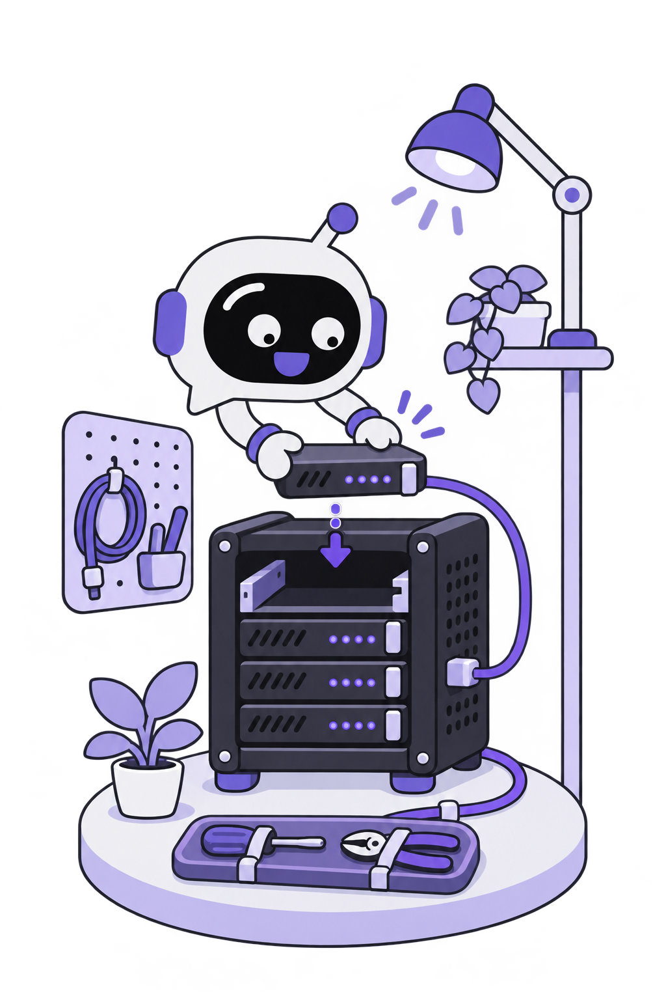
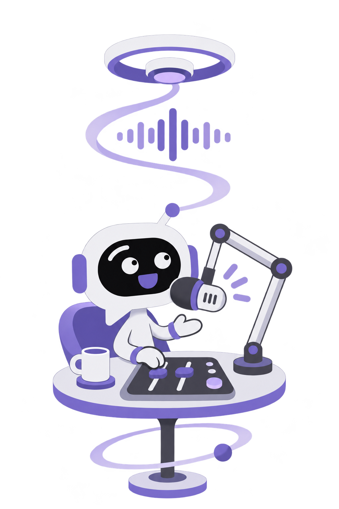
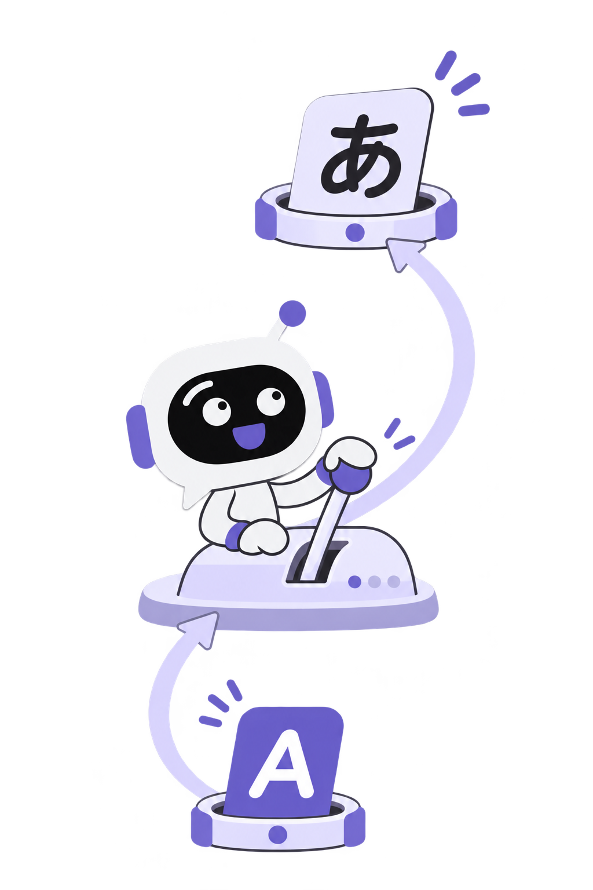
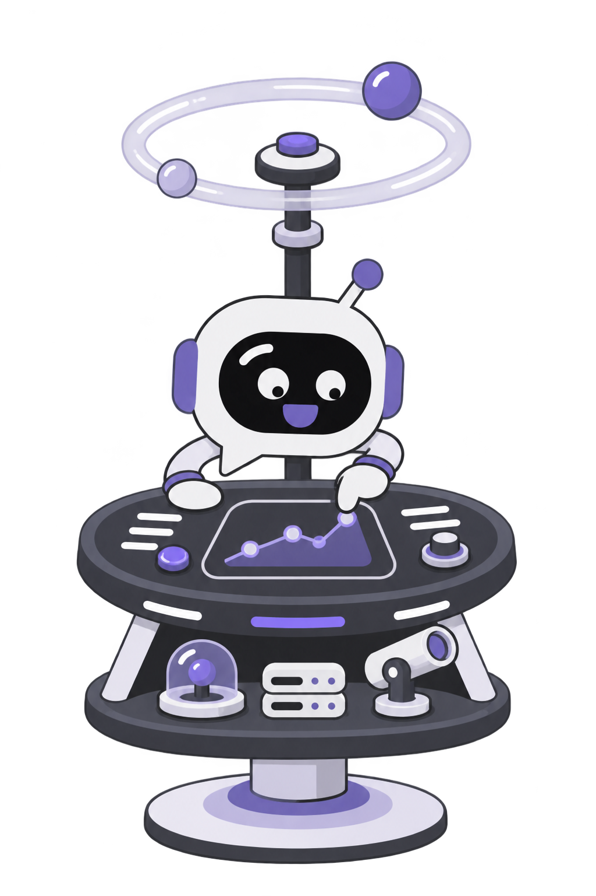

# Stellarr

**Talk on your own server.**  
A self-hosted Discord alternative for small groups of friends: text, voice, video, and screen sharing in one Docker container.

Quick start · Documentation · [Docs site](https://arkazzae.github.io/Stellarr/) · Unraid guide

Experimental · In active development


## Why Stellarr

|                                                                                                                                                                                                                                     |                                                                                                                                                                                                                                                |
| ----------------------------------------------------------------------------------------------------------------------------------------------------------------------------------------------------------------------------------- | ---------------------------------------------------------------------------------------------------------------------------------------------------------------------------------------------------------------------------------------------- |
| **One container, one folder** Everything ships in a single Docker container backed by one volume.                            | **Voice, video, and screen sharing** Built-in Rust for performance with neural noise reduction (RNNoise, GTCRN, Speex).                           |
| **Private offline translation** Translate chat messages in your browser. Message text never leaves your own server. | **Owner panel included** Manage users, 2FA policies, live logs, automated backups, and optional remote backups on Cloudflare R2. |

## Try it in 3 steps

Make sure you have [Docker](https://docs.docker.com/get-docker/) installed, then start Stellarr locally:

```bash
mkdir stellarr && cd stellarr
curl -fsSLO https://raw.githubusercontent.com/Arkazzae/Stellarr/main/docker-compose.yml
curl -fsSL https://raw.githubusercontent.com/Arkazzae/Stellarr/main/.env.example -o .env
docker compose up -d
```

Open `https://localhost:8443` in your browser, accept the self-signed certificate warning, and create the first account (it becomes the server owner).

- **Inviting friends over the internet?** Set `PUBLIC_IP` and `STELLARR_DOMAIN` in `.env`, forward UDP port `49000` (and TURN ports) on your router, and configure trusted HTTPS. See [Requirements](docs/install/requirements.md#behind-nat) and [Reverse proxy and TLS](docs/install/reverse-proxy-and-tls.md).
- **Using Unraid?** Follow the [Unraid setup guide](docs/install/unraid.md).
- **Want the full walkthrough?** See the [Quick start](docs/install/quick-start.md).

## Documentation

Browse the full documentation in [`docs/`](docs/README.md) or on the [documentation site](https://arkazzae.github.io/Stellarr/):

- **Setup & self-hosting**: [Quick start](docs/install/quick-start.md) · [Requirements](docs/install/requirements.md) · [Configuration](docs/install/configuration.md) · [Reverse proxy & TLS](docs/install/reverse-proxy-and-tls.md) · [Unraid](docs/install/unraid.md) · [Upgrading](docs/install/upgrading.md)
- **Administration**: [Operator CLI](docs/admin/cli.md) · [Account security](docs/admin/account-security.md) · [Automatic backups](docs/admin/backups.md) · [Cloudflare R2](docs/admin/cloudflare-r2.md) · [Activity notifications & Web Push](docs/admin/notifications.md)
- **Technical reference**: [Architecture](docs/architecture.md) · [RTC & ports](docs/rtc-and-ports.md) · [Voice & RTC protocol](docs/rtc-protocol.md) · [Stellarr Media (SFU)](docs/stellarr-media.md) · [Localization](docs/localization.md)

## Repository layout

| Directory | What lives here |
| --- | --- |
| `web/` | Web client (`web/src/stellarr/`) and [Stellarr Cockpit](web/src/cockpit/README.md) (`/cockpit`), built to static files |
| `packages/` | Shared workspace packages: [`@stellarr/ui`](packages/stellarr-ui/README.md), [`@stellarr/icons`](packages/stellarr-icons/README.md), [`@stellarr/router`](packages/stellarr-router/README.md) |
| `artifacts/` | Verified WASM noise suppressors and Bergamot translation models |
| `server/` | ASP.NET Core API, SignalR hub, `stellarr` operator CLI, and tests |
| `media/` | [Stellarr Media](media/README.md), the Rust WebRTC SFU and [Chromium smoke suite](media/smoke/README.md) |
| `init/` | [Stellarr Init](init/README.md), the container's Rust PID 1 process manager |
| `infra/` | Container entrypoint, Nginx, `coturn`, and TLS scripts |
| `deploy/` | [Platform templates](deploy/README.md) (Unraid) and [Cloudflare backup relay](deploy/cloudflare/backup-relay/README.md) |
| `scripts/` | [Dev database seed scripts](scripts/README.md) |
| `docs/` | VitePress documentation site |
| `branding/` | [Logo, mascot, brand guidelines](branding/README.md), and the [README film](branding/film/README.md) |

## License

Source code is licensed under the [MIT License](LICENSE). See [`branding/README.md`](branding/README.md#name-and-logo-policy) for usage rules for the Stellarr name, logo, and mascot.
