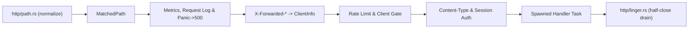

# Stellarr API (`api/`)

Rust Cargo workspace (`edition = "2024"`, `#![forbid(unsafe_code)]`) powering the Stellarr HTTP API, `stellarr.v1` WebSocket hub, and `stellarr` operator CLI.

```sh
cargo fmt --all --check
cargo clippy --workspace --all-targets --locked -- -D warnings
cargo test --workspace --locked
```

## Workspace crates (`api/crates/*`)

| Crate | Package | Responsibility |
| --- | --- | --- |
| `server` | `stellarr-api` | HTTP pipeline, SQLite access, background workers, realtime hub methods, and endpoint groups (`stellarr_api` lib + `stellarr-api` binary). |
| `cli` | `stellarr-cli` | Operator CLI (`stellarr`): health, settings, sealed secrets, sessions, MFA recovery, and backup staging directly on `/data/stellarr`. |
| `hub` | `stellarr-hub` | `stellarr.v1` WebSocket RPC (`call`/`result`/`error`), server `event` broadcasts, and `ping` keep-alives. |
| `websocket` | `stellarr-websocket` | RFC 6455 WebSocket handshake, framing, ping/pong, and close handling over upgraded `hyper` connections. |
| `messages` | `stellarr-messages` | Zero-dependency bilingual (`en` and `pl`) message catalog enforced via exhaustive `match` on `MessageKey`. |
| `unicode` | `stellarr-unicode` | Deterministic Unicode category tables, case folding (`NormalizedUsername`, `NormalizedEmail`), and UTF-16 message slicing. |
| `mentions` | `stellarr-mentions` | `@username` mention parser matching the web client's tokenizer. |
| `webauthn` | `stellarr-webauthn` | Sans-IO Fido2/WebAuthn ceremony generation and assertion verification. |
| `oidc` | `stellarr-oidc` | Sans-IO OpenID Connect relying-party requests, state tokens, callbacks, and ID token signature checks. |
| `outbound` | `stellarr-outbound` | Bounded HTTP/1.1 client (`rustls`) enforcing per-request DNS/IP SSRF filters (`AllowPrivateNetworks`). |
| `embeds` | `stellarr-embeds` | URL extraction and OpenGraph link-card unfurling. |
| `discord` | `stellarr-discord` | Reads Discord server templates, channels, threads, message history, and signed attachment URLs. |
| `storage` | `stellarr-storage` | Local `files/` object store, S3 backend, and magic-byte MIME validation. |
| `s3` | `stellarr-s3` | Sans-IO AWS Signature Version 4 request/response builder for S3 and Cloudflare R2 multipart uploads. |
| `archive` | `stellarr-archive` | Streaming ZIP / ZIP64 backup writer and verifier with per-entry CRC-32 validation. |
| `deflate` | `stellarr-deflate` | Zero-dependency DEFLATE, gzip, zlib, and CRC-32 implementation. |
| `mail` | `stellarr-mail` | Transactional and notification HTML/text email templates (*Midnight* layout with inline CID assets) and Resend transport. |
| `smtp` | `stellarr-smtp` | MIME message builder and SMTP/STARTTLS/TLS client. |
| `webpush` | `stellarr-webpush` | Sans-IO RFC 8291 Web Push payload encryption and VAPID JWT signing. |
| `timezone` | `stellarr-timezone` | System `zoneinfo` reader for IANA time zone validation and UTC offset lookup. |

---

## Layout of `crates/server/src`

### Shared plumbing (modify in dedicated commits only)

| Module | Role |
| --- | --- |
| `lib.rs`, `main.rs`, `version.rs` | `serve()` / `run()` entrypoints, `groups.list.rs` & `workers.list.rs` wiring, and `STELLARR_VERSION` build metadata. |
| `settings/` | Startup configuration loader (`defaults.rs`, `variables.rs`). Invalid values abort startup (`SettingError`), except `Push:*` which degrades to push-disabled. |
| `database/` | SQLite WAL pool, `schema.sql`, `OneTimeSteps`, `DbError`, and `MutationGate` for server-wide invariants. |
| `values/`, `encoding.rs`, `cursor.rs` | `Id` (36-char hyphenated UUID; uppercase in SQLite, lowercase in JSON), `Timestamp`, `int_enum!`, strict Base64 (`Octets`), and URL-safe cursors. |
| `seal.rs`, `secrets/` | `HKDF-SHA256` + `AES-256-GCM` sealing under `keys/master.key` (`0600`) with domain-separated `purpose`, `aad`, and optional expiry; `InstanceSecrets` DB storage. |
| `object_store.rs`, `admission.rs` | `files/` or S3 store initialization (`incoming/` emptied on boot) and upload reservation leases (user/instance quotas, `df` free-space floor, concurrency slots). |
| `http/` | Request pipeline (`pipeline.rs`), path normalizer (`path.rs`), typed extractors, `Problem` JSON, rate limiters, client gate, `file::answer` (`Range` streaming), `stream::channel`, and `linger.rs` TCP half-close drain. |
| `state.rs`, `events.rs`, `logging.rs`, `background/` | Shared `AppState` (zero mutable globals), hub event publisher, `tracing` setup with Cockpit ring-buffer filtering, and supervised `Worker` runtime. |
| `auth/`, `instance/`, `permissions/`, `panel/` | Unified sign-in/2FA ceremonies, normalized names/starter entities, uncached SQLite authorization & channel visibility, and `/api/cockpit` `InstanceOwner` / `FreshInstanceOwner` gates. |
| `mail/`, `realtime/` | Mail transport router + security-alert queue, and `/hubs/app` `stellarr.v1` connections, presence seats, `methods.list.rs`, and `realtime-sessions` watcher. |

### Endpoint groups and workers

| Group / Worker | Responsibility |
| --- | --- |
| `accounts/`, `account_security/`, `second_step/`, `identity_providers/`, `desktop_login/` | `/setup` founding, invite registration, login/logout, sessions, password/email updates, TOTP/email/passkey/recovery ceremonies, OIDC SSO/linking, and desktop browser handoff. |
| `own_profile/`, `client_settings/`, `bootstrap/`, `theme_sources/` | Profile & arrival sound, cross-device client settings sync, `/api/bootstrap`, and server-fetched external CSS/theme imports. |
| `servers/`, `administration/`, `roles/`, `moderation/`, `discord_import/` | Server CRUD, invites, audit logs, ownership transfer, roles & overrides, kicks/bans, and background Discord structure/history/attachment imports. |
| `channels/`, `messages/`, `message_views/`, `link_previews/` | Channels & sections, PWA share target, transcripts & `MessageChanges`, reactions, pins, threads, FTS5 search, and OpenGraph link unfurling worker. |
| `social/`, `direct/`, `encryption/` | Friendships & blocks, 1:1 DMs, and 1:1 E2EE public keys, PIN backups, session-bound devices, and conversation epochs. |
| `uploads/`, `assets/`, `emoji/`, `soundboard/` | Multipart & encrypted uploads, range-streamed `/assets/{id}` downloads, custom server emojis, and soundboard clips. |
| `voice/`, `activities/` | Voice seats, SFU control broker & closer worker, voice moderation, installed/preview multiplayer activities, and live voice-bar activity state. |
| `inbox/`, `delivery/` | In-app `@mention`/system inbox and async Web Push + email dispatcher worker (`notification-delivery`). |
| `backups/`, `housekeeping/` | Online `.db` snapshots, `.zip` archives, R2 replication, staged restores, and hourly batched cleanup worker. |
| `cockpit/`, `releases/`, `health/` | `/api/cockpit/*` routes & `/proc` runtime worker, `/.well-known/stellarr/client` + PWA manifest + native builds, and `/health/{live,ready}`. |

---

## Adding a group of endpoints

Create `src/<group>/mod.rs` exposing `pub fn routes() -> Endpoints` and append `<group>,` to `src/groups.list.rs`:

```rust
// src/channels/mod.rs
use axum::extract::State;
use serde::Serialize;

use crate::database::DbError;
use crate::http::{ApiError, ApiResult, Endpoints, Json, Path};
use crate::state::AppState;
use crate::values::Id;

pub fn routes() -> Endpoints {
    Endpoints::new()
        .get("/api/channels/{id}", read)
        .authorized()
}

#[derive(Serialize)]
#[serde(rename_all = "camelCase")]
struct ChannelDto {
    id: Id,
    name: String,
    topic: Option<String>,
}

async fn read(State(state): State<AppState>, Path(id): Path<Id>) -> ApiResult<Json<ChannelDto>> {
    let found = state
        .database()
        .read(move |db| -> Result<Option<ChannelDto>, DbError> {
            let mut stmt = db.prepare("SELECT \"Name\", \"Topic\" FROM \"Channels\" WHERE \"Id\" = ?1")?;
            let mut rows = stmt.query([id])?;
            Ok(match rows.next()? {
                Some(row) => Some(ChannelDto { id, name: row.get(0)?, topic: row.get(1)? }),
                None => None,
            })
        })
        .await?;
    found.map(Json).ok_or_else(ApiError::not_found)
}
```

### Union-merged registration lists

Four flat list files carry `merge=union` in `.gitattributes` so parallel branches never conflict—never edit `main.rs` or `pipeline.rs` to wire new features:

1. **HTTP routes:** `src/groups.list.rs` (`groups! { channels, ... }`)
2. **Background workers:** `src/workers.list.rs` (`workers! { link_previews, ... }`)
3. **Hub RPC methods:** `src/realtime/methods.list.rs` (`methods! { channels::hub, ... }`)
4. **API integration tests:** `tests/api/modules.list.rs` (`mod channels;`)

### Route modifiers & Cockpit gates

- `.authorized()` — requires a valid `UserSessions` cookie (`401` empty body otherwise); injects `Caller` (`MaybeCaller` on public routes).
- `.json_body()` / `.json_body_up_to(bytes)` — rejects non-JSON `Content-Type` with `415` before rate limiting; defaults to `1 MiB` (`128 MiB` server ceiling).
- `.rate_limit(RateLimitPolicy::...)` — enforces named per-IP/account sliding windows.
- `.fresh_second_step()` — requires `.authorized()` plus a real 2FA check within `5 minutes` when enrolled (`403 fresh-mfa-required` before reading the body).
- **Cockpit routes (`/api/cockpit/*`):** Mark `.authorized()` only and extract `InstanceOwner` or `FreshInstanceOwner` (using `panel::bind_then_gate::<T>` on JSON routes so non-owners receive `403` rather than `fresh-mfa-required`).

---

## HTTP pipeline and handler rules



- **Path normalization (`http/path.rs`):** Runs outermost before routing, rate limits, or auth. Rejects request lines `> 8192 B` (`414`) and `%00` in paths (`400`) with `Connection: close`. Decodes `%XX` except `%2F` (preserving segment boundaries), resolves `.` and `..` per RFC 3986, and strips a single trailing slash (`/api/x/` → `/api/x`; `/api/x//` → `404`). Route matching is case-sensitive.
- **Strict extractors (`crate::http`):** Always use `crate::http::{Path, Query, QueryValues, Json}`—never `axum::extract::*` (which emit plain-text `400`/`422` bodies). Invalid path `Id`s return `404`; duplicate fields, quoted numbers, `NaN`, BOMs, or unpadded Base64 (`Octets`) return `400`.
- **JSON serialization (`http/json.rs`):** Structs use `#[serde(rename_all = "camelCase")]`, emit `null` for `Option::None` (never `skip_serializing_if`), and preserve declaration field order—never build responses with `serde_json::Value` or `json!` (which sort keys alphabetically).
- **Streaming & blocking work:** Never buffer files in memory or use `http_body_util::channel::Channel` (drops trailing chunks under race). Use `http::file::answer` (64 KiB range-aware streaming) or `http::stream::channel`. Run CPU/disk work inside `state.database()` or `tokio::task::spawn_blocking`.
- **Early refusals (`http/linger.rs`):** Handlers run inside detached tasks (completing DB commits + hub `events().publish(...)` even if the client disconnects). When rejecting a request before reading its body (`401`/`403`/`413`/`429`), `linger.rs` half-closes write and drains up to `128 MiB` / `10 s` (max `1,024` concurrent) so clients receive the HTTP error instead of a TCP `RST`.
- **SQLite & Unicode:** Use `state.database().read(|db| ...)` or `.write(|tx| ...)` (`BEGIN IMMEDIATE`), quoting table/column identifiers from `database/schema.sql`. Normalize usernames and emails strictly through `instance::names` / `stellarr_unicode`—never `std` `to_lowercase`/`to_uppercase`.

---

## Auth ceremonies, hub audiences, and workers

### Second-factor ceremonies (`auth::ceremony`)

Routes never mutate `UserSessions` or challenge tables directly; all 2FA transitions go through `#[must_use]` ceremonies in `auth::ceremony` (`flow::start`, `answer`, `start_from_session`, `start_totp`/`confirm_totp`, `send_enrollment_code`/`confirm_email`, `start_passkey`/`confirm_passkey`, `passkey_sign_in`, `remove_method`, `regenerate_recovery_codes`, `redeem_recovery_credential`). Savepoints inside `answer`/`confirm_*` ensure failed post-login hooks (like a conflicting OIDC link) still consume valid OTP proofs without leaking password/code validity.

### Realtime hub (`realtime/`)

Clients connect to `/hubs/app` with subprotocol `stellarr.v1`. Revoked sessions close with WebSocket code `4401` (via immediate `events().session_ended(...)` or the 1-second `realtime-sessions` polling worker). Publish events **after** `database().write(...)` commits:

| `Audience` | Recipients |
| --- | --- |
| `Server(id)` | Every connection following `serverId` (used for open channels) |
| `Followers { server, users }` | Connections of `users` following `server` (used for private `viewChannel` fan-out) |
| `Users(ids)` | Every connection of the listed accounts across all tabs |
| `Reach { servers, users }` | Union of `servers` followers and `users` connections (presence updates) |
| `Everyone` / `Connection(id)` | Broadcast to instance / unicast to one socket |

### Background workers (`background::Worker`)

Workers start after the listener binds, use `stop.sleep(...)` / `stop.stopped()`, chunk bulk SQLite deletes (`1,000` rows per tx in `housekeeping` so writers wait `< 5 ms` p99), and automatically restart with `1 s`–`60 s` exponential backoff on panic while sharing a `30 s` graceful shutdown deadline.

---

## Testing (`crates/server/tests/api/`)

- **Unit tests (`#[cfg(test)]`):** Use `crate::testing::{TempDir, new_database}` (`stellarr-unit-*`).
- **Integration tests (`tests/api/`):** Each test spawns a real `stellarr-api` child process (`Server::start()`) or in-process router (`Server::in_process_with(...)`) on an ephemeral port and isolated `stellarr-it-*` temp folder (`TMPDIR` on tmpfs speeds runs by ~20%, provided `exec` is enabled for doctests). Background workers stay off in `Testing` unless named in `Testing__Workers`.
- **Upload & CLI harnesses:** `crates/cli` tests every command, flag, JSON output, and exit status (`0–5`) against disk fixtures (`cargo test -p stellarr-cli`). `tests/uploads-probe.py` and `tests/uploads-real-bucket.sh` verify byte-exact multipart and S3 compatibility against local filesystems, Garage, and VersityGW.
