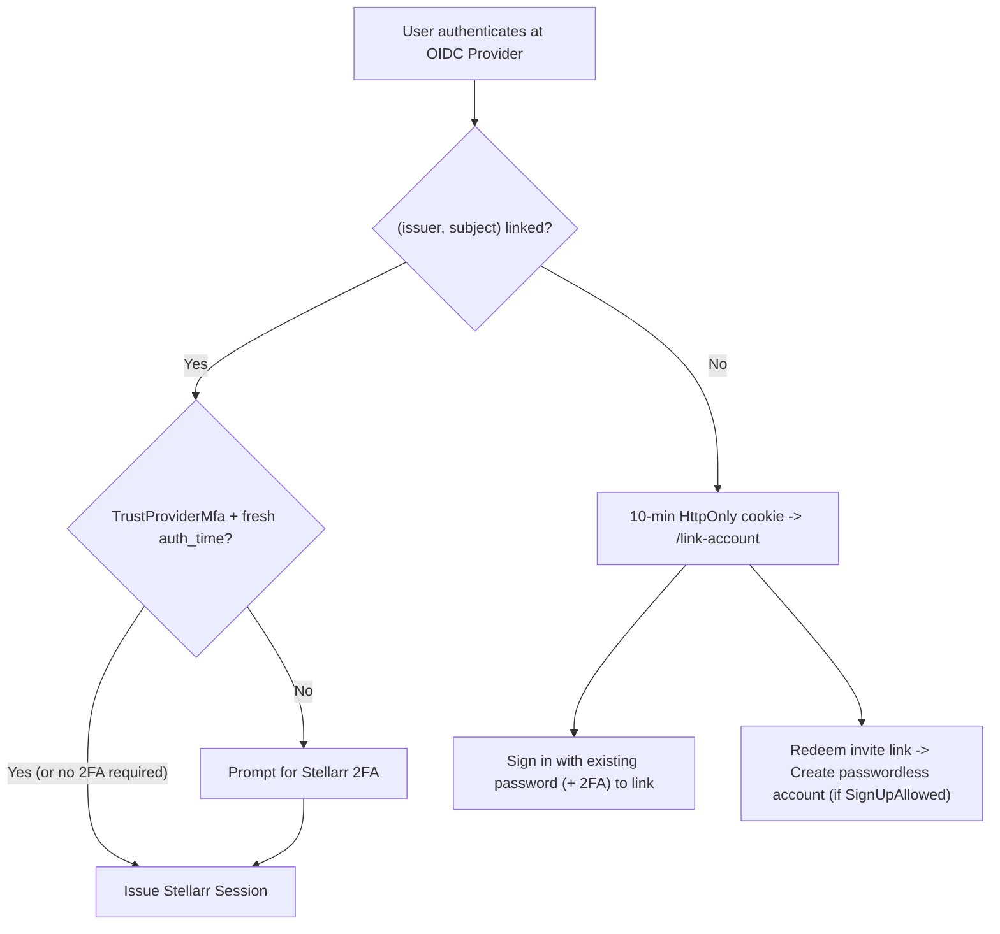

# Account security

Stellarr supports multi-factor authentication (passkeys, TOTP apps, email codes, and single-use recovery codes), OpenID Connect (OIDC) linking, passwordless OIDC accounts, trusted devices, and operator-assisted recovery.

## Second-factor methods

Users manage security methods, trusted devices, active sessions, and security history under **Settings → Login and security**:

| Method | Mechanism | Operational notes |
| --- | --- | --- |
| **Passkey / security key** | Device biometrics/PIN or USB/NFC Fido2 hardware key | Discoverable passkeys also enable single-step passwordless sign-in ([see below](#passkeys)) |
| **Authenticator app (TOTP)** | 6-digit, 30 s codes via QR or setup key | Supports multiple named authenticators per account |
| **Email code** | 6-digit one-time code sent via [configured Mail](../install/configuration.md#mail) | Rate-limited by `mfa.email-cooldown-seconds`, `mfa.email-sends-per-hour`, and `mfa.email-attempts` |
| **Recovery codes** | 10 single-use backup codes issued on first 2FA enrollment | Shown once; regenerating invalidates earlier sets |

Revoking a session under **Active sessions** immediately drops its `/hubs/app` WebSocket (`4401`), closes active voice/media legs, and deactivates its bound E2EE device key.

### Fresh 5-minute proof (`auth/fresh.rs`)

Sensitive account mutations—changing passwords or emails, adding/removing 2FA methods, regenerating recovery codes, linking/unlinking OIDC, or resetting E2EE PIN backups—require fresh authentication proof (`SecurityWrite`: max `30` requests / `15 min` per IP):

| Account configuration | Required proof |
| --- | --- |
| **Has a 2FA method enrolled** | Real second factor completed within the **last 5 minutes** (trusted devices never qualify) |
| **Password only (no 2FA)** | Current password, or primary sign-in completed within the **last 5 minutes** |
| **Passwordless OIDC (no 2FA)** | Sign-in within 5 minutes, or live OIDC re-authentication (`/api/auth/oidc/{id}/reauthenticate` with `prompt=login`, `max_age=300`, and verified `auth_time ≤ 5 min`) |

## Passkeys

Passkeys require an HTTPS origin with a domain name (`STELLARR_DOMAIN` or `STELLARR_PUBLIC_URL`, plus `http://localhost` in development); bare IP origins hide passkey enrollment.

- **Discoverable passkeys** enable **Continue with a passkey** on `/login` and satisfy both primary authentication and MFA requirements (including Cockpit) via `uv` verification.
- **Non-discoverable hardware keys** act as a second factor after password or OIDC sign-in.

> [!WARNING]
> WebAuthn binds passkeys cryptographically to the relying-party hostname. **Changing `STELLARR_DOMAIN` or `STELLARR_PUBLIC_URL` invalidates all registered passkeys**—users must sign in with another method or recovery code and enroll a new passkey.

---

## Linking an identity provider

When [OIDC is configured](../install/configuration.md#single-sign-on-oidc), identities bind strictly by `(issuer, subject)`—never by email address. Each provider identity links to at most one Stellarr account, and each account links at most one identity per provider.



- **Unlinked sign-in (`/link-account`):** Holds the verified identity for 10 minutes without revealing whether its email exists on the instance. Linking an existing account requires a real second factor if enrolled (trusted devices are rejected).
- **Passwordless invite sign-ups:** In **Cockpit → Integrations → Sign-in providers**, the owner can enable **Allow account creation** (`SignUpAllowed`, off by default) per provider. Invited users can then register without a local password (`PasswordHash == null`); `email_verified` carries over only if confirmed by the provider for the exact submitted address. The initial owner account at `/setup` always requires a local password.
- **Last sign-in method guard (`WaysIn`):** Neither users nor Cockpit can remove an account's last remaining independent way in (local password, confirmed passkey, or active OIDC link—returns `409 last-way-in`).

## Changing an email address

Updating an account's email requires configured mail delivery plus current password/fresh proof (and fresh 2FA if enrolled):

1. Stellarr sends a session-bound confirmation link (`60 min` expiry) to the **new** address.
2. The account email updates only once that link is opened and confirmed.
3. A security alert goes to the **old** address, and pending OTP/reset tokens for the old address are invalidated.

## Trusted devices and session lifetimes

| Mechanism | Duration & behavior |
| --- | --- |
| **Trusted device cookie** | Skips standard sign-in 2FA for `mfa.trusted-device-days` (`14` days default); **never** satisfies fresh 5-minute MFA gates. |
| **Persistent session** (`Keep me signed in` checked) | Valid for `30` days (desktop browser handoffs always issue 30-day sessions). |
| **Temporary session** (unchecked) | Browser session cookie with a hard `12-hour` server-side cap. |

Modifying 2FA methods revokes all other sessions on the account. Revocations close active WebSockets and SFU sessions within `1 s`.

---

## Instance MFA policy (operators)

Configure instance-wide enforcement in **Cockpit → Settings → Account security** or via [`stellarr config set`](cli.md#configuration):

```bash
docker compose exec stellarr stellarr config set mfa.requirement everyone --yes
```

| Policy | Enforcement scope |
| --- | --- |
| `optional` | Default. Users opt into 2FA individually; enrolled accounts are prompted on sign-in. |
| `cockpit` | Standard chat sign-in follows per-account settings; opening `/cockpit` requires a real second factor. |
| `admins` | Mandatory 2FA enrollment for the instance owner and anyone holding a role with `manageServer`. |
| `everyone` | Mandatory 2FA enrollment for every user on next sign-in. |

> [!IMPORTANT]
> **Enroll a second factor on the owner account before switching `mfa.requirement` away from `optional`.** Stricter policies reject trusted-device sessions at `/cockpit` until a real second factor is completed.

## Account recovery

### User self-recovery

Users who lose a passkey or authenticator select **Use a recovery code** at the 2FA prompt to spend one of their ten backup codes.

### Operator recovery

When a user has no recovery codes left, reset their MFA in **Cockpit → Users → (account) → Recover access** or via the CLI:

```bash
docker compose exec stellarr stellarr security show maja
docker compose exec stellarr stellarr security recover maja --reason "lost phone"
```

Operator recovery executes atomically:

1. Revokes all MFA methods, trusted devices, active sessions, desktop handoffs, and unused recovery codes (preserving OIDC links).
2. Prints a **one-time recovery credential** valid for `mfa.cli-recovery-minutes` (`10` minutes default) for out-of-band delivery to the user.
3. Locks normal sign-in (`SecurityRecoveryRequired`) until the user authenticates, redeems the credential, and enrolls a replacement second factor.

> [!NOTE]
> Recovering the **instance owner's** own account must be run from the CLI (`stellarr security recover`), because recovery revokes the active Cockpit session. Always pair `db/stellarr.db` with `/data/stellarr/keys/master.key` in backups so sealed TOTP seeds remain readable.
