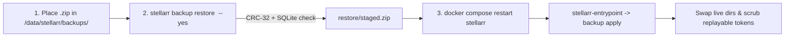

# Automatic backups

Production containers create an automatic full `.zip` backup every 24 hours by default (first check 5 minutes after startup). Manage schedules and local retention in **Cockpit → Backups → Backup settings**, and optional offsite replication under **Cockpit → Integrations → [Cloudflare R2](cloudflare-r2.md)**.

## Backup formats

| Format | Contents | Restorable via CLI? |
| --- | --- | --- |
| **Full backup (`.zip`)** | `manifest.json` + (1) online SQLite snapshot `stellarr.db`, (2) `objects/` attachments, (3) `keys/` (`master.key`), and (4) `instance/` (`secrets/`, `tls/`, `releases/`) | Yes (`stellarr backup restore`) |
| **Database snapshot (`.db`)** | Online SQLite snapshot alone | Manual offline restore only |

> [!IMPORTANT]
> Scheduled backups always produce **full `.zip` archives** and fail (scheduling a retry) if any referenced attachment is missing on disk. `.env` is never packaged inside backup archives—keep a separate copy of `.env` in your offline recovery store.

### Save the instance recovery key separately

On first start after installation or upgrade, Stellarr creates `/data/stellarr/pin-recovery/master.key` (32 random bytes, mode `0600`). Save a copy in a password manager that supports files or on a separately secured offline drive. Keep it apart from the ZIP and its storage credentials. The regular `keys/master.key` serves a different purpose.

The API uses the instance key to seal each client-encrypted key backup, including its verifier, before storing it in SQLite. For disaster recovery on another host, the operator needs the ZIP and the separately saved instance key. To read encrypted history, a user signs in and enters their own recovery code on the new device.

Existing users complete PIN migration in an updated client. An unlocked browser can migrate directly. On a new browser the owner first opens the old backup with the original PIN, then saves a freshly generated recovery code and confirms the change. This rotates the active account key and keeps the old private key inside the new encrypted backup for reading history. The server retires the PIN record in the same transaction. Until the owner completes this step, their live backup still has PIN protection.

SQLite rebuilds the database once during upgrade to clear superseded backup records from unused pages. Allow space for the rebuild. A snapshot or volume copy made before migration can still expose historical keys if someone can open its PIN backup. After users migrate, take a new backup and retire pre-migration copies according to your retention policy.

## Schedule and runtime behavior

Seed defaults in `.env` (changes saved in Cockpit take effect within 1 minute without restarting and override `.env`):

```dotenv
STELLARR_BACKUP_ENABLED=true
STELLARR_BACKUP_INTERVAL_HOURS=24
STELLARR_BACKUP_RETRY_MINUTES=15
STELLARR_BACKUP_INITIAL_DELAY_MINUTES=5
```

- **Completion-relative intervals:** Measured in UTC from the **last successful run**. Downtime across a scheduled window triggers a single run after `STELLARR_BACKUP_INITIAL_DELAY_MINUTES` rather than catch-up bursts.
- **Shared lock (`BackupJobs`):** Manual and scheduled backups serialize cleanly; automatic runs log under `[automatic]` in the operator audit trail.
- **Offsite atomicity:** When Cloudflare R2 is enabled, a run counts as complete only once the R2 upload and `HEAD` checksum check succeed. Failed uploads retry the existing local `.zip` every `STELLARR_BACKUP_RETRY_MINUTES` (`/data/stellarr/automatic-backup.json`).
- **Monitoring:** Stellarr does not email on backup failures—monitor **Cockpit → Backups**, container logs, or backup file timestamps externally.

---

## Restoring a backup

Full `.zip` archives are verified and staged via the [operator CLI](cli.md), then applied atomically by `stellarr-entrypoint` on container restart before any service boots.



### Step-by-step restore

On the original volume the instance recovery key stays in place through a restore. On a replacement volume, install the saved key at `/data/stellarr/pin-recovery/master.key` with mode `0600` and ownership readable by the API before applying a backup that contains protected account key records. Restore checks the key before replacing live data. On an existing instance the CLI also refuses to reactivate a retired PIN identity. A fresh host with only an old archive has no record of later migrations.

1. **Copy the archive** into `/data/stellarr/backups/` if downloaded from offsite storage (verify its SHA-256 first):

   ```bash
   docker compose cp ./backup-20261114-030000-<id>.zip stellarr:/data/stellarr/backups/
   ```

2. **Verify and stage** the archive (`manifest.json`, path safety, SQLite integrity, and every entry's CRC-32 and byte length):

   ```bash
   docker compose exec stellarr stellarr backup restore backup-20261114-030000-<id>.zip --yes
   ```

3. **Restart the container** so `stellarr-entrypoint` swaps `db/`, `files/`, `keys/`, `secrets/`, `tls/`, and `releases/` into place and moves replaced live folders to `/data/stellarr/restore/previous-<timestamp>/` (`logs/`, `backups/`, and `instance-id` stay untouched):

   ```bash
   docker compose restart stellarr
   ```

4. **Verify and clean up:** Sign in as owner, check messages, attachments, integrations, and run a fresh backup. Once confirmed, delete `/data/stellarr/restore/previous-<timestamp>/` to reclaim disk space.

### Post-restore security cleanup

Before swapping the restored database into place, `auth::restore::end_what_a_copy_may_bring_back` runs a transaction so credentials spent after the backup was taken cannot replay:

| Reset immediately on restore | Preserved intact |
| --- | --- |
| All browser/desktop sessions and trusted-device cookies (everyone signs in fresh) | Password hashes, confirmed passkeys, and OIDC identity links |
| Unused email 2FA codes, password-reset links, email-change links, and CLI recovery credentials | Sealed TOTP seeds (advanced to the restore timestamp to block code replay) and unused recovery codes |
| Open sign-in challenges, passkey ceremonies, desktop handoffs, and pending OIDC cookies | Client-encrypted E2EE key backups (`ProtectedAccountKeyBackups`, separate recovery key required), sealed Cockpit secrets (`keys/master.key` included in `keys/`), and host `instance-id` |

*(Restoring a database without its matching `keys/master.key` leaves sealed secrets and TOTP seeds unreadable until cleared via `stellarr secrets clear` and re-enrolled.)*

### Safeguards and edge cases

| Condition | Safeguard |
| --- | --- |
| **Cancel before restart** | `docker compose exec stellarr stellarr backup cancel --yes` removes `restore/staged.zip`. |
| **Outcome audit** | `/data/stellarr/restore/last-restore.json` records the result of the latest startup restore. |
| **Corrupted staged archive** | Moved to `restore/refused-<timestamp>.zip`; live data stays intact and the container boots normally. |
| **Interrupted swap + failed rollback** | Writes `/data/stellarr/restore/broken` and refuses to boot until an operator repairs `/data/stellarr` and removes `restore/broken`. |
| **Disk headroom & sub-mounts** | `/data/stellarr` must fit live data + `staged.zip` + unpacked contents on one filesystem (separate sub-mounts like `/data/stellarr/files` require manual offline restore). |
| **Release parity** | Restore onto the same Stellarr version that produced the archive. |

### Manual offline restore (`.db` snapshots or sub-mounted volumes)

1. Run `docker compose stop` and archive the current `/data/stellarr` directory.
2. Copy `stellarr.db` to `/data/stellarr/db/stellarr.db` and delete `stellarr.db-wal` and `stellarr.db-shm`.
3. Copy `keys/` alongside `db/`, `objects/` into `/data/stellarr/files/`, and `instance/` into `/data/stellarr/` (keeping `0600` permissions on `keys/master.key`, `secrets/*`, and `tls/privkey.pem`).
4. For protected account key backups, install the matching `pin-recovery/master.key` from your separate copy.
5. Run `docker compose start` and check `stellarr doctor`.
