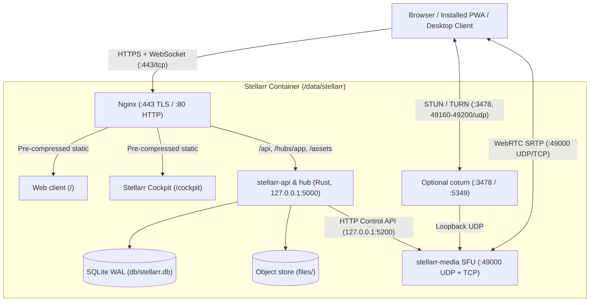
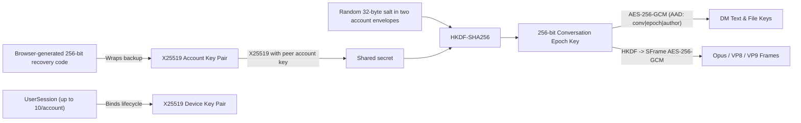

# Architecture

Stellarr runs inside a single Docker container backed by one persistent directory (`/data/stellarr`). Container Nginx terminates TLS and serves static web bundles, `stellarr-api` handles REST and `stellarr.v1` WebSocket traffic over loopback, and `stellarr-media` forwards WebRTC voice and video packets directly over UDP or passive ICE-TCP (or via optional `coturn`).

See [Voice and RTC protocol](./rtc-protocol.md) for hub signaling and client audio/video pipelines, and [Stellarr Media](./stellarr-media.md) for SFU internals.

## System overview



## Component responsibilities

| Component | Location | Responsibility |
| --- | --- | --- |
| **Static browser build** | `web/` | Single Vite build emitting both `index.html` (web client) and `cockpit/index.html` (Cockpit) into `web/dist/` (`gzip -9`). Served directly by Nginx; no Node.js runtime ships in the image. ESLint enforces zero cross-imports between `src/stellarr/` and `src/cockpit/`. |
| **Web client** | `web/src/stellarr/` | Channels, DMs, voice/video, activities, offline translation, and themes. Pre-paint `<head>` scripts apply saved theme and locale without flash; signed-in UI, WebRTC, BetterDiscord conversion, and inactive locale chunks load lazily behind a `259,000`-byte gzip entry budget (`web/bundleReport.ts`). |
| **Service Worker & cache** | `public/stellarr-worker.js`, `lib/deviceStore/` | Caches the active shell keyed by `/release.json` (auto-reloading tabs after upgrades), receives Web Push and OS file shares (`/pwa/share`), and keeps recent channel windows in IndexedDB reconciled against `MessageChanges` (wiped on sign-out/revocation). |
| **Stellarr Cockpit** | `web/src/cockpit/` | Owner-only operator SPA at `/cockpit` backed by `/api/cockpit/*` with independent locale state. |
| **API & Hub** | `api/crates/server`, `api/crates/hub` | Rust control plane for auth, sessions, servers, permissions, messages, uploads, activities, notifications, backups, and the `stellarr.v1` WebSocket hub (`/hubs/app`). Brokers SFU sessions over `127.0.0.1:5200`. |
| **Operator CLI** | `api/crates/cli` (`stellarr`) | Direct `/data/stellarr` inspection, settings/secrets editing, session revocation, MFA recovery, and backup staging built on `stellarr_api` ([Operator CLI](./admin/cli.md)). |
| **SQLite** | `db/stellarr.db` | Relational state, FTS5 full-text indexes, `OneTimeSteps`, and `MessageChanges` journal in WAL mode. Binary blobs never live in SQLite. |
| **Object store** | `files/`, `incoming/` | Local filesystem (`/data/stellarr/files/`) or S3 (`Storage__Provider=S3`). Multipart uploads stream to `incoming/` (cleared on boot), reserve quota/disk leases (`admission.rs`), verify magic bytes (`uploads/inspect.rs`), and move atomically into `images/`, `audio/`, `videos/`, `files/`, `previews/`, `posters/`, or `encrypted/YYYY/MM/<id>.bin`. Served via authorized `/assets/{id}` streams. |
| **Background workers** | `link_previews/`, `housekeeping/`, `delivery/` | Unfurls up to 2 public HTTP(S) URLs per message storing thumbnails locally; runs hourly batched journal compaction, orphan/backup/log pruning, and expired-token cleanup; dispatches queued email and Web Push alerts. |
| **Stellarr Init** | `init/` (`stellarr-init`) | Rust PID 1 supervisor starting services in dependency order (`media` → `api`), probing health, backing off crashed children (`1–30 s`), reaping orphans, and shutting down in reverse order. |
| **Stellarr Media** | `media/` (`stellarr-media`) | Rust `str0m` SFU (`:49000` UDP + passive TCP, ICE-lite, DTLS-SRTP) forwarding RTP packets with per-leg RTCP feedback and GoogCC downlink adaptation—no transcoding or mixing. |
| **coturn** | `/etc/turnserver.conf` | Optional STUN server and HMAC-authenticated TURN relay forwarding relayed UDP packets to `stellarr-media`. |

---

## End-to-end encrypted direct messages and calls

Direct 1:1 conversations support optional end-to-end encryption (`api/crates/server/src/encryption/`, `web/src/stellarr/lib/e2ee/`):



- **Device binding:** Sign-out, session revocation, password change, or account disablement immediately deactivates the session's encryption device; any device/key change triggers automatic epoch rotation on the next message or call.
- **Account key recovery.** The browser generates 32 random bytes and displays them as eight groups of eight hex digits. A versioned input to PBKDF2-HMAC-SHA256 (600,000 iterations) and HKDF-SHA256 derives independent authentication and AES-256-GCM keys. The server stores the encrypted backup and a verifier inside a second envelope protected by an instance key kept outside the ZIP. Recovery sends a derived proof. Ten consecutive incorrect proofs for the current backup delete the server copy. [Key storage and restore](admin/backups.md#save-the-instance-recovery-key-separately)
- **Mutual activation & safety codes:** Transitions `off` → `requested` → `on` only when both peers confirm. Participants verify identities via a 60-digit safety code (`SHA-256` over `stellarr/e2ee/safety/v1`, sorted user UUIDs, and account public keys).
- **1:1 media encryption:** Calls seal Opus, VP8, and VP9 frames in a WebRTC Encoded Transform worker (`SFrame`) while `stellarr-media` forwards opaque ciphertext; see [End-to-end encrypted calls](./stellarr-media.md#end-to-end-encrypted-calls).

For each v2 epoch the sender seals the salt and the other participant’s public key to each account with the existing ephemeral X25519 envelope. HKDF binds the shared account secret and salt to the protocol version, conversation, epoch and both user IDs and public keys. Clients compare the identities with the locally confirmed safety code before sending. New devices recover their account keys with their recovery code. Legacy epochs remain readable. Both participants must update their clients for all new encrypted traffic to use v2. Once a conversation has a v2 epoch, the API rejects new legacy epochs even after the participants toggle encryption. Verification is local to each browser. A previously authorized device that retains the account private key must be treated as an account-key compromise.

This protects against a server that alters the device directory or supplies its own epoch material. It assumes trusted client code and private account keys. For a current backup, the database and instance recovery key still leave a randomly generated 256-bit user secret to guess. A legacy backup remains susceptible to offline PIN guessing if its holder also has the outer key, or if the backup predates outer encryption. Migration rotates the active account identity and retains its predecessor inside the new backup for historical decryption. Previously verified peers must compare the new safety code.

## Account security and `master.key` sealing

- **Unified auth ceremonies (`auth/flow.rs`, `auth/ceremony.rs`):** Password login, discoverable passkeys, invite sign-ups, OIDC SSO, and desktop handoffs funnel through a single flow issuing either a revocable session (`UserSessions`) or a short-lived browser-bound 2FA/enrollment challenge.
- **Passwordless guard (`auth/ways_in.rs`):** Invited users can create passwordless accounts through opted-in OIDC providers; `ways_in` blocks removing an account's last remaining login method (`409 last-way-in`).
- **Master key derivation (`seal.rs`):** One `0600` 32-byte key at `/data/stellarr/keys/master.key` derives domain-separated subkeys via `HKDF-SHA256` (`"stellarr sealed values v1"`) to seal session cookies, OIDC state, TOTP seeds, mailed OTPs, and Cockpit `InstanceSecrets` using `AES-256-GCM` with authenticated AAD and embedded expiry. Recovery codes and trusted-device tokens store `SHA-256` digests only.
- **Fresh MFA and live revocation.** High-risk account, primary-server, and Cockpit writes require a real second factor within five minutes. SQLite triggers journal session, account, role, permission, membership and channel changes in `RealtimeChanges`. The `realtime-sessions` worker (`realtime/watcher.rs`) sleeps until an API transaction commits such a change (signalled in memory), the CLI writes a fresh token to `db/stellarr.db.access-wake` (read every 250 ms while sockets are open), or a connected session reaches its end. It then checks only the affected sessions and closes revoked ones with code `4401`. Changes from outside the API process also update channel groups and voice seats. Message writes and last-seen touches leave the worker asleep. See [Account security](./admin/account-security.md) and [SQLite maintenance](./admin/cli.md#manual-sqlite-maintenance).

---

## Server authorization

HTTP routes and hub methods that need a server permission evaluate it in their SQLite transaction (`permissions::authorization`). A message post and a typing notice reuse the channel already located in that transaction. Missing resources, disabled accounts, and non-members always deny access.

### Roles and the 15 permission bits

- **Role model:** Every member implicitly holds the server's **base role** (`Member`) plus any assigned roles in `ServerMemberRoles`. `ServerMembers.RoleId` tracks their highest-ranked role (lower position numbers outrank higher ones; equal positions do not outrank each other). The **Owner** role is held exclusively by the server owner and bypasses all overrides, as does server-wide `administrator` (`administrator` is rejected with `400` in channel/section overrides, and remains subject to role rank hierarchy).
- **Permission bits (`permissions/privileges.rs`):**
  - **Superuser (1):** `administrator`
  - **Visibility (1):** `viewChannel` (see [Private channels](#private-channels))
  - **Management (8):** `manageServer`, `manageChannels`, `manageRoles`, `manageMembers`, `manageMessages`, `moderateMembers`, `manageBans`, `viewAuditLog`
  - **Channel-wide calls (1):** `mentionEveryone`, decided with the author's effective permissions in the channel when a message is posted. The post stamps `Messages.GroupMention` (bit 1 `@everyone`/`@wszyscy`, bit 2 `@here`/`@obecni`), which the message DTO carries as `mentionsEveryone` / `mentionsHere`; clients highlight and ring by the stamp alone. An edit can only clear bits whose word it removed. The four words are reserved usernames.
  - **Ordinary member actions (5):** Default on a new server's base role; each has a single admission point returning a localized `403` naming `permission`:

| Permission | Enforced at | Permitted without the bit |
| --- | --- | --- |
| `sendMessages` | `POST /api/channels/{id}/messages` (including replies; idempotent retries of an already-stored message return first) | Editing or deleting your own message |
| `attachFiles` | `POST /api/channels/{id}/messages` carrying attachments or a voice message | — |
| `addReactions` | `PUT /api/messages/{id}/reactions/{emoji}` | Removing your own reaction |
| `connect` | `JoinVoice` seat allocation ([Voice seats](./rtc-protocol.md#voice-seats-viewchannel-and-connect)) | Remaining in a room after a moderator moved you there |
| `createInvite` | `POST /api/admin/invites` (scoped to channel for channel invites, server-wide otherwise) | Listing, revoking, or emailing invites (`manageServer`) |

### Pure override evaluator (`permissions/evaluator.rs`)

`permissions/snapshot.rs` loads server roles, member holdings, and relevant section/channel overrides into one pure evaluation pass:

1. Unite the base role with all roles held by the member.
2. Apply **section** overrides (if any), then **channel** overrides. Within each level:
   - Base role override (`deny`, then `allow`)
   - Held role overrides combined (union of `deny` cleared first, then union of `allow` added—so an `allow` on one held role beats a `deny` on another)
   - Member override in `MemberPermissionOverrides` (`deny`, then `allow`; within a single mask, `deny` wins if both bits are set)
3. At a channel, if `viewChannel` is absent after step 2, clear the entire effective mask to `0`.

### Delegation and hierarchy rules

All role, override, channel-move, and moderation writes enforce **both** strict rank hierarchy and actor possession of every affected permission bit, committing structured audit diffs (`permissions/audit.rs`) in the same SQLite transaction:

| Operation | Authorization & rank requirements |
| --- | --- |
| **Create role** | Base `manageRoles` + actor holds every granted bit (only an `administrator` can grant `administrator`). Placed directly above the base role. |
| **Reorder roles** | `PUT /api/admin/roles/order` listing all custom roles once. Base `manageRoles`; only roles below the actor's top role may move, preserving order and ties above it. Recomputes top roles and logs `role.reorder`. |
| **Edit or delete role** | Base `manageRoles` + outrank target role + hold all old and new bits (including scoped grants). Deleting recomputes fallback top roles. |
| **Assign or remove roles** | Base `manageMembers` + not self + outrank target member and every added/removed role + hold every bit/override allow those roles grant (`PATCH .../role` or `PUT .../roles`). Owner role cannot be assigned here; ownership transfers clear the new owner's member overrides. |
| **Role or member override** | Base and scoped `manageRoles` + outrank target role/member (never self or owner) + hold every bit in old and new allow/deny masks. |
| **Move channel across sections** | Manage source channel and destination section/server + full rank and bit delegation checks for every role/member whose effective permissions change across the move. |
| **Kick / ban / voice moderation** | Server `manageMembers`/`manageBans` (or scoped `moderateMembers` in both voice rooms) + strictly outrank target (never self or owner). |

### Schema initialization and `OneTimeSteps`

Empty databases initialize directly from `database/schema.sql` (`database/schema.rs`) without an incremental migration runner. One-off data backfills (such as `ordinary-permissions` and `view-channel`) record completion in the `OneTimeSteps` table inside `stellarr.db` so fresh databases mark them done immediately, backups carry them automatically, and permissions later revoked by an admin stay revoked across restarts.

---

### Private channels

Denying `viewChannel` on the base role and allowing it on specific roles/members makes a channel private (`permissions/visibility.rs`). To anyone without `viewChannel`, the channel behaves as if it does not exist:

| Surface | Behavior for non-viewers |
| --- | --- |
| **HTTP routes & Hub calls** | Returns `404` (or `400` where an unknown ID is invalid, `"Unknown channel."` / `"Unknown voice room."` on the hub) **before** any `403` check. |
| **Bootstrap, lists & reorders** | Omitted from `/api/bootstrap`, muted-channel lists, and invite tables. Sections appear if the caller sees at least one child channel, holds `manageChannels` there, or (when empty) holds `viewChannel`. Reorder calls move visible items while keeping hidden items in place. |
| **Realtime fan-out** | Open channels broadcast to `server:{id}` with zero extra queries. Restricted channels snapshot viewers and publish only to each viewer's `server:{id}:user:{id}` group. Access changes diff viewer sets before/after and emit `ChannelAccessChanged` (`{ serverId }`) to affected clients. |
| **Voice enforcement (`voice::enforce`)** | Any role, override, section, channel, membership, or ownership mutation re-checks seated callers and immediately evicts anyone missing `viewChannel` or `connect` (closing SFU media + sending `VoiceChannelKicked`). |
| **Mentions, uploads & invites** | Mentions notify viewers only (re-checked before email/push send); attachments stay restricted to channel viewers and their uploader; channel invites joined by non-viewers omit the private channel name and land in the first visible text channel. |
| **Cockpit** | Instance owner panel retains full visibility across all channels. |

> [!NOTE]
> **Known side-channel boundaries:** Audit logs name private channels to readers with `viewAuditLog`; server-wide unique channel names, non-empty section delete checks, and duplicate `clientMessageId` checks still return `409`; global channel position numbers contain gaps where private channels sit; and permission evaluation adds a small timing delta over an unknown UUID.

---

## Single-container deployment

### Persistent volume layout (`/data/stellarr`)

| Path | Contents |
| --- | --- |
| `db/stellarr.db` | Primary SQLite database in WAL mode (`-wal`, `-shm`), FTS5 tables, and `MessageChanges` journal |
| `files/` | Attachments, previews, posters, avatars, private wallpapers, custom emojis, soundboard clips, and `encrypted/` DM blobs |
| `incoming/` | Multipart upload staging folder, cleared automatically on API startup |
| `keys/master.key` | `0600` 32-byte master key (`HKDF-SHA256` + `AES-256-GCM`) sealing cookies, TOTP seeds, and Cockpit secrets |
| `pin-recovery/master.key` | Independent `0600` key for E2EE recovery. Store a separate backup for migration to another host. |
| `secrets/` | Auto-generated internal bearer tokens (`media-control-secret`, `turn-shared-secret`) |
| `tls/` | Container-managed self-signed or operator-mounted `fullchain.pem` and `privkey.pem` |
| `releases/` | Optional desktop and mobile client release artifacts |
| `backups/` | Online `.db` snapshots and full `.zip` archives (`automatic-backup.json` sits alongside) |
| `restore/` | Staged `staged.zip`, `last-restore.json` status, and `previous-<timestamp>/` rollback directories |
| `instance-id` | Persistent instance UUID generated when `STELLARR_INSTANCE_ID` is unset |

### Container services (`stellarr-init`)

`stellarr-init` runs as PID 1, supervising `media`, `api`, `nginx`, `tls-maintenance`, and (when enabled) `turn` ([`init/README.md`](../init/README.md)):

```bash
docker compose exec stellarr stellarr-init status          # state, PID, restarts, uptime
docker compose exec stellarr stellarr-init status --json   # machine-readable JSON
docker compose exec stellarr stellarr-init health          # exits 0 when all critical services are ready
docker compose exec stellarr stellarr-init restart api     # restart a single service
docker compose exec stellarr stellarr-init reload nginx    # send SIGHUP to reload TLS/config
```

| State | Meaning |
| --- | --- |
| `waiting` | Waiting for an upstream dependency (`api` waits for `media` to reach `ready`). |
| `starting` | Process spawned; initial readiness probe (`500 ms` interval) has not yet passed. |
| `ready` | Passing steady-state liveness probes (every `10 s`). |
| `failing` | Missed 3 consecutive probes (~`45 s`); marks container `unhealthy` **without** killing the live process. `media` is the exception: it is restarted at that point instead (`stopping`, then `backoff`), because its probe and every call share one task. |
| `backoff` | Exited; waiting to restart with exponential backoff (`1 s` to `30 s`, reset after `60 s` uptime). |
| `stopping` / `stopped` | Ordered reverse-dependency shutdown (`60 s` supervisor deadline; `75 s` container stop grace). |

### Nginx routing and cache policy

Nginx listens on `:443` (TLS) and `:80` (redirecting to HTTPS unless a listed `STELLARR_TRUSTED_PROXIES` peer sends `X-Forwarded-Proto: https`):

| Path pattern | Target | Cache / status policy |
| --- | --- | --- |
| `/api/`, `/assets/`, `/health`, `/.well-known/stellarr/` | `http://127.0.0.1:5000` | Upstream headers (`128m` max body) |
| `/hubs/` | `http://127.0.0.1:5000` (WebSocket) | `Upgrade` / `Connection` forwarded (`75s` read timeout) |
| `/static/`, `/fonts/` | `/opt/stellarr/web` (`gzip_static on`) | `public, max-age=31536000, immutable` on `200`/`206`/`304`; missing files return plain `404` |
| `/stellarr-instance.js` | `/run/stellarr/stellarr-instance.js` | `public, max-age=3600, must-revalidate` |
| `/audio/`, `/bergamot-models/`, `/codecs/`, `/identity/`, `/mascot/`, `/pwa/`, `/sounds/`, or `*.ext` | `/opt/stellarr/web` | `no-cache`; missing files always return plain `404` (never HTML) |
| `/pwa/share` (when Service Worker is inactive) | `303 /?share=error` | Redirects safely into the web client |
| `/cockpit`, `/cockpit/*` | `/opt/stellarr/web/cockpit/index.html` | `no-cache`, HTTP `200` |
| Web client routes (`/`, `/login`, `/register`, `/setup`, `/forgot-password`, `/reset-password`, `/confirm-email`, `/link-account`, `/invite/*`) | `/opt/stellarr/web/index.html` | `no-cache`, HTTP `200` (enforced against `routes.tsx` by `web/documents.test.ts`) |
| Any other unmatched path | `/opt/stellarr/web/index.html` | `no-cache`, HTTP `404` (renders themed not-found UI while monitors see `404`) |

---

## Architectural invariants and trade-offs

1. **Single container, single writer on `/data/stellarr`:** SQLite WAL (`db/stellarr.db`), backup locks (`BackupJobs`), and local object storage assume exclusive ownership. Horizontal multi-container scaling is traded away for ~35 MiB idle RAM, zero external services, and single-directory backups.
2. **Channel authorization:** Each protected operation uses its SQLite transaction to read current membership, role assignments and applicable overrides. Opening a public text channel checks membership and visibility in one statement. Role and override changes apply on the next check.
3. **Trigger-driven relational cascades:** Deleting a server or channel cascades synchronously via SQLite triggers (`database/schema.sql`) across channels, messages, attachment links, reactions, embeds, pins, FTS5 rows, and `MessageChanges`, leaving unreferenced blobs for the hourly orphan sweep.
4. **Strict app isolation & `259,000`-byte gzip entry budget:** Bundled chunks live under `static/` (leaving `/assets/` for API downloads), `/release.json` hashes all emitted files outside JS chunks, and heavy signed-in subsystems stay behind dynamic `import()`.
5. **Full DOM transcript with CSS containment (`contain: layout style`):** Avoids scroll-jump jitter from virtualization or `content-visibility: auto` while keeping native `Ctrl+F` search, full accessibility tree access, and overhanging hover toolbars fast up to 10,000+ messages ([benchmarks](../web/bench/README.md)).
6. **Non-destructive liveness probes:** `stellarr-init` marks slow services `failing` without killing them so transient host CPU/IO contention cannot drop in-flight requests or cause restart storms. The media server is the exception: one that misses three probes serves no call, so it is restarted, never more often than its ~`45 s` of missed probes plus the crash backoff allow.
7. **Dedicated `sendonly` WebRTC transceivers:** Clients publish tracks exclusively via `addTransceiver(track, { direction: "sendonly", streams: [stream] })`—never `addTrack`, which browsers can bind to `recvonly` server m-lines.
8. **Automated Docs-as-Code contracts:** CI enforces parity across `STELLARR_*` variables (`setting-names.test.sh`), `--ui-*` CSS tokens (`tokens:check`), Nginx/client routes and WASM SHA-256 digests (`documents.test.ts`, `artifacts.test.ts`), and VitePress links (`docs/` test & build).
