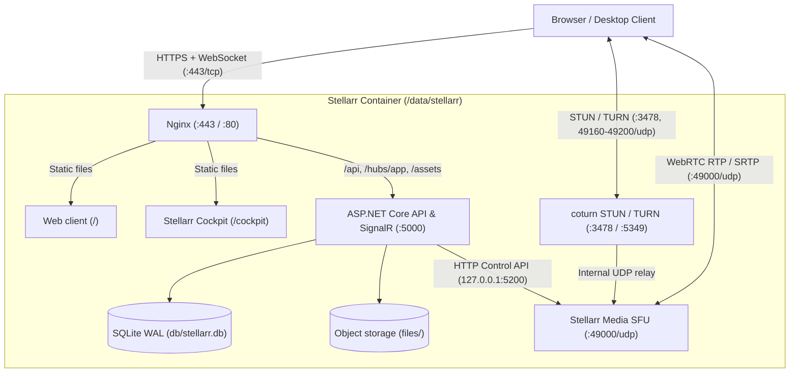

# Architecture

Stellarr runs inside a single Docker container backed by one persistent volume (`/data/stellarr`). All HTTP and WebSocket traffic enters through Nginx, while WebRTC voice and video packets flow directly to `stellarr-media` (or through `coturn` when direct UDP is blocked).

See [Voice and RTC protocol](./rtc-protocol.md) for client state and SignalR signaling, and [Stellarr Media](./stellarr-media.md) for the Rust SFU media server.

## System overview



## Component responsibilities

- **Browser apps (`web/`)**: A single multi-page Vite build emits the web client (`web/index.html`) and Cockpit (`web/cockpit/index.html`) as static files in `web/dist/`, pre-compressed with `gzip -9`. Nginx serves them directly from `/opt/stellarr/web`; no Node.js runtime ships in the production image. Each app has its own `main.tsx`, `routes.tsx` ([`@stellarr/router`](../packages/stellarr-router/README.md)), and `pages/` and imports nothing from the other.
- **Web client (`web/src/stellarr/`)**: Browser client for text channels, direct messages, voice, and video. Blocking pre-paint scripts apply the saved theme and locale before first paint (see [Localization](./localization.md)), while the signed-in application bundle and language catalog chunks load on demand (enforced by an up-front gzip budget in `web/bundleReport.ts`).
  - **Service Worker and release tracking (`web/public/stellarr-worker.js`, `web/release.ts`)**: Caches the current release's application shell (`/release.json`) for instant navigation and handles Web Push notifications. Running tabs check `/release.json` on startup, hub reconnect, and tab visibility changes, updating the cached shell and reloading automatically when the server moves to a new release.
  - **Device message cache (`web/src/stellarr/lib/deviceStore/`)**: Stores the latest message window per channel in browser IndexedDB for immediate rendering on load, reconciled against the server's message change journal (`MessageChanges`) and wiped on sign-out or session revocation.
- **Stellarr Cockpit (`web/src/cockpit/`)**: Standalone operator SPA at `/cockpit`, backed by `/api/cockpit/*` endpoints restricted to the instance owner role, with its own locale preference.
- **ASP.NET Core (`server/Stellarr.Api`)**: Control plane for authentication, sessions, servers, channels, messages, uploads, link previews, presence, activity notifications, backups, and SignalR signaling. Allocates and closes SFU sessions on `stellarr-media` over `127.0.0.1:5200` and relays SDP/ICE negotiation.
- **Operator CLI (`server/Stellarr.Cli`)**: The `stellarr` binary for inspecting health, editing database settings and encrypted secrets, revoking sessions, issuing MFA recovery credentials, and verifying or staging backup restores directly against `/data/stellarr`. Shares published assemblies with `Stellarr.Api` in `/opt/stellarr/api`. See [Operator CLI](./admin/cli.md).
- **SQLite (`db/stellarr.db`)**: Stores relational state, full-text search indexes (FTS5), and the message change journal in WAL mode. Binary files are never stored in SQLite.
- **Uploaded files (`files/`)**: Stored on `/data/stellarr/files/` by object key (or in an S3-compatible bucket when `Storage__Provider=S3`). Uploads write to `files/.incoming/`, flush to disk, validate magic-byte signatures against declared MIME types (`AttachmentValidation.cs`), and move atomically into place:
  - Standard attachments live under `images/`, `audio/`, `videos/`, and `files/`. Image uploads optionally include a reduced WebP/JPEG preview (`previews/`, up to 1 MiB) and a 32-byte base64 blurred placeholder; video uploads optionally include a poster image (`posters/`, up to 2 MiB).
  - End-to-end encrypted direct-message uploads are stored as opaque ciphertext under `encrypted/YYYY/MM/<id>.bin` (`application/octet-stream`).
  - Every download under `/assets/{id}` is authorized and streamed by the API (`AttachmentAccess.cs`).
- **Link previews (`server/Stellarr.Api/Embeds/`)**: Background worker unfurls up to two HTTP(S) links per channel message (`Stellarr:Embeds`), blocking loopback, link-local, and private network ranges by default (`AllowPrivateNetworks=false`). Preview thumbnails are downloaded and stored as local attachments so reader browsers never contact external hosts.
- **Housekeeping (`server/Stellarr.Api/Maintenance/`)**: Hourly background worker (`InstanceMaintenance`) that compacts the `MessageChanges` journal, drains the object deletion queue, sweeps unreferenced orphan uploads, prunes expired local backups and log files per Cockpit retention settings, and purges expired auth challenges, OTP codes, and recovery tokens.
- **coturn**: Stateless STUN server and HMAC-authenticated TURN relay forwarding relayed media allocations to the local `stellarr-media` UDP socket.
- **Stellarr Init (`init/`, Rust)**: PID 1 process supervisor (`stellarr-init`). Starts container services in dependency order (`media` before `api`), runs periodic readiness probes, restarts exited processes with exponential backoff (1 s to 30 s), kills leftover process groups, reaps zombies, and stops services in reverse order on container shutdown.
- **Stellarr Media (`media/`, Rust)**: Selective Forwarding Unit (SFU) on UDP `49000` using `str0m` (ICE-lite, DTLS-SRTP). Forwards microphone, camera, and screen-share RTP packets without transcoding or mixing, with per-leg RTCP feedback and per-receiver GoogCC downlink adaptation.

## End-to-end encrypted direct messages and calls

Direct 1:1 conversations support optional end-to-end encryption (`server/Stellarr.Api/Endpoints/EncryptionEndpoints.cs`, `DirectEncryptionEndpoints.cs`, `web/src/stellarr/lib/e2ee/`):

- **Account and device keys**: Each user generates an X25519 account key pair and an X25519 device key pair per browser sign-in session (up to 10 active devices per account). Device lifecycles bind directly to `UserSessions`: signing out, revoking a session, changing a password, or disabling an account automatically deactivates the corresponding encryption device.
- **PIN-protected key backup**: The account private key is sealed locally in IndexedDB with a non-extractable WebCrypto AES-256-GCM wrapping key and backed up to the server encrypted under a 6-digit PIN (`PBKDF2-HMAC-SHA256` with 600,000 iterations, expanded via `HKDF-SHA256` into a separate server `authKey` verifier and client-only `encKey`). Ten consecutive wrong PIN attempts permanently delete the server backup. Users can replace their PIN or reset their account key after completing a fresh security proof.
- **Mutual activation and epochs**: Enabling encryption in a conversation requires a request from one participant and confirmation from the other (`off` → `requested` → `on`). Messages are encrypted under sequential 256-bit conversation epoch keys (`EncryptionEpochs`). Every new epoch key must be wrapped (ephemeral X25519 + HKDF-SHA256 + AES-256-GCM bound to `conversationId|epochId|recipientKeyId`) for both participants' account keys and every active device key of both participants. Adding or revoking a device or resetting an account key triggers automatic epoch rotation on the next message or call.
- **Encrypted messages and files**: Message payloads (`v: 1`, containing message text and attachment metadata, per-file AES-256-GCM keys, IVs, dimensions, durations, previews, and blurred placeholders) are sealed with AES-256-GCM using `conversationId|epochId|authorId` as associated data. Attached files, video posters, and image previews are each encrypted in the browser with an independent random AES-256-GCM key before uploading to `POST /api/uploads/encrypted`.
- **1:1 voice and video calls**: Calls in an encrypted conversation encrypt every Opus, VP8, and VP9 media frame end-to-end in a WebRTC Encoded Transform worker using keys derived from the conversation's active epoch key. `stellarr-media` forwards the encrypted RTP payloads without modification or access to the media keys; see [End-to-end encrypted calls](./stellarr-media.md#end-to-end-encrypted-calls).
- **Safety codes**: Participants can verify each other's identity by comparing a 60-digit safety code (12 groups of 5 digits, computed from the SHA-256 digest of `stellarr/e2ee/safety/v1` and both users' sorted UUIDs and account public keys).

## Account security

- **Unified authentication flow**: Password sign-in, passkey sign-in, invite registration, OIDC single sign-on, and desktop browser handoff resolve through `AuthenticationFlow.cs`, issuing either a revocable session or a short-lived browser-bound challenge when a second factor or enrollment is required.
- **Accounts without a password and sign-in protection**: When an operator enables account creation for an OIDC provider in Cockpit, invited users can register through that provider without setting a local password. `WaysIn.cs` prevents users or operators from unlinking or deleting an account's last remaining sign-in method (password, passkey, or active OIDC link).
- **Session properties**: Sessions track their sign-in origin, latest second-factor timestamp, security version, and absolute expiry. Unchecking **Keep me signed in** issues a session cookie capped at 12 hours server-side.
- **Second factors and secrets**: Supports TOTP apps, email codes, passkeys/hardware security keys (Fido2 validated against `Operations:PublicUrl`), and single-use recovery codes. TOTP seeds and email codes are encrypted with `/data/stellarr/keys`; recovery codes and trusted-device tokens are stored only as SHA-256 digests.
- **High-risk actions and live revocation**: Sensitive account, server, and Cockpit mutations require a second step completed within the last 5 minutes (or a fresh OIDC re-authentication with `auth_time` within 5 minutes for passwordless accounts; trusted devices never qualify). `SessionRevocationWatcher` polls revocations every second and immediately terminates matching SignalR and media sessions. See [Account security](./admin/account-security.md).

## Server authorization

HTTP handlers and SignalR hub methods evaluate permissions through `ServerAuthorization` (`ServerAccess`) directly against SQLite on every call, without caching, using `PermissionScope` (server, section, or channel). Missing resources, disabled accounts, and missing memberships always deny access.

- **Roles**: Every member holds the server's base role (the last system role) without storing it, and any number of other roles in `ServerMemberRoles`. `ServerMembers.RoleId` is the member's top role, the highest one they hold or else the base role; it alone decides rank. The owner role is held by the owner only. Server-wide permissions are the base role's united with every held role's; the owner holds everything. Removing a role from a member, or deleting it, also lifts its overrides' denies for them, as on Discord.
- **Permissions** (`ServerPrivileges`, wire names in `ServerAccess`): eight manage the server (`manageServer`, `manageChannels`, `manageRoles`, `manageMembers`, `manageMessages`, `moderateMembers`, `manageBans`, `viewAuditLog`), `administrator` stands for all of them, and five are what an ordinary member does. Each ordinary one has exactly one admission point, evaluated at the channel so overrides apply, and a refusal is a localized 403 problem whose `permission` names it:

  | Permission | Admitted in | Needs nothing |
  | --- | --- | --- |
  | `sendMessages` | `POST /api/channels/{id}/messages`, replies included (a retry of a send that went through is answered first) | Editing or deleting one's own message |
  | `attachFiles` | The same post when it carries any attachment, a voice message included | |
  | `addReactions` | `PUT /api/messages/{id}/reactions/{emoji}` | Taking one's own reaction back |
  | `connect` | `JoinVoice`, which gives the seat that admits a connection to media (see [Voice seats and `connect`](./rtc-protocol.md#voice-seats-and-connect)) | A connection already seated in the room, as one a moderator moved there is |
  | `createInvite` | `POST /api/admin/invites`: at the channel for a channel invite, server-wide otherwise | Listing, revoking and sending invites stay with `manageServer` |

  A new server's base role gets `ServerRole.BaseRoleDefaults` (send, attach, react, connect); the owner's stores `ServerPrivileges.All`.
- **Evaluation**: `PermissionEvaluator` is the one pure function behind every decision; `PermissionSnapshot` loads its inputs for one server (roles, the members asked for with what they hold, and the overrides of the sections and channels asked for). For a channel in a section the section level applies first and the channel level second; a channel outside a section has only its own level. Within a level, as on Discord: the base role's override (deny, then allow), then the overrides of the held roles together (the union of their denies is removed, then the union of their allows added, so one role's allow beats another's deny), then the member's own override from `MemberPermissionOverrides` (deny, then allow). Within a single override a bit both allowed and denied stays denied. The owner skips every override, and so does anybody whose server-wide permissions include `administrator`: they hold everything everywhere. `administrator` is server-wide only: both override routes refuse it with a 400, and the evaluator ignores it in a stored mask. Rank is not a permission, so an administrator still cannot act on anyone at or above their top role, nor on the owner.
- **Role hierarchy**: Lower role position values represent higher rank; equal positions do not outrank one another. A member ranks by their top role. The base role ranks below every other role: a new role is placed just above it, and `RoleRankSchema` puts a database from before that in order on start. The owner role's base permissions are immutable (and the owner can still clear legacy overrides on their own role, which no longer restrict them).
- **Delegation checks**: Managing roles, assigning roles, setting overrides, reparenting channels, and moderating members/voice all enforce both rank hierarchy and possession of every affected permission bit. "Holds" means the actor's server-wide permissions from all their roles, and at a scope their effective permissions there:

| Operation | Authorization rules |
| --- | --- |
| Create role | Base `manageRoles`; actor must hold every granted bit, so only an administrator grants `administrator` (a new role ranks below the other roles and above the base role). |
| Reorder roles | `PUT /api/admin/roles/order` with every role between the owner role and the base role, highest first, once each (else 400). Base `manageRoles`; only roles the actor's top role outranks may move, and every other role keeps its place and position, so nothing reaches the actor's top role and ties above it stay ties. Moved roles are numbered after the kept ones, the base role stays last, every top role is worked out again, and `role.reorder` goes to the audit log. |
| Edit or delete role | Base `manageRoles`; top role must outrank the role; must hold both existing and proposed bits (including live scoped grants). Deletion also checks the fallback role, and each holder's top role moves to the next role they hold. |
| Give or take roles | Base `manageMembers`; must not be the member, must outrank the member and every role given or taken, and must hold everything each of those roles could grant, override allows included. `PATCH /members/{id}/role` sets exactly one role (the base role's id clears them) and also checks the member's current top role; `PUT /members/{id}/roles` sets the whole list and checks what changes. The owner role is never given or taken this way. |
| Set or clear role override | Base and scoped `manageRoles`; must outrank the role and hold all bits in both old and new allow/deny masks (including removing a deny). |
| Set or clear member override | Same as a role override, with the member in place of the role: must outrank the member (never oneself), and nobody sets one on the owner. Routes: `/api/admin/{channels,sections}/{id}/permissions/members[/{userId}]`, beside the role routes. |
| Move channel across sections | Manage source channel and destination section/server; for every role, and every member with a section override, whose section overrides differ and are not decided by their channel override, enforces full delegation, hierarchy, and bit checks across both contexts. |
| Kick or ban member | Server permission + lower-ranked target; cannot target self or owner. Held roles and member overrides go with the membership. |
| Kick or move in voice | Scoped `moderateMembers` + hierarchy; moves validate both source and destination voice channels. |

`PermissionsChanged` carries each recipient's own server-wide permissions, so a change to the base role reaches every member. A handover moves the owner role; both people keep their other roles, and the successor's member overrides are removed.

**One-time data steps.** Schema steps in `Data/Schema/` run on every start and are idempotent. A change to the data that must happen once, such as `OrdinaryPermissionDefaults` (a server from before the ordinary permissions gets the base role defaults, `createInvite` for every role with `manageServer`, and the new everything for the owner role), is a step in `Data/OneTime/OneTimeSteps.cs`. Its name is claimed in the `OneTimeSteps` table in the same transaction as its writes, so it never runs again, and what an administrator takes away afterwards stays away across restarts. A new database runs every step on no data and is marked; the writers of new data (`ServerDirectoryEndpoints.AddServer`, the test fixture, `scripts/seed-dev.py`) write what the steps would have. The table lives in the database file, so a backup carries it: a backup from before a step gets it on its first start after a restore, one from after does not. The CLI's schema check needs nothing, because the CLI never runs steps and neither reads nor writes what they change.

Mutations commit together with structured audit records (`ServerAudit.cs`, recording both a localized summary and structured `ChangesJson` field diffs) in a single SQLite transaction before emitting SignalR events. On the primary instance server, role and override changes also require a fresh second step under the active MFA policy.

## Single-container deployment

`stellarr-init` supervises all five container processes (`media`, `api`, `turn`, `nginx`, and `tls-maintenance`, defined in `init/src/services.rs`) behind `/data/stellarr`. See [`init/README.md`](../init/README.md) for the control socket wire protocol.

### Container services (`stellarr-init`)

```bash
docker compose exec stellarr stellarr-init status          # state, PID, restarts, uptime
docker compose exec stellarr stellarr-init status --json   # JSON output for scripts
docker compose exec stellarr stellarr-init health          # exits 0 only when all critical services are ready
docker compose exec stellarr stellarr-init restart api     # restart one service immediately
docker compose exec stellarr stellarr-init reload nginx    # send SIGHUP to reload Nginx config and TLS cert
```

| State | Meaning |
| --- | --- |
| `waiting` | Waiting for a dependency to reach `ready` (`api` waits for `media`). |
| `starting` | Process spawned; initial readiness probe has not yet passed. |
| `ready` | Process running and passing readiness probes (polled every 10 s). |
| `failing` | Missed three consecutive readiness probes (~45 s); marks container unhealthy without killing a slow process. |
| `backoff` | Process exited; waiting before restart (exponential backoff from 1 s to 30 s). |
| `stopping`, `stopped` | Shutting down or stopped during restart or container exit. |

All service logs stream to container stdout/stderr (`docker compose logs`), including `stellarr-init:` state changes. Routine health probes are suppressed from API logs, and Nginx disables access logging because API requests are logged by `Stellarr.Api.Requests`.

### Nginx routing and cache policy

Nginx terminates TLS (or accepts plain HTTP from a trusted reverse proxy sending `X-Forwarded-Proto: https`), proxies `/api/`, `/assets/`, `/health`, `/hubs/`, and `/.well-known/stellarr/client` to ASP.NET Core (`127.0.0.1:5000`), and serves `/stellarr-instance.js` plus static files from `/opt/stellarr/web`:

- **Static asset directories** (`/audio/`, `/bergamot-models/`, `/codecs/`, `/fonts/`, `/identity/`, `/mascot/`, `/sounds/`, `/static/`) and any path with a file extension in its final segment return a plain `404` when missing, never an HTML fallback.
- **Cockpit routes** (`/cockpit` and `/cockpit/*`) serve `/opt/stellarr/web/cockpit/index.html`.
- **Web client routes** (`/`, `/login`, `/register`, `/setup`, `/forgot-password`, `/reset-password`, `/confirm-email`, `/link-account`, `/invite/<code>`, matching `web/src/stellarr/routes.tsx` and verified by `web/documents.test.ts`) serve `/opt/stellarr/web/index.html` with HTTP `200`.
- **Unknown paths** return `/opt/stellarr/web/index.html` with HTTP `404` so the web client renders its not-found page while HTTP monitors still observe status `404`.
- **Caching**: Content-hashed bundles under `/static/` and fonts under `/fonts/` are served with `Cache-Control: public, max-age=31536000, immutable` and `gzip_static on`. `/stellarr-instance.js` is served with `public, max-age=3600, must-revalidate`. All other files under `/opt/stellarr/web/` (`index.html`, `cockpit/index.html`, `/release.json`, `/stellarr-worker.js`, audio worklets, WASM binaries, translation models, and sounds) use `Cache-Control: no-cache` so browsers always revalidate stable URLs across releases.

## Architectural invariants and trade-offs

- **Single container, single writer on `/data/stellarr`**: SQLite runs in WAL mode (`db/stellarr.db`) alongside an in-process backup lock (`BackupJobs`) and local filesystem object storage (`files/`). Never mount `/data/stellarr` across multiple running API containers concurrently; horizontal scaling is intentionally traded away in favor of zero external service dependencies (no Postgres, Redis, or external SFU) and single-folder backup/restore.
- **No permission or session caching on the authorization path**: `ServerAuthorization` evaluates membership, role hierarchy, and section/channel override masks directly against SQLite on every HTTP request and SignalR hub invocation. Role changes, permission revocations, kicks, bans, and session revocations (`SessionRevocationWatcher`) take effect immediately without cache-invalidation windows.
- **Static multi-page build with strict app isolation and up-front gzip budget**:
  - `web/` compiles both the web client (`index.html`) and Cockpit (`cockpit/index.html`) once during the image build into `BUILD_DIRECTORY = "static"` (never Vite's default `assets/`, because Nginx proxies `/assets/` to the API for user attachment downloads).
  - `web/bundleReport.ts` fails the build if the static import closure and CSS of `index.html` exceed `UP_FRONT_BUDGET_GZIP` (`259,000` gzipped bytes); SignalR, WebRTC/voice, and language catalogs must remain behind dynamic `import()` boundaries.
  - `web/release.ts` computes a 20-character SHA-256 release ID over all emitted files and writes it to `/release.json` and `<meta name="stellarr-release">` in `index.html` (never inside a JS chunk, which would alter the chunk's own content hash).
  - Adding a top-level route in `web/src/stellarr/routes.tsx` requires updating the matching route rule in `infra/nginx.conf` (enforced by `web/documents.test.ts`).
  - An ESLint boundary rule (`web/eslint.config.mjs`) forbids imports between `src/stellarr/` and `src/cockpit/`.
- **Full DOM retention with CSS containment in the chat transcript**: Loaded transcript messages remain in the DOM without windowing/virtualization or `content-visibility: auto` (which caused multi-second offscreen layout stalls and inaccurate scroll jumps in [`web/bench/transcript/`](../web/bench/README.md)). Instead, `.transcript-inner > [data-row-id]` applies `contain: layout style` (omitting `paint` so the floating action toolbar can overhang its row) paired with structural memoization in `createTranscriptPresenter`, preserving native browser find-in-page (`Ctrl+F`) and full accessibility-tree inspection.
- **Liveness probe failures do not restart running processes**: In `stellarr-init`, a service that misses three consecutive liveness probes transitions to `failing` (marking the container `unhealthy`) but is not killed. Automatically restarting a slow process under host CPU or disk contention would drop in-flight requests and trigger cascading restart loops.
- **Dedicated `sendonly` transceivers for SFU publishing**: Browser clients must publish media tracks via `addTransceiver(track, { direction: "sendonly", streams: [stream] })` and never via `addTrack`, which browsers can attach to a server-created receiving m-line that `stellarr-media` answers as `recvonly` or `inactive`.
- **Automated contract guards (Docs-as-Code)**:
  - `infra/tests/setting-names.test.sh`: Verifies that every `STELLARR_*` variable read by the API (`StellarrVariables.cs`), container scripts (`infra/{entrypoint,settings,tls-maintenance}.sh`), or `docker-compose.yml` matches `.env.example` and the tables in [`docs/install/configuration.md`](./install/configuration.md) (and ensures `.env.example` contains only commented-out `STELLARR_*` lines so `install.sh` can safely append it to `.env`).
  - `npm run tokens:check -w @stellarr/ui`: Verifies that every `--ui-*` CSS custom property read by `@stellarr/ui` is defined by consuming apps and documented in [`packages/stellarr-ui/README.md`](../packages/stellarr-ui/README.md).
  - `web/documents.test.ts` and `web/src/stellarr/lib/artifacts.test.ts`: Verify route parity between `routes.tsx`, `infra/nginx.conf`, and `infra/entrypoint.sh`, and recipe stage parity between `artifacts/manifest.json`, `Dockerfile`, and `docker-bake.hcl`.
