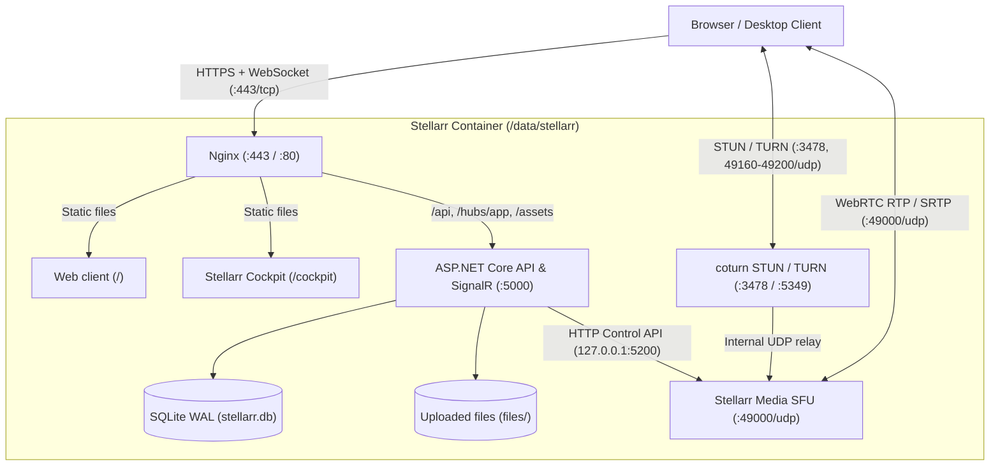

# Architecture

Stellarr runs inside a single Docker container backed by one persistent volume (`/data/stellarr`). All HTTP and WebSocket traffic enters through Nginx, while WebRTC voice and video go directly to `stellarr-media` (or through `coturn` when direct UDP fails).

See [Voice and RTC protocol](./rtc-protocol.md) for client state and SignalR signaling, and [Stellarr Media](./stellarr-media.md) for the Rust SFU media server.

## System overview



## Component responsibilities

- **Browser apps (`web/`)**: One Vite build emits the web client (`web/index.html`) and Cockpit (`web/cockpit/index.html`) as static files in `web/dist/`. Nginx serves them from `/opt/stellarr/web`, so no Node.js runtime ships in production. Each app has its own `main.tsx`, `routes.tsx` ([`@stellarr/router`](../packages/stellarr-router/README.md)), and `pages/` and imports nothing from the other. In development, `npm run dev` serves both.
- **Web client (`web/src/stellarr/`)**: Browser client for text, voice, and video. Bootstrap scripts apply the saved theme and locale before first paint (see [Localization](./localization.md)). React UI consumes `VoiceState` snapshots and calls `VoiceClient`.
- **Stellarr Cockpit (`web/src/cockpit/`)**: Standalone operator SPA at `/cockpit`, backed by `/api/cockpit/*` endpoints requiring the owner role, with its own locale setting.
- **ASP.NET Core (`server/Stellarr.Api`)**: Control plane for auth, sessions, servers, channels, messages, uploads, presence, notifications, backups, and SignalR signaling. Opens and closes SFU sessions on `stellarr-media` over `127.0.0.1:5200` and relays SDP/ICE negotiation.
- **Operator CLI (`server/Stellarr.Cli`)**: The `stellarr` binary for checking health, editing settings and encrypted secrets, managing sessions/security, and staging backup restores directly on `/data/stellarr`. See [Operator CLI](./admin/cli.md).
- **SQLite**: Stores relational application state in WAL mode (`db/stellarr.db`). Binary files are never stored in SQLite.
- **Uploaded files**: Plain files under `/data/stellarr/files/` by object key (for example, `audio/2026/11/<id>.webm`). Uploads write to `files/.incoming/`, flush to disk, and move atomically into place. The API authorizes and streams every download.
- **coturn**: Stateless STUN and HMAC-authenticated TURN relay forwarding allocations to the local `stellarr-media` UDP socket.
- **Stellarr Init (`init/`, Rust)**: PID 1 supervisor (`stellarr-init`). Starts services in dependency order (`media` before `api`), checks readiness every 10 s, restarts exited processes with backoff up to 30 s, reaps zombies, and stops services in reverse order on shutdown. See [Container services](#container-services-stellarr-init).
- **Stellarr Media (`media/`, Rust)**: Selective Forwarding Unit (SFU) on UDP `49000` using ICE-lite and DTLS-SRTP. Forwards microphone, camera, and screen-share RTP packets without transcoding or mixing, handling per-leg RTCP feedback and per-receiver downlink adaptation.

> [!NOTE]
> Because `stellarr-media` terminates DTLS-SRTP on each leg to forward packets, call audio and video are decrypted in `stellarr-media` memory on your host rather than end-to-end encrypted between browsers.

## Account security

- **Unified authentication**: Password, passkey, registration, OIDC sign-in, and desktop handoff resolve through one decision, issuing either a revocable session or a short-lived browser-bound challenge when a second step or enrollment is required.
- **Session properties**: Sessions record their sign-in origin, latest second-step timestamp, security version, and absolute expiry. Unchecking **Keep me signed in** issues a browser-session cookie capped at 12 hours server-side.
- **Second factors and secrets**: Supports TOTP apps, email codes, passkeys/hardware keys (Fido2 checked against `Operations:PublicUrl`, never `Host`), and single-use recovery codes. TOTP seeds and email codes are encrypted with `/data/stellarr/keys`; recovery codes and trusted-device tokens are stored only as digests.
- **High-risk actions and live revocation**: Sensitive instance/account changes require a second step completed within the last 5 minutes in the same session (trusted devices do not qualify). The API polls session/role revocations at most once per second and immediately closes matching SignalR and media connections. See [Account security](./admin/account-security.md).

## Server authorization

HTTP handlers and SignalR checks evaluate permissions through `ServerAuthorization` (`ServerAccess`) directly against SQLite, without caching, using `PermissionScope` (server, section, or channel). Missing resources, disabled accounts, and missing memberships always deny access.

- **Inheritance**: Effective permissions start from the member's base server role, then apply section overrides, then channel overrides. At each level, an explicit deny overrides an allow; a channel override can replace an inherited section decision.
- **Role hierarchy**: Lower role position values represent higher rank; equal positions do not outrank one another. The owner role's base permissions are immutable (and the owner can repair legacy overrides on their own role).
- **Delegation checks**: Managing roles, assigning roles, setting overrides, reparenting channels, and moderating members/voice all enforce both rank hierarchy and possession of every affected permission bit:

| Operation | Authorization rules |
| --- | --- |
| Create role | Base `manageRoles`; actor must hold every granted bit in their base role (new roles sit below existing roles). |
| Edit or delete role | Base `manageRoles`; must outrank the role and hold both existing and proposed bits (including live scoped grants). Deletion also checks the fallback role. |
| Assign role | Base `manageMembers`; must outrank and hold all rights of both current and target roles (self-assignment and owner assignment are forbidden). |
| Set or clear override | Base and scoped `manageRoles`; must outrank the role and hold all bits in both old and new allow/deny masks (including removing a deny). |
| Move channel across sections | Manage source channel and destination section/server; if effective role permissions change, enforces full delegation, hierarchy, and bit checks across both contexts. |
| Kick or ban member | Server permission + lower-ranked target; cannot target self or owner. |
| Kick or move in voice | Scoped `moderateMembers` + hierarchy; moves validate both source and destination voice channels. |

Mutations commit together with audit entries in a single database transaction before emitting realtime notifications. On the primary instance server, role and override changes also require a fresh second step under the active MFA policy.

The web client tracks its selected server per tab and passes it explicitly on HTTP and SignalR calls.

## Single-container deployment

`stellarr-init` supervises all five container processes (`media`, `api`, `turn`, `nginx`, `tls-maintenance` defined in `init/src/services.rs`) behind `/data/stellarr`. See [`init/README.md`](../init/README.md) for control socket details.

> [!TIP]
> Keeping all services in one container reduces deployment and backup to a single volume. If you later need dedicated media hardware, `stellarr-media` and `coturn` communicate only over network protocols and can be separated without changing browser clients.

### Container services (`stellarr-init`)

```bash
docker compose exec stellarr stellarr-init status          # state, PID, restarts, uptime
docker compose exec stellarr stellarr-init status --json   # JSON output for scripts
docker compose exec stellarr stellarr-init health          # exits 0 only when healthy
docker compose exec stellarr stellarr-init restart api     # restart one service immediately
docker compose exec stellarr stellarr-init reload nginx    # reload Nginx config and TLS cert
```

| State | Meaning |
| --- | --- |
| `waiting` | Waiting on a dependency (for example, `api` waits for `media`). |
| `starting` | Process started; readiness probe has not succeeded yet. |
| `ready` | Running and passing readiness checks. |
| `failing` | Missed three consecutive checks (~45 s); marks the container unhealthy without restarting a slow process. |
| `backoff` | Exited and waiting before restart (1 s to 30 s). |
| `stopping`, `stopped` | Shutting down or stopped during restart/exit. |

All service logs go to container stdout/stderr (`docker compose logs`), including `stellarr-init:` state transitions. Routine health probes write no log lines, and Nginx disables access logging because API requests are logged by the API itself.

### Nginx routing

Nginx exposes one HTTPS origin, proxies `/api/`, `/assets/`, `/health`, `/hubs/`, and `/.well-known/stellarr/client` to ASP.NET Core (`127.0.0.1:5000`), and serves `/stellarr-instance.js` plus static files in `/opt/stellarr/web` (including `/bergamot-models/` and `/codecs/bergamot/`):

- Asset directories (`/static/`, `/bergamot-models/`, etc.) and paths with a dot in the final segment return a plain `404` when missing.
- `/cockpit` and paths under it serve Cockpit's `index.html`.
- Known web-client routes (`/`, `/login`, `/invite/<code>`, etc., matching `web/src/stellarr/routes.tsx`) serve the web client's `index.html`.
- Any other path returns the web client's `index.html` with HTTP `404` so the app renders its not-found view.
