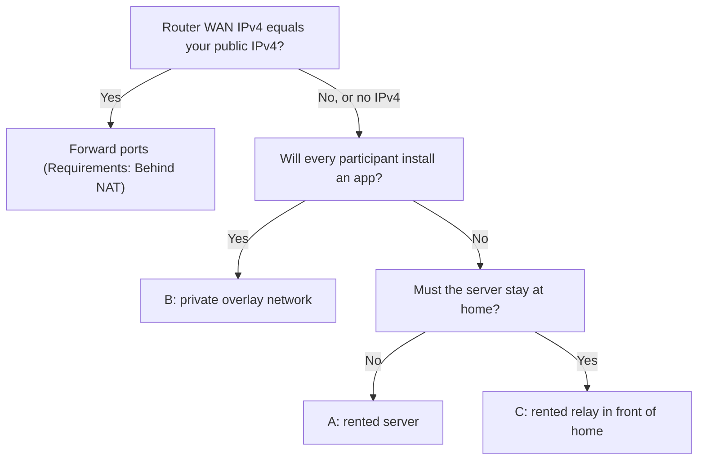
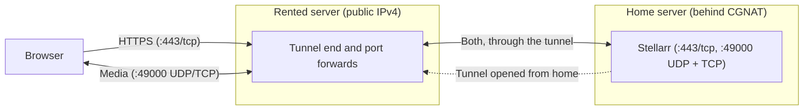

# Hosting without port forwarding

The setups in [Requirements: Behind NAT](requirements.md#behind-nat) assume a router you can forward ports on and a public IPv4 address on its internet side. This page is for a host who has neither, typically because the provider puts the connection behind carrier-grade NAT (CGNAT), and for anyone whose friends can open the page but hear nothing in calls.

A call works only when every participant's browser can reach **two** addresses. The web address must also be served over HTTPS, because browsers restrict the microphone, camera and screen capture to secure contexts ([Browser requirements](requirements.md#browser-requirements)):

| Address | Transport | Carries | Set by |
| --- | --- | --- | --- |
| **Web address** (`https://STELLARR_DOMAIN`) | `443/tcp` | Web client, sign-in, chat, call signalling (`/hubs/app` WebSocket) | `STELLARR_DOMAIN`, `STELLARR_PUBLIC_PORT` |
| **Media address** (`<ip>:STELLARR_MEDIA_PORT`) | `49000/udp`, falling back to `49000/tcp` | Voice, video, screen share, straight from each browser to `stellarr-media` | `STELLARR_PUBLIC_IP`, `STELLARR_MEDIA_LAN_IP`, `STELLARR_MEDIA_ADVERTISE` |

Media never travels through the web address or an HTTP proxy ([What bypasses the HTTP reverse proxy](reverse-proxy-and-tls.md#what-bypasses-the-http-reverse-proxy)). A tunnel that carries only HTTPS gives a page that loads and a call that stays silent.

## How the media address is chosen

`stellarr-media` puts a list of IPv4 `ip:port` host candidates in the SDP it sends each browser, and the browser tries to reach them. The container builds the list at startup:

| Source | Advertised as | Notes |
| --- | --- | --- |
| `STELLARR_PUBLIC_IP=<ipv4>` | `<ipv4>:STELLARR_MEDIA_PORT` | First in the list. Browsers are told this address whatever address the host's own network interface has. |
| `STELLARR_PUBLIC_IP=auto` | The IPv4 that `STELLARR_DOMAIN` resolves to inside the container | The container refuses to start when the name does not resolve to an IPv4 address. |
| `STELLARR_PUBLIC_IP` unset | `STELLARR_DOMAIN` when it is a numeric IPv4; `127.0.0.1` when the domain is unset (`localhost`) | A hostname in `STELLARR_DOMAIN` alone adds nothing. |
| `STELLARR_MEDIA_LAN_IP=<ipv4>` | `<ipv4>:STELLARR_MEDIA_PORT` | Second, for callers on the host's LAN. |
| Always | The container's own address on `49000` | Not reachable from other devices; optional TURN relays to it. |
| `STELLARR_MEDIA_ADVERTISE=<ip:port,...>` | Exactly the listed entries | Replaces the whole list above, the container's own address included. |

Every value must be IPv4 (see [IPv6](#ipv6)). Read the result from the startup log:

```bash
docker compose logs stellarr | grep -e 'candidates=' -e 'advertises only'
```

```txt
INFO stellarr_media::server: stellarr-media is running control=127.0.0.1:5200 media=0.0.0.0:49000 candidates=[203.0.113.10:49000, 172.18.0.2:49000] epoch=…
```

When the list holds only the container's own address, the entrypoint warns first. Calls cannot work from other devices in that state:

```txt
STELLARR_PUBLIC_IP is empty, so the media server advertises only this container's own address. Browsers outside the container network need a reachable media candidate. Set STELLARR_PUBLIC_IP to the IPv4 address browsers reach this host at, or to 'auto'.
```

`GET /api/bootstrap` does not show the advertised address: its `rtc.mediaServer` is built from `STELLARR_DOMAIN` and `STELLARR_MEDIA_PORT`.

---

## Are you behind carrier-grade NAT?

1. Open your router's admin page and find the IPv4 address on its internet side (often labelled **WAN** or **Internet**).
2. From a device on the same network, open any "what is my IP" page and note the IPv4 address it shows.
3. Compare the two:

| Router's WAN IPv4 | What it means |
| --- | --- |
| Same as the "what is my IP" address | You have a public IPv4 address. Forward the ports as in [Requirements: Behind NAT](requirements.md#behind-nat); this page is not needed. |
| In `100.64.0.0/10` (`100.64.0.0` to `100.127.255.255`) | Carrier-grade NAT. [RFC 6598](https://www.rfc-editor.org/rfc/rfc6598) reserves this range for the links between a provider's CGN devices and customer routers. Nothing you forward on your router reaches it from the internet. |
| A private address (`10.x.x.x`, `172.16.x.x`–`172.31.x.x`, `192.168.x.x`) | Another router sits in front of yours. Forward the ports on that one as well; if you cannot reach it, ask the provider. |
| Any other address that differs | The provider translates your address somewhere. Ask the provider. |
| No IPv4 address, only IPv6 | Calls still need an IPv4 media address; see [IPv6](#ipv6). |

> [!NOTE]
> Tailscale also hands out addresses from `100.64.0.0/10` ([Tailscale: IP addresses](https://tailscale.com/kb/1015/100.x-addresses)). A `100.x` address on your computer's own network interface says nothing about your provider. Check the router's WAN address.

To be sure, ask the provider two questions: is the connection behind carrier-grade NAT, and can it get a public IPv4 address? If it can, the port-forwarding setup in [Requirements](requirements.md#behind-nat) applies.

## Choose a path



| Situation | Recommended path | Who installs something | What it costs |
| --- | --- | --- | --- |
| **Public IPv4, ports can be forwarded** | [Requirements: Behind NAT](requirements.md#behind-nat) | Host only | Nothing extra |
| **CGNAT; friends should only open a link** | [A: rented server](#a-run-stellarr-on-a-rented-server) | Host only | Server rent and a domain name |
| **CGNAT; a small group that will install an app** | [B: private overlay network](#b-a-private-overlay-network-tailscale) | Every participant, on every device | Tailscale's free Personal plan covers up to 6 users ([pricing](https://tailscale.com/pricing), November 2026) |
| **CGNAT; the server must stay at home** | [C: relay in front of a home server](#c-a-rented-relay-in-front-of-a-home-server) | Host only, on two machines | Server rent, a domain name, and a tunnel to maintain |
| **Only an HTTP tunnel is available** | [D: does not work](#d-what-does-not-work) | — | — |

Path A is the plain answer behind carrier-grade NAT: it is the deployment the rest of the documentation describes, with the home connection taken out of it. Path B needs no rent and no domain and keeps the instance private, at the price of an app on every device. Path C keeps the hardware and data at home but has the most parts that can break.

---

## A: Run Stellarr on a rented server

A small server with its own public IPv4 address has nothing in front of it to forward through. Friends open a link and need nothing else.

| | |
| --- | --- |
| **Who installs** | The host, on the server |
| **Cost** | Server rent, plus a domain name (or a subdomain you control) pointed at the server; a browser-trusted certificate needs a DNS name |
| **Server** | Public IPv4 address; Docker Engine + Compose `2.24.0+`; `linux/amd64` or `linux/arm64`; `2 GiB+` RAM recommended (CI smoke-tested in `512 MiB` RAM and `1` CPU); `2 GiB+` free disk plus room for uploads (see [Host sizing](requirements.md#host-sizing)) |

### Steps

1. Create a DNS `A` record for `chat.example.com` pointing at the server's IPv4 address.
2. In the provider's firewall and on the server, allow `443/tcp`, `49000/udp` and `49000/tcp`. When Caddy obtains the certificate, allow `80/tcp` as well: its automatic HTTPS needs ports `80` and `443` reachable from the internet ([Caddy: Automatic HTTPS](https://caddyserver.com/docs/automatic-https)).
3. Install Stellarr as in the [Quick start](quick-start.md), with these settings in `.env`:

   ```dotenv
   STELLARR_DOMAIN=chat.example.com
   STELLARR_PUBLIC_IP=auto
   ```

   `auto` resolves the `A` record at startup; an explicit `STELLARR_PUBLIC_IP=203.0.113.10` works the same.
4. Give the web address a trusted certificate with one of the two setups in [Reverse proxy and TLS](reverse-proxy-and-tls.md): Caddy in front (which adds `STELLARR_PUBLIC_PORT`, `STELLARR_HTTPS_PORT`, `STELLARR_HTTP_PORT` and `STELLARR_TRUSTED_PROXIES`), or a mounted CA certificate.
5. Set up [automatic backups](../admin/backups.md): the instance's data now lives on the rented server.

### Confirm

```bash
docker compose logs stellarr | grep -e 'Resolved STELLARR_DOMAIN' -e 'candidates='
curl https://chat.example.com/health
```

The log names the server's public address first (`Resolved STELLARR_DOMAIN=chat.example.com to the external IPv4 203.0.113.10 for media.` and `candidates=[203.0.113.10:49000, …]`), and `/health` answers `{"status":"ready"}`. Then run the [two-device check](#check-it-from-outside).

---

## B: A private overlay network (Tailscale)

Every device joins one private network, and the Stellarr host is reachable inside it at a stable `100.x` address and a name under `ts.net` with a Let's Encrypt certificate. No router rule is needed. Tailscale is the worked example; the same settings apply to any overlay that gives the host a stable IPv4 address and a trusted HTTPS name.

> [!IMPORTANT]
> Every participant needs the Tailscale client installed and connected on every device they call from, phones included ([download](https://tailscale.com/download)). Without it the web address does not load at all.

| | |
| --- | --- |
| **Who installs** | The host and every participant |
| **Cost** | Tailscale's Personal plan is free for up to 6 users ([pricing](https://tailscale.com/pricing), as listed in November 2026); invited users who join and transfer data count towards billing |
| **Router** | Nothing to forward |

### Steps

1. Install Tailscale on the Stellarr host and sign in.
2. In the Tailscale admin console, enable **MagicDNS**, then **HTTPS Certificates** ([Enabling HTTPS](https://tailscale.com/kb/1153/enabling-https)). The tailnet's DNS name and the name of every machine you request a certificate for then appear in the public Certificate Transparency logs, so do not use it with machine names that hold anything sensitive.
3. Read the host's overlay address and certificate name:

   ```bash
   tailscale ip -4                                   # e.g. 100.101.102.103
   tailscale status --json | grep -A2 CertDomains    # e.g. stellarr.tail1234.ts.net
   ```

4. In the directory that holds `docker-compose.yml`, write the certificate where Stellarr reads it ([`tailscale cert`](https://tailscale.com/kb/1080/cli)):

   ```bash
   mkdir -p certs
   sudo tailscale cert --cert-file certs/fullchain.pem --key-file certs/privkey.pem \
     stellarr.tail1234.ts.net
   ```

   Then mount `./certs` as described in [Mount a custom TLS certificate](reverse-proxy-and-tls.md#mount-a-custom-tls-certificate).
5. Set the overlay name and address in `.env`:

   ```dotenv
   STELLARR_DOMAIN=stellarr.tail1234.ts.net
   STELLARR_PUBLIC_IP=100.101.102.103
   ```

   Prefer the explicit address to `auto`: `auto` resolves the name inside the container, and whether the container can resolve a `ts.net` name depends on how Docker forwards DNS on the host. Prefer `STELLARR_PUBLIC_IP` to `STELLARR_MEDIA_ADVERTISE`, which would also drop the container address that optional TURN relays to.
6. Apply the settings with `docker compose up -d`.
7. Bring the others in, either way:
   - **Invite them to your tailnet** (Users → **Invite external users** in the admin console); each person opens the invite, signs in and installs the client ([Invite any user](https://tailscale.com/docs/features/sharing/how-to/invite-any-user)). The default access policy lets every device in a tailnet reach every other device ([access control](https://tailscale.com/kb/1018/acls)); restrict it if your tailnet holds more than the Stellarr host.
   - **Share only the Stellarr host** with people who keep their own tailnet ([Sharing](https://tailscale.com/kb/1084/sharing)). They reach it by its full name, which matches the certificate. Its IPv4 address in their tailnet is typically the same as in yours, but Tailscale assigns another when that address is already taken there. Stellarr advertises one address, so for such a person calls stay silent; check with `tailscale ip -4 stellarr.tail1234.ts.net` on their device, which should print the address in `STELLARR_PUBLIC_IP`.
8. Send everyone `https://stellarr.tail1234.ts.net`.

### Confirm

```bash
docker compose logs stellarr | grep candidates=
# … candidates=[100.101.102.103:49000, 172.18.0.2:49000] …

# From another device in the tailnet, with no -k: the certificate must be trusted.
curl https://stellarr.tail1234.ts.net/health
echo | openssl s_client -connect stellarr.tail1234.ts.net:443 -servername stellarr.tail1234.ts.net 2>/dev/null \
  | grep -E 'issuer=|Verify return code'
```

Expect `{"status":"ready"}` and `Verify return code: 0 (ok)`, then run the [two-device check](#check-it-from-outside).

`tailscale status` shows whether a participant's device reaches the host `direct` or through a `relay`. Relayed (DERP) connections are generally slower than direct ones and may offer lower throughput ([Connection types](https://tailscale.com/kb/1257/connection-types)).

### Renewing the certificate

Let's Encrypt certificates from `tailscale cert` expire after 90 days, and renewing them is up to you ([Enabling HTTPS](https://tailscale.com/kb/1153/enabling-https)). Before then, run the command from step 4 again with `--min-validity=720h`, which asks for a certificate with at least 30 days left, and reload Nginx:

```bash
sudo tailscale cert --min-validity=720h --cert-file certs/fullchain.pem --key-file certs/privkey.pem \
  stellarr.tail1234.ts.net
docker compose exec stellarr stellarr-init reload nginx
```

---

## C: A rented relay in front of a home server

Stellarr stays at home; a rented server with a public IPv4 address receives the traffic and passes it through a tunnel that the home server opens outwards, so carrier-grade NAT does not stand in the way. Friends install nothing.



This page gives no configuration for a particular tunnel; set it up from the tool's own documentation, for example [WireGuard](https://www.wireguard.com/), which encapsulates IP packets over UDP, or [frp](https://github.com/fatedier/frp), whose `tcp` and `udp` proxy types expose a port of the home machine on the public server. Whatever the tool, the setup is complete only when:

| Requirement | Why |
| --- | --- |
| The relay forwards `443/tcp`, `49000/udp` and `49000/tcp` to the home server | Both addresses must be reachable; UDP is the preferred media path and TCP the fallback. |
| The media port number is the same on the relay and at home | Browsers are told `STELLARR_MEDIA_PORT` as it is; change both ends together. |
| `STELLARR_DOMAIN` has an `A` record pointing at the relay, and `STELLARR_PUBLIC_IP` is the relay's IPv4 address (or `auto`) | The relay's address is the media address browsers must reach. |
| Replies to browsers leave through the tunnel | ICE fails a connectivity check whose response comes from a different address than the request was sent to ([RFC 8445, 7.2.5.2.1](https://www.rfc-editor.org/rfc/rfc8445#section-7.2.5.2.1)). A proxying tool sends replies back the same way; with port forwarding over a routed tunnel, the relay must translate the source address or the home server must route replies back into the tunnel. |
| The web address has a trusted certificate | Either Stellarr's own TLS with a [mounted CA certificate](reverse-proxy-and-tls.md#mount-a-custom-tls-certificate) and `443/tcp` forwarded as is, or a [reverse proxy](reverse-proxy-and-tls.md#run-behind-a-reverse-proxy) on the relay that forwards HTTP through the tunnel to `STELLARR_HTTP_PORT` bound to the home server's tunnel address. |

> [!WARNING]
> When the relay forwards `443/tcp` at the network level and replaces the source address, Stellarr sees the relay's address for every visitor, and everyone shares one per-IP rate-limit bucket ([Client addresses](reverse-proxy-and-tls.md#client-addresses)). A reverse proxy on the relay adds `X-Forwarded-For`; list the address the container sees it connect from in `STELLARR_TRUSTED_PROXIES` ([Finding and pinning the proxy IP](reverse-proxy-and-tls.md#finding-and-pinning-the-proxy-ip)).

Confirm as in [path A](#confirm): the `candidates=` line must start with the relay's address, and the [two-device check](#check-it-from-outside) must pass.

---

## D: What does not work

A tunnel or proxy that carries only HTTP(S) gives the web address a public name, but not the media address: the page loads, sign-in and chat work, and calls stay silent. Products as their own documentation describes them (November 2026):

| Product | What it carries | Why calls fail |
| --- | --- | --- |
| **Cloudflare Tunnel** (published application) | HTTP and HTTPS; TCP, SSH, RDP and SMB only with `cloudflared` installed on the visitor's device; no UDP service type ([protocols](https://developers.cloudflare.com/cloudflare-one/networks/connectors/cloudflare-tunnel/routing-to-tunnel/protocols/)) | Browsers cannot reach a media address through it. For private applications that use UDP, such as VoIP, Cloudflare recommends Cloudflare Mesh instead ([connectivity options](https://developers.cloudflare.com/cloudflare-one/networks/connectivity-options/)), which this page does not cover. |
| **Cloudflare proxied DNS** (orange cloud) | HTTP(S) | The host still needs its own reachable IPv4 for media ([Reverse proxy and TLS](reverse-proxy-and-tls.md#what-bypasses-the-http-reverse-proxy)). UDP through Cloudflare Spectrum is a paid add-on on Enterprise only, not on Free, Pro or Business ([Spectrum protocols per plan](https://developers.cloudflare.com/spectrum/protocols-per-plan/)). |
| **Tailscale Funnel** | HTTPS, a TCP forwarder and a TLS-terminated TCP forwarder, on public ports `443`, `8443` and `10000` only; no UDP option; non-configurable bandwidth limits ([Funnel](https://tailscale.com/kb/1223/funnel), [`tailscale funnel`](https://tailscale.com/kb/1311/tailscale-funnel)) | No UDP, and the media port cannot be published as `49000`. Inside a tailnet, use path B instead. |
| **ngrok** | HTTP, HTTPS, TCP and TLS endpoints; ngrok states it does not support UDP ([ngrok vs. Tailscale](https://ngrok.com/compare/tailscale)) | No UDP. A TCP address is a host and port that ngrok assigns, and free accounts can open TCP endpoints only on random addresses after adding a payment method ([TCP addresses](https://ngrok.com/docs/gateway/domains/tcp-addresses)). |

A tunnel that carries raw TCP could in principle reach the media server's TCP fallback, but it would lose the preferred UDP path, and it is not a supported or tested configuration.

### The built-in TURN relay does not help

The optional TURN relay ([RTC and ports](../rtc-and-ports.md#optional-turn-relay)) is for callers whose own networks block `49000`. It does not help a host behind carrier-grade NAT:

- `coturn` runs in the same container, and its ports (`3478`, `5349`, `49160-49200/udp`) are published on the same host, so the provider's NAT blocks them exactly as it blocks `49000`.
- It relays only to the container's own local addresses (`allowed-peer-ip`), never to another server.
- The client receives only this instance's TURN server, at `STELLARR_DOMAIN`, with credentials signed by its own secret; an outside TURN service cannot be configured.

---

## IPv6

The media server advertises IPv4 only. `STELLARR_PUBLIC_IP`, `STELLARR_MEDIA_LAN_IP` and `STELLARR_MEDIA_ADVERTISE` refuse IPv6 values at startup (`STELLARR_PUBLIC_IP must be an IPv4 address or the value 'auto'.`), and IPv6 media sockets are not implemented ([Stellarr Media](../stellarr-media.md)).

Container Nginx also listens on IPv6, so where Docker publishes ports on IPv6 the web address can load over it. A call still needs an IPv4 media address every participant can reach. A connection with a public IPv6 address but carrier-grade NAT for IPv4 therefore needs one of the paths above.

---

## Check it from outside

Join the same voice channel from two devices: a phone on mobile data, with Wi-Fi off (and Tailscale connected for path B), and a computer. Talk in both directions. The phone's mobile connection is a network outside yours, so it exercises both addresses as a friend would.

| What you see | What it means | Where to look |
| --- | --- | --- |
| **The page does not load on the phone** | The web address is not reachable from outside. | DNS record, `443/tcp` firewall or relay forward; for path B, the phone's Tailscale client. |
| **The browser warns about the certificate** | The web address has no browser-trusted certificate. Fix it before testing calls. | [Reverse proxy and TLS](reverse-proxy-and-tls.md) or the [Tailscale certificate](#b-a-private-overlay-network-tailscale). |
| **Voice calls are unavailable**: "This browser does not support voice calls." | The browser offers no microphone API, which happens on a page that is not a secure context, such as `http://` from another device. | Open the `https://` address. |
| **Microphone is not working** | Permission or device problem on that device, not the network. | The site permissions beside the address bar. |
| **Call audio problem**: "Lost the connection to the media server. Reconnect to continue." | The page works but the media address is unreachable; the client replaced the failed connection three times and gave up. | The `candidates=` log line, then `49000/udp` and `49000/tcp` along the path. |
| **Call audio problem**: "The connection to the media server is not carrying any audio." | A connection to the media server opened, but no media flows over it. | [RTC and ports: Diagnostics](../rtc-and-ports.md#diagnostics). |
| **Call audio problem**: "The media server is connected, but audio from one or more people is not reaching you." | Your device works; the media of one of the others does not arrive. | Run the check from that person's device. |
| **Both hear each other** | Both addresses work from outside. | — |

The call problems carry **Reconnect** and **Copy diagnostics for the host**. The copied report holds the signalling and media status, participant counts and the latest round-trip time, loss and bitrate; ask friends to send it with their description. For the host-side checks, see [RTC and ports: Diagnostics](../rtc-and-ports.md#diagnostics).
