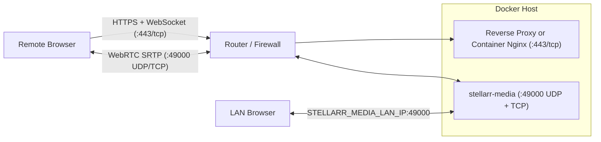

# Requirements

Stellarr ships as a single Docker container with zero external database, cache, or media-server dependencies. For a local walkthrough, start with the [Quick start](quick-start.md).

## Host sizing

| Resource | Requirement | Notes |
| --- | --- | --- |
| **Runtime** | Docker Engine + Compose `2.24.0+` | Verify with `docker compose version` |
| **Architecture** | `linux/amd64` or `linux/arm64` | Multi-arch image on GHCR |
| **Memory** | `2 GiB+` host RAM recommended | ~35 MiB container RSS at idle; `4 GiB` default cap (`STELLARR_CONTAINER_MEMORY_LIMIT`); CI smoke-tested inside `512 MiB` RAM and `1` CPU |
| **CPU** | `1+` cores (`4` CPU default cap) | Controlled via `STELLARR_CONTAINER_CPUS` |
| **Process limit** | `512` PIDs | Controlled via `STELLARR_CONTAINER_PIDS_LIMIT` |
| **Disk** | `2 GiB+` free minimum | ~390 MB unpacked image (~152 MB compressed) plus `/data/stellarr` |

### Storage quotas

Uploads reserve space before writing to disk and enforce three independent limits (see [Uploads and quotas](configuration.md#uploads-and-quotas)):

- **Per-account quota:** `2 GiB` (`STELLARR_UPLOAD_USER_BYTES`, editable live in **Cockpit → Settings → File storage**)
- **Instance quota:** `20 GiB` (`STELLARR_UPLOAD_TOTAL_BYTES`)
- **Free-disk floor:** `1 GiB` (`STELLARR_MIN_FREE_BYTES` must remain free on `/data/stellarr` after every upload)

## Ports

| Default binding | Transport | Service | Variable |
| --- | --- | --- | --- |
| `443` | TCP | HTTPS web client, Cockpit, REST API, and `stellarr.v1` WebSocket hub | `STELLARR_HTTPS_PORT` |
| `49000` | UDP + TCP | `stellarr-media` WebRTC SFU (direct UDP and passive ICE-TCP) | `STELLARR_MEDIA_PORT` |
| `127.0.0.1:8888` | TCP | Local HTTP upstream for an external reverse proxy | `STELLARR_HTTP_PORT` |

Optional STUN/TURN ports (`3478`, `5349`, `49160–49200/udp`) are published only when you include `infra/compose/turn.yml`. See [RTC and ports](../rtc-and-ports.md#published-host-ports) for internal loopback ports and relay sizing.

## Behind NAT

WebRTC media packets flow directly between each browser and `stellarr-media`—never through an HTTP reverse proxy. Browsers outside the Docker host need a reachable IPv4 candidate advertised in SDP.

| Deployment scenario | Required `.env` settings | Firewall & router rules |
| --- | --- | --- |
| **Local machine only** | Defaults (`localhost`) | None; advertises `127.0.0.1:49000` |
| **LAN only** | `STELLARR_DOMAIN=<LAN-IP>` (or hostname + `STELLARR_PUBLIC_IP=<LAN-IP>`) | Allow `443/tcp`, `49000/udp`, and `49000/tcp` on the host firewall; no router forwarding needed |
| **Internet behind NAT** | `STELLARR_DOMAIN=chat.example.com` and `STELLARR_PUBLIC_IP=auto` (or static WAN IPv4) | Forward `443/tcp` (to Stellarr or your [reverse proxy](reverse-proxy-and-tls.md#run-behind-a-reverse-proxy)) and `49000/udp` + `49000/tcp` (1:1 external-to-host port) |
| **Split LAN + WAN (no NAT hairpin)** | Add `STELLARR_MEDIA_LAN_IP=<LAN-IP>` alongside `STELLARR_PUBLIC_IP` | Advertises both WAN and LAN IPv4 candidates on `STELLARR_MEDIA_PORT` |

See [RTC and ports: NAT and firewall configuration](../rtc-and-ports.md#nat-and-firewall-configuration) for explicit `STELLARR_MEDIA_ADVERTISE` overrides, TURN relay setup, and call diagnostics.

## Domain and TLS

When `STELLARR_DOMAIN` is unset, TLS certificate generation and the optional TURN realm default to `localhost`. On first start, the container generates a 365-day RSA-3072 self-signed certificate for `STELLARR_DOMAIN` and renews it automatically. For remote access, mount a CA-signed certificate or place Caddy/Nginx in front of the container as covered in [Reverse proxy and TLS](reverse-proxy-and-tls.md).

## Browser requirements

> [!IMPORTANT]
> Browsers restrict microphone, camera, and screen capture (`getUserMedia`, `getDisplayMedia`), Service Workers, Web Push, and WebCrypto to **secure contexts** (`https://` or `http://localhost`). Remote instances must be served over HTTPS.

Optional 1:1 end-to-end encrypted voice and video calls additionally require WebRTC Encoded Transform (`RTCRtpScriptTransform` or `createEncodedStreams`) and WebCrypto `X25519`.

## Outbound network

Stellarr makes zero telemetry, license, or asset requests to external servers. Outbound traffic occurs only for features you enable:

| Feature | Default | Outbound behavior |
| --- | --- | --- |
| **Voice DSP & chat translation** | Offline | Web client, fonts, audio worklets, WASM suppressors (`rnnoise`, `gtcrn`, `speex`), and Bergamot `en`↔`pl` models ship inside the image and load from the instance origin. |
| **Link previews** (`Stellarr__Embeds__Enabled`) | `true` | Server unfurls up to 2 public HTTP(S) URLs per channel message (`6 s` timeout, private/loopback IPs blocked) and stores thumbnails locally so reader browsers never ping external hosts. Set `Stellarr__Embeds__Enabled=false` in `.env` for zero outbound fetches (YouTube/Vimeo player stubs still render locally). |
| **Mail, OIDC, Web Push, R2** | `false` / unset | Server connects to your configured SMTP/Resend relay, OIDC authority, browser push endpoints, or Cloudflare R2 endpoint when enabled. |
| **GIPHY picker** (`STELLARR_GIPHY_API_KEY`) | unset | Server calls `api.giphy.com` only when testing a key in Cockpit. Signed-in browsers query GIPHY when opening the GIF picker unless disabled in the user's privacy settings. |
