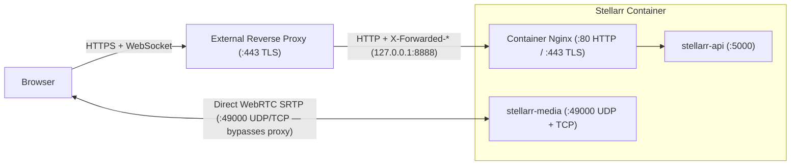

# Reverse proxy and TLS

Stellarr terminates TLS out of the box with an auto-renewing 365-day self-signed certificate. For remote deployments that require browser-trusted HTTPS (mandatory for WebRTC media capture, Service Workers, passkeys, and Web Push), choose one of two setups:

1. **Mount a CA-signed certificate** into `/data/stellarr/tls` and expose container port `443/tcp` directly.
2. **Terminate TLS on an external reverse proxy** (Caddy, Nginx, Nginx Proxy Manager) forwarding HTTP to `127.0.0.1:8888`.



---

## Mount a custom TLS certificate

Container Nginx and `coturn` read their certificate pair from `/data/stellarr/tls/`:

| Container path | Format |
| --- | --- |
| `/data/stellarr/tls/fullchain.pem` | PEM leaf certificate followed by intermediate CA certificates |
| `/data/stellarr/tls/privkey.pem` | Unencrypted PEM private key |

Operator-mounted CA certificates are never overwritten. On boot (`stellarr-tls-maintenance prepare`) and every 12 hours (`STELLARR_TLS_RENEW_CHECK_SECONDS`), Stellarr checks whether the certificate on disk is container-managed (`.stellarr-self-signed` marker + `subject == issuer`). Unreadable or mismatched CA pairs exit with code `1`; CA certificates expiring within 7 days log a startup warning.

### Setup steps

1. Place `fullchain.pem` and `privkey.pem` as regular files inside `./certs/` next to `docker-compose.yml`.
2. Mount the directory read-only in `docker-compose.override.yml`:

   ```yaml
   services:
     stellarr:
       volumes:
         - ./certs:/data/stellarr/tls:ro
   ```

3. Set `STELLARR_DOMAIN` in `.env` to match the certificate hostname and recreate the container:

   ```bash
   docker compose up -d
   ```

4. Verify the served chain (`Verify return code: 0 (ok)`):

   ```bash
   echo | openssl s_client -connect chat.example.com:443 -servername chat.example.com 2>/dev/null \
     | grep -E 'issuer=|Verify return code'
   ```

> [!WARNING]
> Bind-mount the **directory** (`./certs:/data/stellarr/tls:ro`), never individual `.pem` files—single-file bind mounts pin the old inode across atomic renewals. For Certbot `live/` symlinks, copy dereferenced files (`cp -L`) into `./certs/` via a renewal deploy hook.

### Reloading after certificate renewal

```bash
docker compose exec stellarr stellarr-init reload nginx
docker compose exec stellarr stellarr-init restart turn   # only if TURN is enabled
```

Verify service readiness with `docker compose exec stellarr stellarr-init status` (see [Container services](../architecture.md#container-services-stellarr-init)). Note that `coturn` cannot reload TLS certificates on `SIGHUP`, so restarting `turn` briefly reconnects relayed voice callers.

### TURN over TLS (`turns:`)

When optional TURN is enabled, `STELLARR_TURNS_ENABLED=true` serves TURN over TLS/DTLS on `STELLARR_TURNS_PORT` (`5349` default) using `/data/stellarr/tls/{fullchain,privkey}.pem`. Enable `STELLARR_TURNS_ENABLED` **only** with a browser-trusted CA certificate; browsers silently reject self-signed certificates on `turns:` candidates.

---

## Run behind a reverse proxy

When Caddy or Nginx owns public port `443/tcp` and forwards plain HTTP to Stellarr's loopback port (`127.0.0.1:8888`), set `.env` as follows:

```dotenv
STELLARR_DOMAIN=chat.example.com
STELLARR_PUBLIC_PORT=443
STELLARR_HTTPS_PORT=8443
STELLARR_HTTP_PORT=127.0.0.1:8888
STELLARR_TRUSTED_PROXIES=<proxy-ip-seen-by-container>
```

Moving `STELLARR_HTTPS_PORT` to `8443` frees host port `443` for your proxy, while `127.0.0.1:8888` keeps unencrypted HTTP off external interfaces.

### Proxy requirements

| Requirement | Reason |
| --- | --- |
| `X-Forwarded-Proto: https` | Prevents HTTPS redirect loops in container Nginx and enables `Secure` session cookies in the API. |
| Preserve `Host` (`$http_host`) | Supplies the fallback origin and `/.well-known/stellarr/client` discovery host. |
| Append client IP to `X-Forwarded-For` | Lets the API extract real client IPs once the proxy is listed in `STELLARR_TRUSTED_PROXIES`. |
| Forward `Upgrade`, `Connection`, and `Origin` | Required for `stellarr.v1` WebSocket upgrades on `/hubs/app`. |
| Max request body `≥ 128 MiB` | Video uploads reach `100 MiB`; container Nginx and the API allow up to `128 MiB`. |
| Read timeout `> 20 s` | The realtime hub sends keep-alives every `15 s` and WebSocket pings every `20 s`. |

### Example: Caddy

Caddy handles automatic ACME TLS, `X-Forwarded-*`, and WebSockets by default; raise only the request body ceiling:

```txt
chat.example.com {
    request_body {
        max_size 128MB
    }
    reverse_proxy 127.0.0.1:8888
}
```

*(If Caddy shares a Docker network with Stellarr, proxy to `stellarr:80` instead.)*

### Example: Nginx

Place the `map` block inside `http {}`:

```nginx
map $http_upgrade $connection_upgrade {
    default upgrade;
    ''      close;
}

server {
    listen 443 ssl;
    http2 on;
    server_name chat.example.com;

    ssl_certificate     /etc/ssl/chat.example.com/fullchain.pem;
    ssl_certificate_key /etc/ssl/chat.example.com/privkey.pem;
    client_max_body_size 128m;

    location / {
        proxy_pass http://127.0.0.1:8888;
        proxy_http_version 1.1;
        proxy_set_header Host $http_host;
        proxy_set_header X-Forwarded-For $proxy_add_x_forwarded_for;
        proxy_set_header X-Forwarded-Proto $scheme;
        proxy_set_header Upgrade $http_upgrade;
        proxy_set_header Connection $connection_upgrade;
        proxy_read_timeout 3600s;
    }
}
```

*(If Nginx shares a Docker network with Stellarr, use `proxy_pass http://stellarr:80;`.)*

Verify with `curl https://chat.example.com/health` (`{"status":"ready"}`) and confirm `/hubs/app` returns `101 Switching Protocols` in browser DevTools.

---

### Client addresses

Until your proxy's connecting IP is listed in `STELLARR_TRUSTED_PROXIES`:

- Active sessions, security events, and trusted devices log the proxy's IP instead of the user's IP.
- Every visitor shares a single per-IP rate-limit bucket, allowing failed logins from one user to throttle the entire instance.

#### How IP extraction works

Container Nginx appends the immediate TCP peer to `X-Forwarded-For`, and the API walks that list **right-to-left**, skipping addresses matched by `STELLARR_TRUSTED_PROXIES`. The first untrusted address becomes the client IP—spoofed values injected by clients on the left are ignored as long as your proxy **appends** (`$proxy_add_x_forwarded_for`) rather than overwriting or passing raw client headers. Include outer CDN/load-balancer CIDRs when chained in front of your proxy.

#### Finding and pinning the proxy IP

| Proxy placement | Connecting IP seen by Stellarr |
| --- | --- |
| Container on the same Docker network (`http://stellarr:80`) | The proxy container's Docker network IP |
| Host process or separate bridge reaching `127.0.0.1:8888` | The gateway IP of Stellarr's Docker bridge |

Inspect the gateway IP of Compose's network, or sign in once through the proxy with `STELLARR_TRUSTED_PROXIES` unset and check the recorded session IP:

```bash
docker network inspect stellarr_default --format '{{range .IPAM.Config}}{{.Gateway}}{{end}}'
docker compose exec stellarr stellarr sessions list --user <your-username>
```

Because Docker bridge subnets can shift across `docker compose down`, pin either a static `ipv4_address` on a shared Docker network or a fixed subnet in `docker-compose.override.yml`:

```yaml
networks:
  default:
    ipam:
      config:
        - subnet: 172.30.0.0/24
```

> [!WARNING]
> Prefer a shared Docker bridge with a pinned proxy container IP over trusting the Docker bridge gateway—trusting the bridge gateway trusts every local process or container reaching Stellarr via host port forwarding.

---

## What bypasses the HTTP reverse proxy

HTTP reverse proxies forward HTTPS and WebSocket signaling (`443/tcp`) only. Voice, video, and screen-share packets connect **directly** to `stellarr-media` on `49000/udp` and `49000/tcp` (raw RFC 4571 ICE-TCP, not HTTP).

> [!IMPORTANT]
> Always publish and router-forward `49000/udp` and `49000/tcp` directly to the Docker host (plus TURN ports if enabled). If `STELLARR_DOMAIN` sits behind an HTTP-only CDN or proxy (such as Cloudflare orange-cloud), set `STELLARR_PUBLIC_IP` to the host's real WAN IPv4 address so browsers never send WebRTC traffic to the CDN IP. See [Requirements: Ports](requirements.md#ports) and [RTC and ports](../rtc-and-ports.md#published-host-ports).

Tunnels such as Cloudflare Tunnel, Tailscale Funnel and ngrok cannot stand in for port forwarding: for visitors without extra software they carry the web client but no UDP to the media port, so calls stay silent. For hosts that cannot forward ports, including the certificate a Tailscale name gets, see [Hosting without port forwarding](no-port-forwarding.md).
