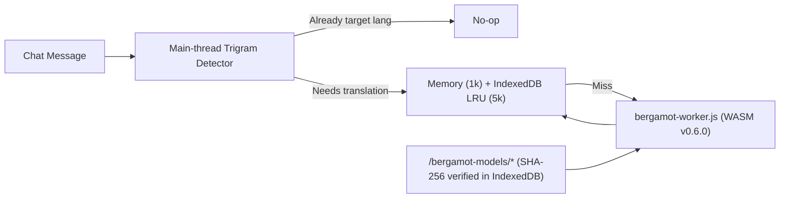

# Localization

Stellarr supports English (`en`, default) and Polish (`pl`) across the web client, Stellarr Cockpit, and the Rust API, paired with offline in-browser chat translation powered by Mozilla's Bergamot WebAssembly engine.

## Locale resolution and `STELLARR_LANGUAGE`

UI language (`locale`) and chat message translation are independent settings. Configuring `STELLARR_LANGUAGE` (`en` or `pl`; other values abort startup) sets the instance default across components:

| Component | Resolution order | Notes |
| --- | --- | --- |
| **Web client** (`web/src/stellarr/`) | 1. `localStorage` (`stellarr_language_settings.locale`)<br>2. `/stellarr-instance.js` (`STELLARR_LANGUAGE`)<br>3. `en` | `entrypoint.sh` writes `/run/stellarr/stellarr-instance.js` (`max-age=3600, must-revalidate`); pre-paint `localeScript.ts` sets `<html lang>` and `modulepreload`s **only** the active catalog chunk (`stellarr_instance_language_hint` speeds repeat loads). |
| **Stellarr Cockpit** (`web/src/cockpit/`) | 1. `localStorage` (`stellarr.cockpit.locale`)<br>2. `en` | Selected in **Cockpit → Settings**; independent of `/stellarr-instance.js` and the chat client. |
| **Rust API** (`api/crates/server/`) | `STELLARR_LANGUAGE` at startup | Localizes API problem responses, system notices, starter server/channel/role names, audit sentences, and outgoing emails. Existing SQLite rows retain the language they were created with. |

## Compile-time message catalogs

Missing translation keys fail compilation across all three codebases:

- **Web client (`web/src/stellarr/i18n/messages/`):** `pl.ts` defines `MessageKey`; `en.ts` enforces `satisfies Record<keyof typeof pl, string>`. `web/documents.ts` fails Vite builds if either catalog leaks into the entry chunk or shares a Rollup chunk.
- **Cockpit (`web/src/cockpit/i18n/`):** `en.ts` and `pl.ts` enforce identical key sets with `{name}` placeholder interpolation.
- **Rust API (`api/crates/messages/`):** `english.rs` and `polish.rs` implement exhaustive `match` expressions over `MessageKey` (`key.rs`).

---

## Offline in-browser chat translation



> [!TIP]
> Translation executes 100% locally inside `web/public/bergamot-worker.js`. Message text never leaves the user's device, and models download exclusively from your Stellarr instance—never from external CDNs.

1. **Reproducible WASM & Marian 2.x models:** `@stellarr/translation` bundles Bergamot `v0.6.0` ([`artifacts/recipes/bergamot/`](../artifacts/recipes/README.md), byte-identical to Firefox Remote Settings) plus Mozilla `pl-en` 2.0 and `en-pl` 2.1 models (`web/public/bergamot-models/registry.json`).
2. **SHA-256 content-addressed cache:** Downloaded model files verify exact byte size and SHA-256 digest against `registry.json` (`artifacts/manifest.json`) and store in IndexedDB (`bergamot-models`) keyed by SHA-256—deduplicating the shared SentencePiece vocabulary (`vocab.*.spm`) across both directions and pruning stale release hashes on startup.
3. **Segmentation & repeat guard:** Uses `Intl.Segmenter` for multi-sentence messages and `withoutRepeat` to collapse short-phrase Marian repetitions (e.g. `"Dzięki!"` → `"Thanks!"`).
4. **Zero-download language detection:** `detectLanguage.ts` classifies messages synchronously via character-trigram profiles, function words, and diacritics before queuing viewport-prioritized worker jobs.

---

## Adding a new language

1. **Web client (`web/`):**
   - Add `<code>` to `SUPPORTED_LOCALES` (`i18n/index.ts`), create `i18n/messages/<code>.ts`, and add `language.name.<code>` to every catalog.
   - Register the chunk in `LOADERS` (`i18n/index.ts`), `CATALOGS` (`i18n/localeScript.ts`), `CATALOG_MODULES` / `preloadPlan` (`web/documents.ts`), `CATALOG_UNAVAILABLE` (`i18n/messages/unavailable.ts`), and `web/vitest.setup.ts`.
   - Add `<code>` to `write_instance_language` in `infra/entrypoint.sh` (checked by `web/documents.test.ts`), `NATIVE_NAMES` in `LanguagePane.tsx`, and `LOCALE_TAG` / `pluralForm` in `lib/format/format.ts`.
   - For Bergamot translation, add models to `artifacts/npm/sources.json` and `artifacts/NOTICES`, publish `@stellarr/translation`, and update `TranslationTargetLanguage` + `modelStatus.ts`.
2. **Cockpit (`web/src/cockpit/i18n/`):** Create `<code>.ts` and register it in `index.ts`.
3. **API (`api/crates/`):** Add the variant to `Language` (`messages/src/lib.rs`), implement `messages/src/<code>.rs`, and allow `<code>` in `STELLARR_LANGUAGE` validation (`server/src/settings/variables.rs`).

## Verification

```bash
npm ci
npm test -w stellarr-web && npm run typecheck -w stellarr-web && npm run lint -w stellarr-web
npm run test:translation-runtime -w stellarr-web   # offline headless Chromium Bergamot E2E check
(cd api && cargo test -p stellarr-messages)
```
