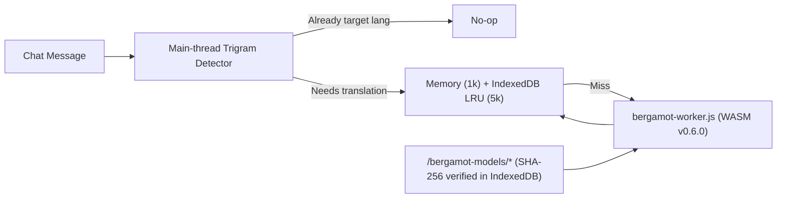

# Localization

Each interface language has one JSON file. English defines the message keys and placeholders for the chat client, Cockpit and API. The language picker lists English, Polish and German. [English source and translator notes](../locales/en.json) · [Polish translation](../locales/pl.json) · [German translation](../locales/de.json)

## Translating a language pack

| Section | Where people see it |
| --- | --- |
| `meta` | Native language name in settings, date and number formatting tag, page description, and the error shown if the web catalog cannot load |
| `web` | Chat client screens, buttons, accessibility labels and notifications |
| `cockpit` | Instance administration pages, logs, backups and operator actions |
| `api` | API errors, system notices, starter names, audit text, installation shortcuts and email |

In the English template, `_context.*` notes sit beside the strings they explain. For example, `shell.pendingInvite.one` is read aloud after a number, so its leading space matters. The notes are optional in translations and are stripped during the build.

To add an interface language, copy `locales/en.json` to `locales/<code>.json`, set `meta.nativeName` and `meta.tag`, and translate the values. Preserve keys and named placeholders such as `{count}`. Placeholders can move within the sentence. For counted phrases, supply each variant in the template. The current formatter selects `.one`, `.few` and `.many`, with other categories using `.many`.

The web build discovers the files, checks keys and placeholders against English, and writes the browser catalogs to the ignored `web/.locales/` directory. The chat client loads its selected language as a separate chunk. Cockpit bundles its own strings. Cargo builds the API message enum and its static catalogs from the same files.

## Choosing the default

| Component | Language selection |
| --- | --- |
| Chat client | The choice saved in `stellarr_language_settings.locale`, then the instance’s `STELLARR_LANGUAGE`, then English. The document sets its language before the first paint. |
| Cockpit | The operator’s choice in **Settings**, saved under `stellarr.cockpit.locale` in this browser. Defaults to English. |
| Rust API | The instance’s `STELLARR_LANGUAGE` at startup. An empty or unshipped code uses English. Previously saved names and audit entries keep their original text. |

## Verifying edits

```sh
npm run typecheck -w stellarr-web
npm test -w stellarr-web -- documents.test.ts src/stellarr/i18n src/cockpit/i18n
npm run build -w stellarr-web
(cd api && cargo test -p stellarr-messages)
```

## Offline in-browser chat translation

Chat translation has its own preference. The bundled models translate between English and Polish, including when the interface is in German.



> [!TIP]
> Translation executes 100% locally inside `web/public/bergamot-worker.js`. Message text never leaves the user's device, and models download exclusively from your Stellarr instance—never from external CDNs.

1. **Reproducible WASM & Marian 2.x models:** `@stellarr/translation` bundles Bergamot `v0.6.0` ([`artifacts/recipes/bergamot/`](../artifacts/recipes/README.md), byte-identical to Firefox Remote Settings) plus Mozilla `pl-en` 2.0 and `en-pl` 2.1 models (`web/public/bergamot-models/registry.json`).
2. **SHA-256 content-addressed cache:** Downloaded model files verify exact byte size and SHA-256 digest against `registry.json` (`artifacts/manifest.json`) and store in IndexedDB (`bergamot-models`) keyed by SHA-256—deduplicating the shared SentencePiece vocabulary (`vocab.*.spm`) across both directions and pruning stale release hashes on startup.
3. **Segmentation & repeat guard:** Uses `Intl.Segmenter` for multi-sentence messages and `withoutRepeat` to collapse short-phrase Marian repetitions (e.g. `"Dzięki!"` → `"Thanks!"`).
4. **Zero-download language detection:** `detectLanguage.ts` classifies messages synchronously via character-trigram profiles, function words, and diacritics before queuing viewport-prioritized worker jobs.
