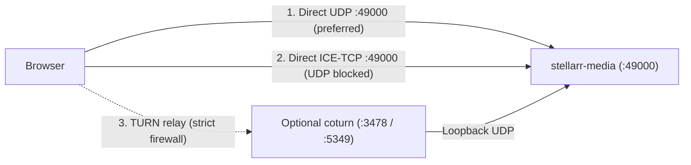

# RTC and ports

Stellarr separates signaling from media across two published ports: HTTPS (`443/tcp`) carries the web client and WebSocket signaling, while `stellarr-media` (`49000` UDP + TCP) carries WebRTC media. See [Voice and RTC protocol](./rtc-protocol.md) and [Stellarr Media](./stellarr-media.md).



## Published host ports

| Default binding | Protocol | Purpose | Variable |
| --- | --- | --- | --- |
| `443` | TCP | HTTPS for the web client, Cockpit, REST API, and `/hubs/app` WebSocket | `STELLARR_HTTPS_PORT` |
| `49000` | UDP + TCP | Direct WebRTC SRTP and passive ICE-TCP to `stellarr-media` | `STELLARR_MEDIA_PORT` |
| `127.0.0.1:8888` | TCP | Loopback HTTP upstream for a local reverse proxy | `STELLARR_HTTP_PORT` |

Always map `STELLARR_MEDIA_PORT` 1:1 on **both** UDP and TCP. Port `443` is omitted from generated URLs when it is the public HTTPS port.

### Optional TURN relay

Fresh installations run direct SFU media without TURN. Enable `coturn` only if callers sit behind restrictive firewalls that block both UDP and TCP on `49000`:

- **With `install.sh`:** Pass `--enable-turn` (writes `docker-compose.turn.yml` in the install directory).
- **Manual Compose:** Include `infra/compose/turn.yml` on every `up` and `pull`:

```bash
docker compose -f docker-compose.yml -f infra/compose/turn.yml up -d
```

| Default port | Enabled transport | Variable |
| --- | --- | --- |
| `3478/udp` | STUN and UDP TURN | `STELLARR_TURN_PORT` |
| `3478/tcp` | TURN over TCP (`STELLARR_TURN_TCP_ENABLED=true`) | `STELLARR_TURN_PORT` |
| `5349/tcp` + `5349/udp` | TURN over TLS/DTLS (`STELLARR_TURNS_ENABLED=true`; requires CA cert) | `STELLARR_TURNS_PORT` |
| `49160-49200/udp` | Media relay allocation pool, mapped 1:1 | `STELLARR_TURN_RELAY_RANGE` |

- **Disabled transports** are closed in `/etc/turnserver.conf` and omitted from `/api/bootstrap`. See [TURN over TLS](./install/reverse-proxy-and-tls.md#turn-over-tls-turns).
- **Relay sizing:** Each browser uses a single `max-bundle` peer connection, consuming **1 UDP relay port per relayed participant** (`49160-49200` provides `41` concurrent relayed seats). Keep Docker mappings, host firewall, and router forwarding aligned if you widen `STELLARR_TURN_RELAY_RANGE`.

## Container-internal ports

| Loopback port | Service |
| --- | --- |
| `127.0.0.1:5000/tcp` | `stellarr-api` HTTP and WebSocket server behind container Nginx ([routing policy](./architecture.md#nginx-routing-and-cache-policy)) |
| `127.0.0.1:5200/tcp` | `stellarr-media` HTTP control API authenticated with `/data/stellarr/secrets/media-control-secret` |

## NAT and firewall configuration

Forward public HTTPS (`443/tcp` or your reverse proxy's port) plus `49000/udp` and `49000/tcp` directly to the Docker host:

```dotenv
STELLARR_DOMAIN=chat.example.com
STELLARR_PUBLIC_IP=auto
STELLARR_MEDIA_PORT=49000
```

- `STELLARR_PUBLIC_IP=auto` resolves `STELLARR_DOMAIN`'s IPv4 address at container startup (set an explicit WAN IPv4 if `STELLARR_DOMAIN` sits behind an HTTP CDN). When `STELLARR_PUBLIC_IP` is unset, a numeric IPv4 `STELLARR_DOMAIN` supplies the direct candidate.
- Add `STELLARR_MEDIA_LAN_IP=<host-lan-ipv4>` when local callers cannot hairpin through your router's public IP—`stellarr-media` will advertise both LAN and WAN candidates in SDP.
- Set `STELLARR_MEDIA_ADVERTISE` (`ip:port,ip:port`) only when overriding the entire derived candidate list.

## Diagnostics

If the call offers **Copy diagnostics for the host**, send the report to the person running the instance. It includes signaling and media status, participant counts, and the latest network measurements. A missing measurement appears as `null`.

Run through these checks in order when calls stay on `Connecting` or produce one-way audio:

1. **Secure context & permissions:** Confirm the browser opened `https://` (or `http://localhost`) and granted microphone permission.
2. **Bootstrap config:** Verify `GET /api/bootstrap` shows the expected `rtc.mediaServer` (`rtc.iceServers` is `[]` when TURN is disabled; actual ICE host candidates come from SDP).
3. **Firewall & NAT parity:** Confirm host firewall and router forward both `UDP` and `TCP` on `STELLARR_MEDIA_PORT` 1:1 to the container host.
4. **Service readiness:** Run `docker compose exec stellarr stellarr-init status` and verify `media` (and `turn`, if enabled) reports `ready`.
5. **Browser WebRTC internals:** Check the selected ICE candidate pair's `protocol` (`udp` or `tcp`) and confirm inbound/outbound RTP packet counters increment.
6. **SFU room stats:** Query live SFU ingress/egress counters over loopback:

   ```bash
   docker compose exec stellarr bash -c '
     exec 3<>/dev/tcp/127.0.0.1/5200
     printf "GET /v1/stats HTTP/1.0\r\nAuthorization: Bearer %s\r\n\r\n" \
       "$(cat /data/stellarr/secrets/media-control-secret)" >&3
     cat <&3'
   ```
