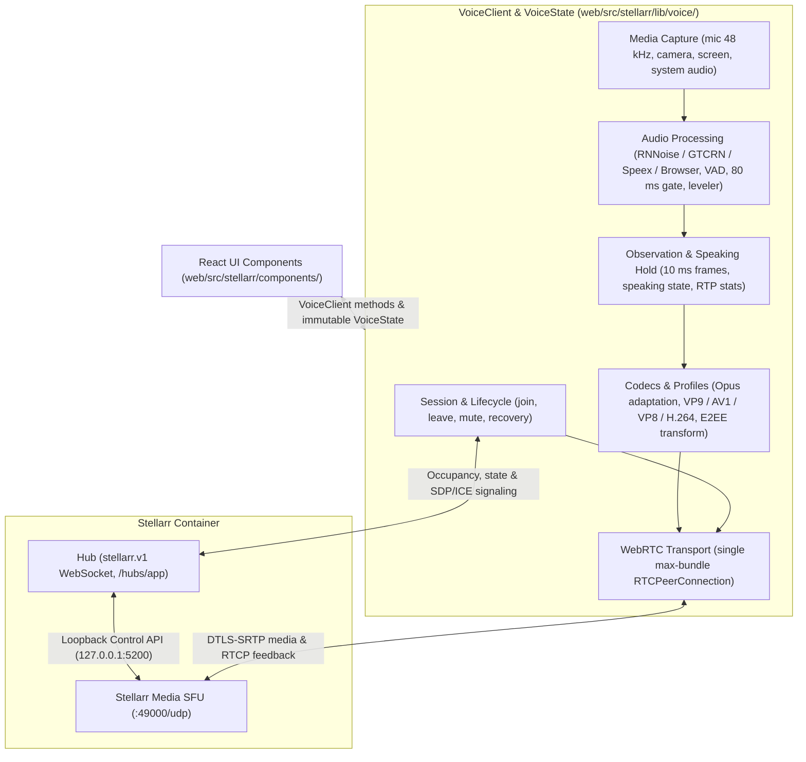
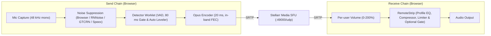

# Voice and RTC protocol

All voice and video call media routes through Stellarr Media (`stellarr-media`). The web client (`VoiceClient`) exchanges signaling events with the realtime hub (`/hubs/app`, upgrading directly with the `stellarr.v1` WebSocket subprotocol via `web/src/stellarr/lib/realtime/websocket.ts`), which manages room sessions over the media server's loopback control API. See [Stellarr Media](./stellarr-media.md) for SFU SDP negotiation, track attribution, downlink adaptation, end-to-end encrypted call frames, and the loopback control API.

## Client and signaling layers



UI components interact exclusively with `VoiceClient` and immutable `VoiceState` snapshots; they never import the WebSocket hub client, `RTCPeerConnection`, audio worklets, or media-server internals directly. High-frequency RTP packet counters and raw audio levels are kept out of React render state so call controls, tiles, and the channel rail only re-render on discrete state transitions (join, leave, mute, speaking start/stop, stream toggle, or downlink hold).

## Bootstrap configuration

`GET /api/bootstrap` returns the `rtc` configuration object:

```json
{
  "protocolVersion": 1,
  "capabilities": {
    "audioCodecs": ["opus"],
    "videoCodecs": ["vp9", "vp8", "h264"],
    "audioProcessing": ["browser", "rnnoise", "gtcrn", "speex", "gate"],
    "camera": true,
    "screenShare": true,
    "screenAudio": true
  },
  "iceServers": [],
  "signalingHub": "/hubs/app",
  "mediaServer": "udp://chat.example.com:49000"
}
```

- `iceServers` is populated per request with a STUN URL, a 1-hour HMAC-authenticated TURN URL, and (when `STELLARR_TURNS_ENABLED=true`) a `turns:` URL.
- `mediaServer` is `udp://<Rtc:PublicHost>:<Rtc:MediaPort>`.
- The client verifies `protocolVersion === 1` before opening media devices and aborts with an `unsupported` error otherwise.

## Signaling

`VoiceSignal` broadcasts a participant's mute, stream, and encryption state to other participants in the room:

```json
{
  "protocolVersion": 1,
  "channelId": "uuid",
  "fromUserId": "uuid",
  "toUserId": "uuid",
  "kind": "state",
  "payload": "JSON string"
}
```

- `channelId` identifies an RTC room: either a server voice channel or a two-user direct conversation.
- Clients omit `fromUserId`; the hub populates it from the authenticated session. When `toUserId` is omitted, the signal broadcasts to all other participants in the room.
- The backend validates authentication, room membership, recipient membership, `protocolVersion`, `kind`, and a 128 KiB payload limit.
- Occupancy updates (`VoiceParticipantChanged`) for server voice channels go to the members who see the channel, and to whoever is seated in it; where nobody is denied `viewChannel` at the channel that is the server's whole group, as before. Direct-call occupancy updates go only to the two conversation participants.
- Declining a direct call (`DeclineDirectCall`) clears room occupancy and emits `DirectCallDeclined` so the caller releases capture devices immediately.
- Payloads are validated by typed codecs (`web/src/stellarr/lib/rtc/protocol.ts`). A `state` payload has the shape `{ muted, screenStreamId, cameraStreamId, encrypted }` (`cameraStreamId` is optional, omitted when camera is off; `encrypted` is optional, omitted when the sender does not encrypt media frames).
- Local mute state is authoritative for the local user over out-of-order hub echoes. In a 1:1 direct call, an unencrypted receiver mutes remote media until the peer's `state` signal arrives (preventing encrypted frames from playing as static noise) and upgrades its own connection to end-to-end encryption if the peer announces `encrypted: true` (see [End-to-end encrypted calls](./stellarr-media.md#end-to-end-encrypted-calls)).

> [!NOTE]
> `SendVoiceSignal` accepts only `kind: "state"`. The hub rejects `offer`, `answer`, and `candidate` with a hub error ("Invalid voice signal."). SDP descriptions, ICE candidates, and receive subscriptions flow exclusively through `OpenMediaSession`, `SendMediaSignal`, `MediaSignal`, and `MediaSessionClosed` (see [Stellarr Media](./stellarr-media.md#hub-leg)).

Breaking changes to the envelope or payload require incrementing `protocolVersion`. Optional fields may be added within version `1`.

### Hub methods and events

Defined in `web/src/stellarr/lib/rtc/protocol.ts` and implemented by the hub methods of `api/crates/server/src/voice/` (`hub.rs`, `media.rs`, `sounds.rs`):

| Type | Name | Description |
| --- | --- | --- |
| Method | `JoinVoice` | Take a seat in a voice channel or direct call (or move directly from another room) |
| Method | `LeaveVoice` | Leave the current voice seat |
| Method | `SendVoiceSignal` | Relay a `state` `VoiceSignal` to one participant or the room |
| Method | `DeclineDirectCall` | End a ringing or active direct call for both participants |
| Method | `PlaySoundboard` | Schedule a soundboard clip in a server voice channel |
| Method | `GetRtcClock` | Return server Unix timestamp in milliseconds for clock-offset estimation |
| Method | `OpenMediaSession` | Allocate an SFU media session on `stellarr-media` for the caller's seat |
| Method | `SendMediaSignal` | Send an SDP offer/answer, ICE candidate, or receive subscription list to `stellarr-media` |
| Event | `VoiceParticipantChanged` | Room occupancy snapshot: `{ channelId, sequence, participants }` |
| Event | `VoiceChannelKicked` | `channelId` identifies the room. Access enforcement adds `reason: "access-revoked"`. A moderator disconnect omits `reason`. |
| Event | `VoiceSignal` | Relayed `VoiceSignal` envelope |
| Event | `VoiceSessionReplaced` | Account joined voice from a newer browser tab or device |
| Event | `DirectCallDeclined` | Remote participant declined or ended the direct call |
| Event | `SoundboardPlayed` | Scheduled soundboard clip broadcast (`startsAtUnixMs` +750 ms) |
| Event | `JoinSoundPlayed` | Scheduled personal arrival sound broadcast (`startsAtUnixMs` +750 ms) |
| Event | `SoundboardChanged` | Server soundboard catalog, order, or play rules updated |
| Event | `MediaSignal` | SDP offer/answer or track directory from `stellarr-media` |
| Event | `MediaSessionClosed` | `stellarr-media` closed the caller's media session |

Clients ignore any `VoiceParticipantChanged` snapshot whose `sequence` is older than the highest sequence already applied for that room, and re-synchronize directory occupancy whenever the hub WebSocket reconnects.

### Voice seats, `viewChannel` and `connect`

The seat is what admits a connection to a room's media: `OpenMediaSession` creates a session on `stellarr-media` only for the caller's seat in that room, and `stellarr-media` takes commands from the API alone. So `viewChannel` and `connect` are decided where seats are given, in `JoinVoice`, evaluated at the channel so overrides apply, and inside the presence tracker's lock, so a seat cannot be taken between the decision and the join. A caller who does not see the room is answered as for a room that does not exist, a hub error ("Unknown voice room."); one who sees it without `connect` is refused with a hub error ("Not allowed to join this voice room."). Either keeps whatever seat it had elsewhere, and cannot open media in the room, since it has no seat there. Direct calls are not server channels and need neither.

- **Moderator moves**: `PATCH /api/admin/channels/{id}/members/{userId}` moves the seat, which is the moderator's act and needs `moderateMembers` in both rooms, and seeing both, not the member's `viewChannel` or `connect`. The client confirms a move with `JoinVoice` for the room it was moved to; a connection already seated in that room keeps its seat without either, and opens media there.
- **Losing `viewChannel` or `connect` (`voice::enforce`)**: A seat does not outlive the right to sit in the room. Whenever access mutates on a server (editing, deleting, granting, or revoking a role in the app or Cockpit; setting or clearing a role or member override on a channel or section; moving a channel across sections; deleting a channel; kicking or banning a member; or transferring or deleting a server), `voice::enforce` evaluates every seated participant at their channel via `permissions::authorization::held_at`. Anyone who no longer holds both `viewChannel` and `connect` is immediately unseated: their SFU media session is closed, remaining viewers receive `VoiceParticipantChanged`, and the evicted client receives `VoiceChannelKicked`. (A participant moved into a restricted room by a moderator keeps that seat until they leave or until the next access change on the server triggers `voice::enforce`.)

### Soundboard synchronization

Soundboard clips are synchronized across participants over the realtime hub and decoded locally in each listener's Web Audio `AudioContext` rather than mixed into microphone audio:

- `GET /api/soundboard` returns the server's sounds in their saved display order, the server's playback policy (`everyoneCanPlay`, `rateLimited`), `canManage` (`manageServer`), and `canPlay` (evaluated via `voice/access.rs`).
- `PUT /api/admin/soundboard/order` with `{ "soundIds": [...] }` saves a new display order (requires `manageServer`, must list every sound of the server exactly once, and broadcasts `SoundboardChanged`).
- `PlaySoundboard(channelId, soundId)` verifies that the caller holds an active seat in a server voice channel (direct calls are rejected) and satisfies soundboard playback access: when `everyoneCanPlay` is `false`, the caller must hold `manageServer`, `manageMessages`, or `moderateMembers`.
- When `rateLimited` is `true`, each user is limited to one clip every `5 s` per server across all their connections (`voice/gate.rs`).
- `GetRtcClock()` estimates client-server clock offset using half the round-trip time.
- `SoundboardPlayed` carries clip metadata (including non-destructive `trimStartSeconds` and `trimEndSeconds`, between `0.15 s` and `15 s`) and a `startsAtUnixMs` timestamp scheduled `750 ms` in the future.
- Each receiver fetches and decodes the audio attachment, schedules playback in `AudioContext` (trimming the leading offset if the event arrived late), and displays the active sound badge on the sender's call stage tile.

### Arrival sound

Users can select a personal arrival clip (`joinSoundId`) from any server they belong to:

- Membership in the clip's source server is verified both when saving preferences and on `JoinVoice`. Deleting a soundboard clip automatically clears any `joinSoundId` referencing it.
- `JoinSoundPlayed` reuses the `SoundboardPlayed` payload (`startsAtUnixMs` +750 ms), capped at `5 s` (`MAX_JOIN_SOUND_SECONDS`) and rate-limited by a `30 s` per-user cooldown (`JOIN_SOUND_COOLDOWN`; cooldown skips the arrival clip without blocking `JoinVoice`).
- Asset authorization (`assets/access.rs`) permits downloading the clip when the listener shares a server or DM conversation with its owner.
- Disabling the local `joinLeaveSound` preference mutes both standard join/leave tones and remote arrival clips (`setArrivalsAudible`).

## State model

`VoiceState` separates realtime hub signaling state from WebRTC media transport state:

| Field | Values | Meaning |
| --- | --- | --- |
| `transport.signaling` | `idle`, `connecting`, `connected`, `reconnecting`, `disconnected` | Hub WebSocket connectivity and negotiation readiness |
| `transport.media` | `idle`, `ready`, `connecting`, `connected`, `degraded`, `failed` | Aggregate WebRTC media transport health |
| `peerCount` | `number` | Number of remote participants seated in the room |
| `connectedPeerCount` | `number` | Number of remote participants with verified incoming audio |

- `transport.media = ready`: Local SFU media session is connected with `peerCount === 0`.
- `transport.media = degraded`: A remote participant's audio has not arrived within its 3-second grace window, outgoing audio RTP has stalled, or automatic session replacement is in progress (see [Proving media quickly](./stellarr-media.md#proving-media-quickly)).
- When `stellarr-media` holds back a remote video stream due to receiver downlink limits, the corresponding `VoicePeer` camera or screen share sets `heldBack: true`, and the UI replaces the frozen video element with a paused-video indicator.

> [!IMPORTANT]
> Only one active voice session is permitted per account across all tabs and devices. Joining from a second tab replaces the earlier seat and emits `VoiceSessionReplaced` to the previous connection.

When a user switches directly from one voice channel to another (including by dragging their own row onto another voice channel in the rail), the client calls `JoinVoice` for the destination room without calling `LeaveVoice` first. The hub moves the seat atomically and broadcasts both rooms' snapshots so observers see a single transition, while the client closes its previous SFU session and opens a fresh one for the new room.

## Audio pipeline

### Opus bitrate profiles

| Profile | Max bitrate | Min adaptation bitrate | Channels | DTX | In-band FEC | Packet time |
| --- | ---: | ---: | --- | --- | --- | ---: |
| Auto (default) | 128 kb/s | 16 kb/s | mono | no | yes | 20 ms |
| Economy | 32 kb/s | 16 kb/s | mono | yes | yes | 20 ms |
| Balanced | 64 kb/s | 24 kb/s | mono | no | yes | 20 ms |
| Clarity | 96 kb/s | 32 kb/s | mono | no | yes | 20 ms |
| Premium | 128 kb/s | 64 kb/s | mono | no | yes | 20 ms |
| Studio | 256 kb/s | 96 kb/s | mono | no | yes | 20 ms |
| Screen audio (`music`) | 160 kb/s | 96 kb/s | stereo (when negotiated) | no | yes | 20 ms |

WebRTC handles fast transport congestion control, while the client adapts the Opus encoder bitrate ceiling gradually from smoothed packet-loss and RTT statistics (`RTCRtpSender.getStats()` / `setParameters()`) with hysteresis (`auto` steps across `128`, `64`, and `32 kb/s` tiers down to the `16 kb/s` floor). In end-to-end encrypted direct calls, Opus is configured for constant bitrate (`cbr=1`) with DTX disabled (`usedtx=0`) and without the `ssrc-audio-level` RTP header extension so packet lengths do not leak speech activity.

### Capture, processing, and playback chain



1. **Microphone capture and input gain**: `getUserMedia` at `48 kHz` mono (`web/src/stellarr/lib/voice/capture/`), followed by a manual microphone input gain stage (`-12 dB` to `+24 dB` in `1 dB` steps, `settings.ts`) before noise suppression and the input gate.
2. **Noise suppression (`noiseSuppression.ts`, `suppressorDownload.ts`)**:
   - Modes: `browser` (default), `rnnoise`, `gtcrn`, `speex`, or `off`.
   - `speex` (`/audio/speex-worklet.js` + `/audio/speex.wasm`) and `rnnoise` (`/audio/rnnoise-worklet.js` + `/audio/rnnoise.wasm`, compiled with WebAssembly SIMD and the newest Xiph model) use worklets built from TypeScript source in `web/worklets.ts` and WASM binaries built from source by [`artifacts/recipes/`](../artifacts/recipes/README.md). `gtcrn` (`/audio/gtcrn-worklet.js` + `/audio/gtcrn.wasm`) is staged from `artifacts/files/audio/`.
   - Because `/audio/*-worklet.js` files use fixed unhashed paths served with `Cache-Control: no-cache`, a browser tab left open across a server upgrade that first enters a call after the upgrade will fetch the new release's worklet into the older page. Any incompatible change to a worklet's `processorOptions` or `postMessage` contract must either preserve backward compatibility or use a new worklet filename (`web/worklets.ts`).
   - Selecting a WASM engine debounces for `700 ms` before fetching its binary (so clicking past an option does not download it) and displays download progress as a ring on the call dock button and voice settings choice using exact uncompressed sizes from `virtual:artifact-sizes`. If a worklet fails to initialize or times out, capture falls back to `browser` with a degraded notice.
3. **Detector worklet: VAD, input gate, and automatic leveler (`capture/detector/`, built into `/audio/detector-worklet.js`)**:
   - Analyzes `10 ms` frames (`480` samples at `48 kHz`) using adaptive noise-floor tracking, SNR hysteresis, hangover, stationary-noise rejection (closing on steady hum/buzz), transient/click rejection, and pitch/voicing correlation (`60–400 Hz`). On the main thread, `speakingHold.ts` holds the visual speaking ring across brief intra-word pauses.
   - The **input gate** (enabled by default) uses an `80 ms` lookahead delay line, `6 ms` attack, `90 ms` release, and `600 ms` unvoiced hold limit, attenuating silence without stopping continuous RTP packet transmission.
   - The **automatic leveler** targets `-20 dBFS` (`+6 dB/s` max rise, `-40 dB/s` fall, `+18 dB` max boost, `-6 dB` max cut, `0.95` peak guard) and updates gain only on voiced speech frames so background noise is never boosted.
4. **Source separation**: Microphone audio and screen-share system audio use separate media tracks, separate Opus profiles (`audioProfiles.ts`), and separate playback pipelines. Muting affects only the microphone.
5. **Receive chain (`playback/remoteMixer.ts`, `playback/remoteStrip.ts`, `playback/playbackProfile.ts`)**: Remote microphones pass through per-user volume (`0–200%`), an optional receiver noise gate, and a Web Audio processing strip (`Off`, `Natural`, `Studio`, `Broadcast`, or `Custom` 4-band EQ `±12 dB` at `160 Hz`, `360 Hz`, `3.1 kHz`, and `8 kHz` with dynamics compression and brickwall limiting). Screen-share audio bypasses voice EQ.
6. **Per-account persistence, dock controls, and keybinds**: Audio, device, and per-participant volume/gate settings are persisted per account ID in `localStorage`. The call dock (`VoiceDock.tsx`) condenses connection status into a single status line with a unified microphone quality and noise-reduction menu (`MicMenu.tsx`), and users can bind custom shortcuts for `toggleMute`, `toggleDeafen`, `toggleCamera`, and `disconnect` (`KeybindsPane.tsx`). Hiding or backgrounding a browser tab pauses speaking-ring and call-clock animations without tearing down media connections, and long calls refresh TURN credentials before expiry (`iceSession.ts`).

The entire capture, suppressor, and playback DSP pipeline is held to sample- and envelope-level regression records in [`web/bench/voice/README.md`](../web/bench/voice/README.md).

## Screen sharing

| Profile | Max resolution | Max frame rate | Max bitrate |
| --- | ---: | ---: | ---: |
| Economy | 720p | 15 fps | 1 Mb/s |
| Balanced (default) | 1080p | 30 fps | 2.5 Mb/s |
| Sharp | 1440p | 30 fps | 5 Mb/s |
| Ultra | 2160p | 60 fps | 12 Mb/s |

- Profiles live in `web/src/stellarr/lib/voice/video/screenShare.ts` and update both `getDisplayMedia` constraints and `RTCRtpSender` encoding parameters live without SDP renegotiation or re-prompting.
- Codec preference order: VP9 (2–3 temporal layers when supported), AV1, VP8, H.264 (in end-to-end encrypted direct calls, only VP9 and VP8 are negotiated).
- Uses `contentHint = "detail"` and `degradationPreference = "maintain-resolution"`, with `medium` network priority (below Opus `high`).
- **Opt-in forwarding**: `stellarr-media` forwards screen video and screen audio only to receivers currently watching that share ([receive subscriptions](./stellarr-media.md#receive-subscriptions)). New shares start unwatched; stopping watching halts RTP forwarding immediately without affecting the publisher.
- **Downlink pause**: If a receiver's estimated downlink bandwidth lacks headroom ([downlink adaptation](./stellarr-media.md#downlink-adaptation)), `stellarr-media` holds the video track back (`heldBack: true`) and the UI displays a paused notice until bandwidth recovers.

## Camera

| Profile | Resolution | Frame rate | Max bitrate |
| --- | --- | ---: | ---: |
| Low | 854×480 | 24 fps | 0.7 Mb/s |
| Standard (default) | 1280×720 | 30 fps | 1.5 Mb/s |
| High | 1920×1080 | 30 fps | 3.0 Mb/s |

- Managed by `VoiceClient` (`web/src/stellarr/lib/voice/video/camera.ts`), capturing video with `contentHint = "motion"` and `degradationPreference = "maintain-framerate"`.
- Camera video shares a single `MediaStream` (`msid`) with the publisher's microphone (`cameraStreamId`) for lip-sync; screen shares use a separate `MediaStream` (`screenStreamId`).
- Switching camera devices uses `RTCRtpSender.replaceTrack` without SDP renegotiation; camera errors never interrupt voice audio.
- Receivers order subscriptions by priority: all microphones → watched screen video and screen audio → cameras. When a receiver's downlink cannot carry a camera track, `stellarr-media` sets `VoiceCamera.heldBack = true` and the UI falls back to the speaker's avatar with a paused-video indicator.

## Key source files

| Area | Source files |
| --- | --- |
| Wire protocol & payload codecs | `web/src/stellarr/lib/rtc/protocol.ts`, `api/crates/server/src/voice/protocol.rs` |
| Client interface & state store | `web/src/stellarr/lib/voice/types.ts` (`VoiceClient`, `VoiceState`), `web/src/stellarr/lib/voice/store.ts` (`VoiceStateStore`) |
| Call session & SFU client | `web/src/stellarr/lib/voice/rtc/webrtc.ts`, `webrtcPeer.ts`, `webrtcSfu.ts`, `webrtcSfuDirectory.ts`, `webrtcSfuHealth.ts`, `webrtcTopology.ts`, `webrtcParticipant.ts`, `speakingHold.ts` |
| End-to-end encrypted calls | `web/src/stellarr/lib/voice/e2ee/sframe.ts`, `frameWorker.ts`, `callCrypto.ts`, `encryptedMedia.ts` |
| Soundboard & arrival sounds | `web/src/stellarr/adapters/soundboard.ts`, `web/src/stellarr/containers/useJoinSound.ts`, `api/crates/server/src/soundboard/`, `api/crates/server/src/voice/sounds.rs` |
| Audio, screen & camera profiles | `web/src/stellarr/lib/voice/audioProfiles.ts`, `video/screenShare.ts`, `video/camera.ts` |
| Microphone DSP, worklets & VAD | `web/worklets.ts`, `web/src/stellarr/lib/voice/capture/micPipeline.ts`, `captureGraph.ts`, `noiseSuppression.ts`, `suppressorDownload.ts`, `detector/`, `speex/`, `rnnoise/` |
| Playback mixer & profiles | `web/src/stellarr/lib/voice/playback/remoteMixer.ts`, `remoteStrip.ts`, `playbackProfile.ts` |
| ICE/TURN credential refresh | `web/src/stellarr/lib/voice/rtc/iceSession.ts` |
| Hub & media server broker | `api/crates/server/src/voice/`: `hub.rs`, `media.rs`, `sounds.rs`, `control.rs` (client of the media server's control API), `plane.rs`, `pump.rs` (media events), `closer.rs` (closing media sessions); `api/crates/server/src/realtime/` (presence and seats in `presence/seats.rs`); `api/crates/hub` (the hub protocol) |
| Rust SFU media server | `media/` (`stellarr-media`) |

## Verification

```bash
# Build browser WASM recipes once per checkout (artifacts/recipes/README.md)
docker buildx bake recipes

# Web client RTC & audio unit tests (includes voice DSP characterization checks)
npm run typecheck -w stellarr-web
npm test -w stellarr-web

# Backend hub & voice room integration tests
(cd api && cargo test -p stellarr-api)

# Rust SFU tests and headless Chromium smoke suite
cd media && cargo test
cd smoke && npm run smoke
```
