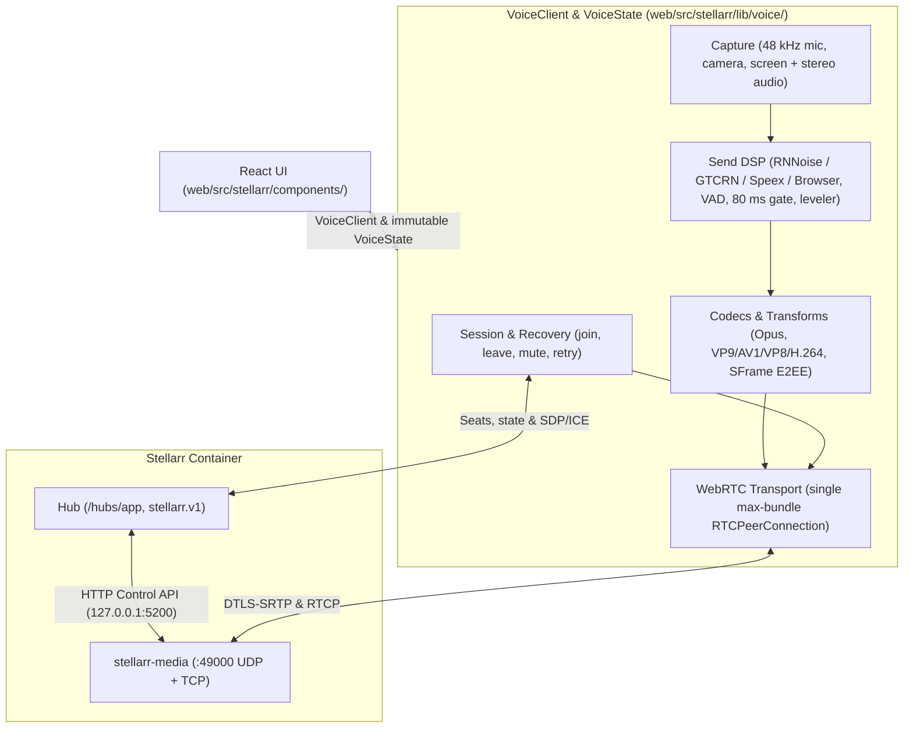
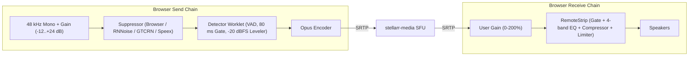

# Voice and RTC protocol

All voice, camera, and screen-share media routes through `stellarr-media`. The browser `VoiceClient` exchanges signaling messages over `/hubs/app` (`stellarr.v1` WebSocket subprotocol in `web/src/stellarr/lib/realtime/websocket.ts`), while the API brokers SFU sessions over `127.0.0.1:5200`. See [Stellarr Media](./stellarr-media.md) for SDP negotiation, track attribution, GoogCC downlink adaptation, and SFrame call encryption.

## Client and signaling architecture



UI components read immutable `VoiceState` snapshots and call `VoiceClient` methods—never touching WebSockets, `RTCPeerConnection`, or `AudioWorklet` nodes directly. High-frequency RTP counters and audio meters stay out of React state so components re-render only on discrete transitions (join, leave, mute, speaking start/stop, stream toggle, or `heldBack` changes).

Push to talk stays inside the client. `VoiceClient.setTalking(held, cut?)` reports the talk key going down or up; in push-to-talk mode the client holds the detector worklet's gate open or shut (`{ type: "hold", open }`, `null` hands it back to the VAD), keeps it open for a `200 ms` release tail unless `cut`, and closes it at once when the page is hidden. `VoiceState.talking` reflects it. Nothing is signalled per press: the `state` signal's `muted` is unchanged, and listeners' speaking rings follow the audio they receive. The input mode is a device setting and does not follow the account.

## Bootstrap configuration (`GET /api/bootstrap`)

```json
{
  "protocolVersion": 1,
  "capabilities": {
    "audioCodecs": ["opus"],
    "videoCodecs": ["vp9", "vp8", "h264"],
    "audioProcessing": ["browser", "rnnoise", "gtcrn", "speex", "gate"],
    "camera": true,
    "screenShare": true,
    "screenAudio": true
  },
  "iceServers": [],
  "signalingHub": "/hubs/app",
  "mediaServer": "udp://chat.example.com:49000"
}
```

- `protocolVersion` must equal `1` before opening capture devices (otherwise aborts with `unsupported`).
- `iceServers` is `[]` unless optional TURN is enabled (which supplies STUN and short-lived HMAC TURN/`turns:` URLs).
- `mediaServer` is diagnostic; actual UDP and passive TCP host candidates are read from the SFU's SDP.

---

## Signaling and hub contract

### `VoiceSignal` (`kind: "state"`)

```json
{
  "protocolVersion": 1,
  "channelId": "uuid",
  "fromUserId": "uuid",
  "toUserId": "uuid",
  "kind": "state",
  "payload": "{\"muted\":false,\"screenStreamId\":null,\"cameraStreamId\":\"...\",\"encrypted\":true,\"watching\":{\"userId\":\"...\",\"streamId\":\"...\"}}"
}
```

- **Envelope validation:** Clients omit `fromUserId` (populated from session); omitting `toUserId` broadcasts to the room (`≤ 128 KiB` limit).
- **Seat vs. room state:** The hub copies `muted` and stream presence (`sharing`, `camera`) into room occupancy (`VoiceParticipantChanged`), visible outside the call as well. `watching` stays inside relayed room signals only.
- **1:1 E2EE noise guard:** Unencrypted 1:1 receivers keep remote tracks muted until the peer's `state` signal arrives, automatically upgrading to SFrame decryption if `encrypted: true` is announced ([End-to-end encrypted calls](./stellarr-media.md#end-to-end-encrypted-calls)).

> [!NOTE]
> `SendVoiceSignal` accepts `kind: "state"` only. SDP offers/answers, ICE candidates, and receive subscriptions use `OpenMediaSession`, `SendMediaSignal`, `MediaSignal`, and `MediaSessionClosed` ([Stellarr Media: Hub leg](./stellarr-media.md#hub-leg)).

### Hub methods (`client → server`)

| Method | Purpose |
| --- | --- |
| `JoinVoice` | Claim a seat in a voice channel or 1:1 call (or switch rooms atomically without calling `LeaveVoice`). |
| `LeaveVoice` | Release the caller's active voice seat. |
| `SendVoiceSignal` | Broadcast or unicast a `kind: "state"` `VoiceSignal` inside the room. |
| `DeclineDirectCall` | End a ringing or active 1:1 call for both participants (`DirectCallDeclined`). |
| `PlaySoundboard` | Schedule a server soundboard clip (`+750 ms` start timestamp). |
| `GetRtcClock` | Return server Unix timestamp (ms) for half-RTT clock offset estimation. |
| `OpenMediaSession` | Allocate an SFU session on `stellarr-media` bound to the caller's seat. |
| `SendMediaSignal` | Forward an SDP offer/answer, ICE candidate, or `subscriptions` list to `stellarr-media`. |

### Hub events (`server → client`)

| Event | Payload & behavior |
| --- | --- |
| `VoiceParticipantChanged` | `{ channelId, sequence, participants }` snapshot (stale `sequence` values are ignored; re-synced on reconnect). |
| `VoiceChannelKicked` | `{ channelId, reason? }` (`reason: "access-revoked"` on permission loss; omitted on moderator kick). |
| `VoiceSignal` | Relayed `VoiceSignal` envelope. |
| `VoiceSessionReplaced` | Same account joined voice from another browser tab or device (at most one active seat per account). |
| `DirectCallDeclined` | Peer declined or hung up a 1:1 call; releases local capture devices immediately. |
| `SoundboardPlayed` / `JoinSoundPlayed` | Synchronized clip metadata + `startsAtUnixMs` (`+750 ms` ahead). |
| `SoundboardChanged` | Soundboard catalog, ordering, or playback policy updated. |
| `MediaSignal` / `MediaSessionClosed` | SFU SDP offer/answer, full `tracks` directory, or session closure notice. |

### Voice seats, `viewChannel` and `connect`

`OpenMediaSession` allocates SFU resources **only** for an active seat in `presence/seats.rs`:

- **Admission (`JoinVoice`):** Evaluated inside the presence lock at the target channel. Missing `viewChannel` returns `"Unknown voice room."`; missing `connect` returns `"Not allowed to join this voice room."` (preserving any existing seat elsewhere). 1:1 direct calls require neither server permission.
- **Moderator moves (`PATCH /api/admin/channels/{id}/members/{userId}`):** Requires `moderateMembers` and visibility in **both** rooms; seats the target user even without their own `viewChannel` or `connect`.
- **Live revocation (`voice::enforce`):** Every role, override, channel-section move, channel delete, kick/ban, or server ownership/delete mutation re-evaluates all seated users via `permissions::authorization::held_at`. Anyone lacking `viewChannel` + `connect` is unseated immediately, their SFU session is closed, remaining viewers receive `VoiceParticipantChanged`, and the evicted client receives `VoiceChannelKicked` (`reason: "access-revoked"`).

### Soundboard and arrival clips

Clips decode locally in each listener's Web Audio `AudioContext` (never mixed into mic RTP):

- **Server soundboard:** `GET /api/soundboard` and `PUT /api/admin/soundboard/order` (`manageServer`). `PlaySoundboard` requires a server voice seat, checks `everyoneCanPlay` (otherwise requires `manageServer`, `manageMessages`, or `moderateMembers`), enforces a `5 s` per-user cooldown when `rateLimited` is on, and schedules playback at `startsAtUnixMs` (`0.15–15 s` non-destructive trim).
- **Personal arrival clip (`joinSoundId`):** Verified for source-server membership on save and on `JoinVoice`, capped at `5 s` with a `30 s` cooldown (cooldown skips the sound without blocking join). Muted locally when `joinLeaveSound` is disabled.

---

## Transport state model (`VoiceState`)

| Field | Values | Meaning |
| --- | --- | --- |
| `transport.signaling` | `idle`, `connecting`, `connected`, `reconnecting`, `disconnected` | `/hubs/app` WebSocket and negotiation state |
| `transport.media` | `idle`, `ready`, `connecting`, `connected`, `degraded`, `failed` | WebRTC SFU session health (`ready` = connected alone; `degraded` = missing peer audio past `3 s` grace, stalled outbound RTP, or active replacement; see [Proving media quickly](./stellarr-media.md#proving-media-quickly)) |
| `peerCount` / `connectedPeerCount` | `number` | Seated remote peers vs. peers with verified inbound audio |
| `talking` | `boolean` | Push to talk has the microphone open: key held, or released within the `200 ms` tail. Always `false` in voice-activity mode; local only, never signalled |

---

## Audio, screen-share, and camera pipelines

### Opus bitrate profiles

| Profile | Max bitrate | Min adaptive floor | Channels | DTX | In-band FEC | Frame size |
| --- | ---: | ---: | --- | --- | --- | ---: |
| `Auto` (default) | 128 kb/s | 16 kb/s | mono | no | yes | 20 ms |
| `Economy` | 32 kb/s | 16 kb/s | mono | yes | yes | 20 ms |
| `Balanced` | 64 kb/s | 24 kb/s | mono | no | yes | 20 ms |
| `Clarity` | 96 kb/s | 32 kb/s | mono | no | yes | 20 ms |
| `Premium` | 128 kb/s | 64 kb/s | mono | no | yes | 20 ms |
| `Studio` | 256 kb/s | 96 kb/s | mono | no | yes | 20 ms |
| Screen audio (`music`) | 160 kb/s | 96 kb/s | stereo | no | yes | 20 ms |

Smoothed RTT and packet-loss stats step `Auto` across `128`, `64`, `32`, and `16 kb/s` with hysteresis. E2EE 1:1 calls enforce constant bitrate (`cbr=1`), disable DTX (`usedtx=0`), and strip `ssrc-audio-level` so packet lengths do not leak speech activity.

### Capture and playback DSP chain



- **WASM suppressors (`/audio/<engine>-worklet.js` + `.wasm`):** Debounced by `700 ms` with progress rings (`virtual:artifact-sizes`) and automatic fallback to `browser` on failure. Fixed unhashed worklet URLs use `Cache-Control: no-cache`, so breaking `postMessage` changes require a new worklet filename (`web/worklets.ts`).
- **Detector worklet (`10 ms` frames):** Tracks noise floor, pitch voicing (`60–400 Hz`), stationary hum/buzz rejection, and click rejection; drives an `80 ms` lookahead gate (`6 ms` attack, `90 ms` release, `600 ms` unvoiced cap) and voiced-only auto-leveler (`+18 dB` max boost, `-6 dB` max cut). Push to talk holds the same gate open or shut, keeping its lookahead and ramps; a capture built for it starts held shut.
- **Receive strip:** Independent per-speaker volume (`0–200%`), optional gate, and EQ presets (`Off`, `Natural`, `Studio`, `Broadcast`, `Custom` at `160 Hz`, `360 Hz`, `3.1 kHz`, `8 kHz`). Screen audio bypasses voice EQ. Regression-tested in [`web/bench/voice/`](../web/bench/voice/README.md).

### Screen sharing and camera profiles

| Mode | Profile | Max resolution | Frame rate | Max bitrate | Notes |
| --- | --- | ---: | ---: | ---: | --- |
| **Screen** (`detail`, `maintain-resolution`) | `Economy` / `Balanced` (default) / `Sharp` / `Ultra` | `720p` / `1080p` / `1440p` / `2160p` | `15` / `30` / `30` / `60 fps` | `1` / `2.5` / `5` / `12 Mb/s` | Live preset switch without renegotiation; VP9 → AV1 → VP8 → H.264 (VP9/VP8 in E2EE); forwarded [only to active viewers](./stellarr-media.md#receive-subscriptions) |
| **Camera** (`motion`, `maintain-framerate`) | `Low` / `Standard` (default) / `High` | `854×480` / `1280×720` / `1920×1080` | `24` / `30` / `30 fps` | `0.7` / `1.5` / `3.0 Mb/s` | Shares `msid` (`cameraStreamId`) with mic for lip-sync; `replaceTrack` device swaps; priority below mics and watched screens ([downlink adaptation](./stellarr-media.md#downlink-adaptation)) |

## Key source map and verification

| Subsystem | Paths |
| --- | --- |
| Wire protocol & state | `web/src/stellarr/lib/rtc/protocol.ts`, `lib/voice/{types,store}.ts`, `api/crates/server/src/voice/protocol.rs` |
| WebRTC SFU client & E2EE | `web/src/stellarr/lib/voice/rtc/*`, `lib/voice/e2ee/{sframe,frameWorker,callCrypto,encryptedMedia}.ts` |
| Capture, DSP & playback | `web/worklets.ts`, `lib/voice/capture/*`, `lib/voice/playback/*`, `lib/voice/{audioProfiles,video/*}.ts` |
| Hub & SFU broker | `api/crates/server/src/voice/{hub,media,sounds,control,plane,pump,closer}.rs`, `realtime/presence/seats.rs`, `media/` |

```bash
npm run typecheck -w stellarr-web && npm test -w stellarr-web
(cd api && cargo test -p stellarr-api)
(cd media && cargo test && cd smoke && npm run smoke)
```
