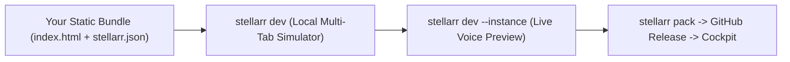

# Getting started

Stellarr Activities let you ship multiplayer games, watch parties, whiteboards, and solo tools as ordinary static web apps (`stellarr.json` + `index.html` + assets).

You write zero backend code and manage zero servers: Stellarr serves your bundle from an isolated origin, authenticates everyone in the voice room (or personal session), and exposes a single `connect()` API for room state, host commands, secret player hands, transient events, cross-device saves, and consented media inputs.



## Prerequisites

- **Node.js `22+`** on your development machine (for the `stellarr` CLI simulator and bundler). Deployed activities run purely in the browser.

---

## 1. Create a zero-build activity in two minutes

Create an empty directory with `stellarr.json` and `index.html`. No build step is needed because Stellarr serves the browser SDK directly at `/_stellarr/sdk/v1.js`.

### `stellarr.json`

```json
{
  "protocol": 1,
  "id": "quick-buzz",
  "name": "Quick Buzz",
  "description": "First player to hit the buzzer claims the round.",
  "version": "0.1.0",
  "launchModes": ["voice", "personal"]
}
```

### `index.html`

```html
<!doctype html>
<html lang="en">
<meta charset="utf-8">
<meta name="viewport" content="width=device-width, initial-scale=1">
<title>Quick Buzz</title>
<style>
  body {
    margin: 0; padding: 2rem; font: 16px/1.5 system-ui, sans-serif;
    background: var(--bg, #17191d); color: var(--fg, #f2f3f5);
  }
  button {
    padding: 0.6rem 1.2rem; border-radius: 8px; border: 0; font: inherit;
    background: var(--accent, #6f65d1); color: #fff; cursor: pointer;
  }
  button:disabled { opacity: 0.45; cursor: default; }
</style>

<h1 id="status">Connecting…</h1>
<p id="players"></p>
<button id="buzz" disabled>Buzz!</button>
<button id="reset" disabled>Next round</button>

<script type="module">
  import { connect } from "/_stellarr/sdk/v1.js";

  const session = await connect({ initialState: { winnerId: null } });
  const statusEl = document.getElementById("status");
  const playersEl = document.getElementById("players");
  const buzzBtn = document.getElementById("buzz");
  const resetBtn = document.getElementById("reset");

  // Match the player's active Stellarr palette automatically:
  session.theme.subscribe(({ colors }) => {
    document.documentElement.style.setProperty("--bg", colors.background);
    document.documentElement.style.setProperty("--fg", colors.text);
    document.documentElement.style.setProperty("--accent", colors.accent);
  });

  function render() {
    const { winnerId } = session.state.get();
    const roster = session.participants.get();
    const winner = roster.find((p) => p.id === winnerId);
    statusEl.textContent = winner ? `${winner.name} buzzed first!` : "Ready — hit the buzzer!";
    playersEl.textContent = `In room: ${roster.map((p) => p.name).join(", ")}`;
    buzzBtn.disabled = winnerId !== null;
    resetBtn.disabled = winnerId === null;
  }

  session.state.subscribe(render);
  session.participants.subscribe(render);

  buzzBtn.onclick = () =>
    session.state.set((cur) => (cur.winnerId ? undefined : { winnerId: session.context.me.id }));
  resetBtn.onclick = () => session.state.set({ winnerId: null });
</script>
```

---

## 2. Test multiplayer locally (`stellarr dev`)

Start the local simulator from your project directory:

```sh
npx @stellarr/sdk dev --dir .
```

Open `http://127.0.0.1:4174/` in your browser. The simulator wraps your activity inside a local Stellarr host shell (`context.standalone === true`) on an isolated `game-<hash>.localhost` origin—matching production iframe isolation.

| Simulator feature | How to use it |
| --- | --- |
| **Add players** | Click **New player** in the top bar to open another tab with its own persistent player ID in the same voice room. Reloading a tab keeps that player's seat and saves. |
| **Test personal vs. voice mode** | Pass `--mode voice` (shared room across tabs, default when supported) or `--mode personal` (isolated solo room per tab). |
| **Test Game audio** | Drag the **Game audio** slider (`0–100%`) in the top bar to verify your `session.media.volume` listener per tab. |
| **Simulate mic & camera** | When `permissions` declares `media.microphoneLevel` or `media.cameraTile`, the top bar displays file pickers so you can loop local audio/video files, test consent prompts, mute, or revoke access without hardware. |
| **Pick a free port** | Pass `--port 0` to bind an available OS port. Restart `stellarr dev` only when you edit `stellarr.json`; HTML/JS/CSS edits reload on browser refresh. |

---

## 3. Set up Vite and TypeScript (optional)

For larger projects with TypeScript, React, Svelte, PixiJS, or Three.js, install `@stellarr/sdk` as a dev dependency:

```sh
npm install --save-dev @stellarr/sdk
```

Set `base` in `vite.config.ts` so generated scripts, styles, and chunks resolve from the installed package directory:

```ts
import { defineConfig } from "vite";

export default defineConfig({ base: "./" });
```

A default instance serves each launch under `/_activity/<key>/`. Use relative URLs for your own assets, such as `./sprites.png`. A leading slash resolves from the instance root. The local simulator serves the package at the root of its own origin, so it can mask this mistake. `stellarr validate` warns when a published HTML file uses a root-relative `src` or `href` such as `/assets/game.js`. The warning names the file and URL. Paths under `/_stellarr/` are reserved for Stellarr and are allowed.

Import typed helpers directly from `@stellarr/sdk` and place `stellarr.json` inside your Vite `public/` folder so `vite build` copies it next to `dist/index.html`:

```ts
import { connect, type Participant } from "@stellarr/sdk";

interface QuizState {
  questionIndex: number;
  scores: Record<string, number>;
}

const session = await connect<QuizState>({
  initialState: { questionIndex: 0, scores: {} },
});
```

Run `vite build` (or `vite build --watch` in one terminal) and point the simulator at `dist/`:

```sh
npx stellarr validate --dir dist
npx stellarr dev --dir dist
```

> [!NOTE]
> During local development (`stellarr dev`) and live previews (`--instance`), `icon` in `stellarr.json` is optional so you can prototype immediately. Adding a `PNG`, `JPEG`, or `WebP` `icon` (`≤ 512 KiB`) is required only when running `stellarr validate` or `stellarr pack` for a release.

---

## 4. Adapt to theme, language, and device class

Every player in a shared voice room may use a different Stellarr color palette, UI language (`en` or `pl`), or device (`desktop`, `tablet`, or `phone`). Subscribe to the live observables so your UI updates immediately—even if a player switches settings mid-round:

```ts
// 1. Theme: mode ("dark" | "light") + 6 semantic hex colors
session.theme.subscribe(({ mode, colors }) => {
  const root = document.documentElement;
  root.dataset.theme = mode;
  for (const [token, value] of Object.entries(colors)) {
    root.style.setProperty(`--ui-${token}`, value);
    // background, surface, text, muted, accent, border
  }
});

// 2. Interface language (e.g. "en", "pl", or browser tag like "pl-PL" in local preview)
session.locale.subscribe((locale) => {
  document.documentElement.lang = locale;
  applyTranslations(locale.startsWith("pl") ? "pl" : "en");
});

// 3. Device class ("desktop" = fine pointer, "tablet" = coarse >= 600px, "phone" = smaller touch)
session.device.subscribe((device) => {
  document.documentElement.dataset.device = device;
});
```

If your activity only works on desktop screens (for example, keyboard-heavy games), set `"devices": ["desktop"]` in `stellarr.json`—mobile participants in the channel will see a clear *"Available on desktop"* badge instead of loading an unplayable frame.

---

## 5. Preview live with friends on a test instance

Before publishing a GitHub release, you can test your local `dist/` folder with real friends inside a voice channel on a development Stellarr instance (`STELLARR_ACTIVITY_DEV_ENABLED=true`; see [Configuration](../install/configuration.md#development-stack)):

1. Ask the instance owner to open **Cockpit → Integrations → Connect project for testing** and generate a single-use pairing code (`5 min` validity).
2. Upload your build from your machine:

   ```sh
   npx stellarr dev --dir dist --instance http://localhost:3000
   ```

3. Enter the pairing code when prompted. The CLI saves a 24-hour author credential in `~/.stellarr-preview`, uploads your bundle (`≤ 16 MiB`, `≤ 1,024` files), and prints a **Tester invite** code (valid up to `2 hours`).
4. Join a voice channel with your co-tester, open **Activity preview**, and paste the tester invite. Re-run step 2 anytime to push a fresh build, or tear down the preview early with:

   ```sh
   npx stellarr dev --dir dist --instance http://localhost:3000 --stop <tester-invite>
   ```

## Next steps

- **[Rooms, state, and saves](rooms-and-state.md):** Learn when to use shared state, host-authoritative commands, spectator seats, secret player hands, fast events, and persistent saves.
- **[Media, manifest, and publishing](media-and-publishing.md):** Wire up Game audio, voice-reactive inputs, camera tiles, and ship a release to Cockpit.
- **[API and CLI reference](api-reference.md):** Look up exact TypeScript signatures, error codes, and runtime limits.
