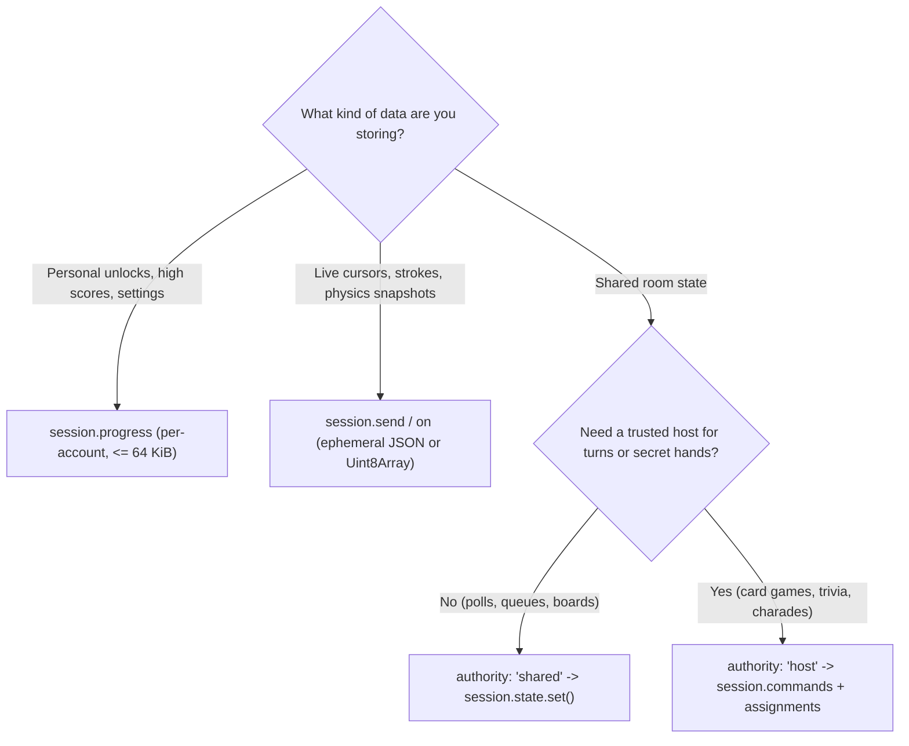

# Rooms, state, and saves

Every Stellarr activity gets four specialized data channels out of the box so you never have to force high-frequency cursor movement through persistent state or hide secret cards in public JSON.

## Picking the right primitive



| Channel | Scope & lifetime | Visibility | Payload limit | Rate limit |
| --- | --- | --- | ---: | ---: |
| `session.state` | Current room (kept `120 s` after room empties) | Everyone in session (including spectators) | `256 KiB` JSON | `32 / s` |
| `session.commands` + `assignments` | Current room (`authority: "host"`) | Everyone sees the `patch`. The caller receives the `result`. The assigned player and the current host can read `assignments[id]`. | `64 KiB` cmd · `256 KiB` assignments | `32` writes/s |
| `session.send` / `on` | Live connected peers only (best-effort) | Broadcast or unicast (`{ to: playerId }`) | `64 KiB` JSON or bytes | `96 / s` |
| `session.progress` | Signed-in account across sessions, updates & devices | Private to the signed-in player | `64 KiB` JSON | `32 / s` |

---

## Launch modes and roster

Declare `"launchModes"` in `stellarr.json` as `["voice"]` (default), `["personal"]`, or `["voice", "personal"]`:

- **`voice` mode:** Scoped to a voice channel or 1:1 call (`session.context.place` holds `{ id }`). Launching joins the existing room session if one is already running.
- **`personal` mode:** Launched solo from **Friends → Activities → Launch for myself** (`session.context.place === null`). Each account gets its own isolated room and state.

### Reading participants and connection state

`session.participants` lists everyone in join order (`{ id, name, username?, avatar, connected }`):

```ts
session.participants.subscribe((people) => {
  rosterEl.replaceChildren(
    ...people.map((person) => {
      const li = document.createElement("li");
      li.textContent = `${person.name}${person.connected ? "" : " (reconnecting…)"}`;
      return li;
    }),
  );
});

session.connection.subscribe((status) => {
  // "connected" | "reconnecting" | "closed"
  bannerEl.hidden = status === "connected";
});
```

- **Stable player IDs:** `person.id` represents the account—not the browser tab. Reloading a tab reconnects as the same `person.id`; opening the activity in a second tab retires the older frame (`status = "closed"`).
- **Grace window (`10 s`):** If a player refreshes or drops Wi-Fi briefly, they stay in `participants` (with `connected: false`) and keep their seat and secret assignment for `graceSeconds` (`10 s`).
- **Nullable avatars:** Always fall back to initials or `person.name` when `person.avatar === null`.

---

## Shared state (`authority: "shared"`)

With default `"shared"` authority, any seated participant can update top-level keys of the session state:

```ts
// 1. Direct top-level patch (last write wins):
await session.state.set({ topic: "Movie night" });

// 2. Optimistic transaction (recommended whenever next state depends on current state):
const committedRevision = await session.state.set((current) => {
  if (current.votes[session.context.me.id] === "ready") return; // returning undefined cancels cleanly!
  return {
    votes: { ...current.votes, [session.context.me.id]: "ready" },
  };
});
```

> [!TIP]
> Keep `state.set((current) => ...)` **pure and free of side effects**—if another player commits a change at the same time, the SDK automatically re-runs your function against the fresh snapshot until it commits without conflict.

---

## Host-authoritative games (`authority: "host"`)

Card games, trivia, and turn-based games often need one referee to enforce turn order, shuffle decks, or hold secret answers. Set `"authority": "host"` in `stellarr.json`:

The host runs your rules in their own browser. They can read every hand or secret answer, choose the outcome of a move, and change scores. Other seated players receive only their own assignment. A player promoted to host gains access to the full current checkpoint. Use this mode when everyone trusts whoever may become host.

1. **Automatic election & failover:** Stellarr elects the first connected seated player as `host` (`session.host.get()`). If the host disconnects for more than `graceSeconds` (`10 s`) or calls `await session.host.transfer(nextPlayerId)`, Stellarr promotes the next connected seated player automatically.
2. **Symmetric handler registration:** Register `session.commands.handle(...)` on **every** client at startup so whichever client is currently host (or becomes host mid-game) can process moves immediately.
3. **Atomic decisions & private assignments:** A command handler receives `(data, { id, from }, currentState, { assignments })` and returns `{ patch?, result?, assignments? }`, which Stellarr commits in a single atomic step.

### Complete example: Charades with secret words & spectators

`stellarr.json`:

```json
{
  "protocol": 1,
  "id": "charades",
  "name": "Charades",
  "description": "Act out the secret prompt before time runs out.",
  "version": "1.0.0",
  "authority": "host",
  "seats": 4
}
```

Game logic (`main.ts`):

```ts
import { connect } from "@stellarr/sdk";

interface CharadesState {
  round: number;
  actorId: string | null;
  endsAt: number | null;
  scores: Record<string, number>;
}

const WORDS = ["astronaut", "campfire", "lighthouse", "skateboard"];
const session = await connect<CharadesState>({
  initialState: { round: 0, actorId: null, endsAt: null, scores: {} },
});

// 1. Register rules on EVERY client (runs only on whichever player is currently host):
session.commands.handle("start-round", (_data, { from }, state, { assignments }) => {
  const seated = session.seats.get();
  if (!seated.includes(from)) throw new Error("Spectators cannot start a round.");

  const actorId = seated[state.round % seated.length];
  const secretWord = WORDS[Math.floor(Math.random() * WORDS.length)];

  // Clear previous secrets with `null` and assign the new word ONLY to `actorId`:
  const nextAssignments: Record<string, string | null> = {};
  for (const id of Object.keys(assignments)) nextAssignments[id] = null;
  nextAssignments[actorId] = secretWord;

  return {
    patch: {
      round: state.round + 1,
      actorId,
      endsAt: session.now() + 60_000,
    },
    assignments: nextAssignments,
    result: { round: state.round + 1 },
  };
});

session.commands.handle("guess", (guess, { from }, state, { assignments }) => {
  if (from === state.actorId) throw new Error("The actor cannot guess!");
  if (!state.actorId || !state.endsAt || session.now() > state.endsAt) {
    return { result: "too-late" };
  }
  const secret = String(assignments[state.actorId] ?? "");
  if (String(guess).trim().toLowerCase() !== secret) {
    return { result: "wrong" };
  }
  return {
    patch: {
      endsAt: null,
      scores: { ...state.scores, [from]: (state.scores[from] ?? 0) + 1 },
    },
    assignments: { [state.actorId]: null },
    result: "correct",
  };
});

// 2. Read ONLY this player's private assignment (spectators & guessers receive `null`):
session.assignments.subscribe((mySecretWord) => {
  secretBanner.textContent = mySecretWord ? `Act out: ${mySecretWord}` : "";
});

// 3. Submit moves from any seated player (pass `id` when retrying a specific turn move):
guessForm.onsubmit = async (e) => {
  e.preventDefault();
  const outcome = await session.commands.submit("guess", guessInput.value);
  feedbackEl.textContent = outcome === "correct" ? "You got it!" : "Keep guessing!";
};
```

### Seats and spectators (`session.seats`)

When `"seats": 4` is set in `stellarr.json`, the first 4 joiners receive playing seats (`session.seats.get()` contains their IDs) and a 5th joiner enters automatically as a **spectator**:

- Spectators see `participants` and public `state`, receive `null` for `assignments`, and are blocked by the server from writing state or submitting commands (`403 A playing seat is required.`).
- Active players can step out to spectate via `await session.seats.release()`, and spectators can take an open seat via `await session.seats.claim()` (`409` if full).

---

## Synchronized timers (`session.now()`)

Never compare `Date.now()` across two players' machines—a laptop clock skewed by 4 seconds will show the wrong countdown. `session.now()` continuously estimates the instance's monotonic millisecond clock using half-RTT samples:

```ts
function updateTimer() {
  const { endsAt } = session.state.get();
  if (!endsAt) return;
  const msLeft = Math.max(0, endsAt - session.now());
  timerEl.textContent = `${(msLeft / 1000).toFixed(1)}s`;
}
```

---

## Fast transient events (`session.send` / `session.on`)

Installed activities using the current SDK receive live messages on Stellarr’s authenticated WebSocket. The room wakes the host when a command arrives and the caller when its decision is ready. After reconnection the SDK reads from its last confirmed revision. Transient messages are best effort and can be lost while disconnected.

Packages importing the SDK from Stellarr use the instance’s copy. If you bundled an older SDK, rebuild your package with the updated SDK to receive pushed events. The local simulator and private development preview use polling.

Use `send` and `on` for ephemeral updates that do not belong in saved state (mouse pointers, live brush previews, emotes, or real-time physics snapshots):

```ts
// Broadcast latest cursor position (supersedes unsent/unreceived cursor frames per recipient):
canvas.onpointermove = (e) => {
  session.send("cursor", { x: e.offsetX, y: e.offsetY }, { latest: true });
};

// Unicast a message to one specific participant:
session.send("ping-peer", { ts: session.now() }, { to: targetPlayerId });

// Send compact binary packets (ArrayBuffer or TypedArray -> received as Uint8Array):
const packet = new Float32Array([player.x, player.y, player.vx, player.vy]);
session.send("tick", packet, { latest: true });

session.on("tick", (bytes, { from }) => {
  if (bytes instanceof Uint8Array) {
    const coords = new Float32Array(bytes.buffer, bytes.byteOffset, 4);
    updateEntity(from, coords);
  }
});
```

`session.send(...)` returns `false` synchronously if disconnected, if the local 32-message outbox is full, or if the payload exceeds `limits.messageBytes` (`64 KiB`).

---

## Persistent player progress (`session.progress`)

While `session.state` resets `120 s` after the last player leaves the room, `session.progress` stores up to `64 KiB` of JSON **privately per signed-in account**—persisting across rooms, devices, voice and personal modes, server restarts, and version updates:

```ts
interface PlayerSave {
  xp: number;
  unlockedSkins: string[];
}

// First visit returns { revision: 0, data: null }
const initial = await session.progress.load();

async function grantReward(skin: string, xpGain: number) {
  for (;;) {
    const { data, revision } = await session.progress.load();
    const prev = (data as PlayerSave | null) ?? { xp: 0, unlockedSkins: [] };
    const next: PlayerSave = {
      xp: prev.xp + xpGain,
      unlockedSkins: [...new Set([...prev.unlockedSkins, skin])],
    };
    try {
      await session.progress.save(next, revision);
      return next;
    } catch (err) {
      // Another tab/device saved concurrently — reload and merge:
      if ((err as { status?: number }).status !== 409) throw err;
    }
  }
}
```

> [!NOTE]
> If your bundled activity might run on an older host build, check `session.capabilities.includes("progress")` before calling `session.progress`. In `stellarr dev`, local test saves live under `~/.stellarr-preview/progress` per project, port, and simulated tab.
