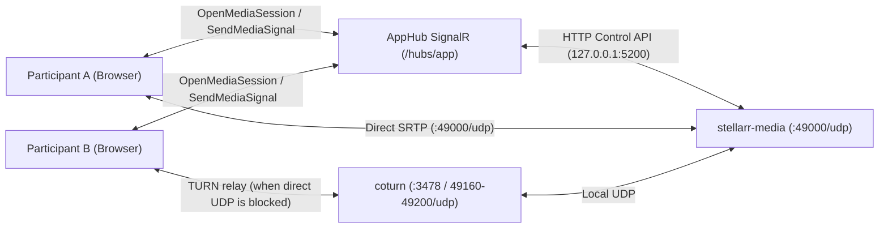
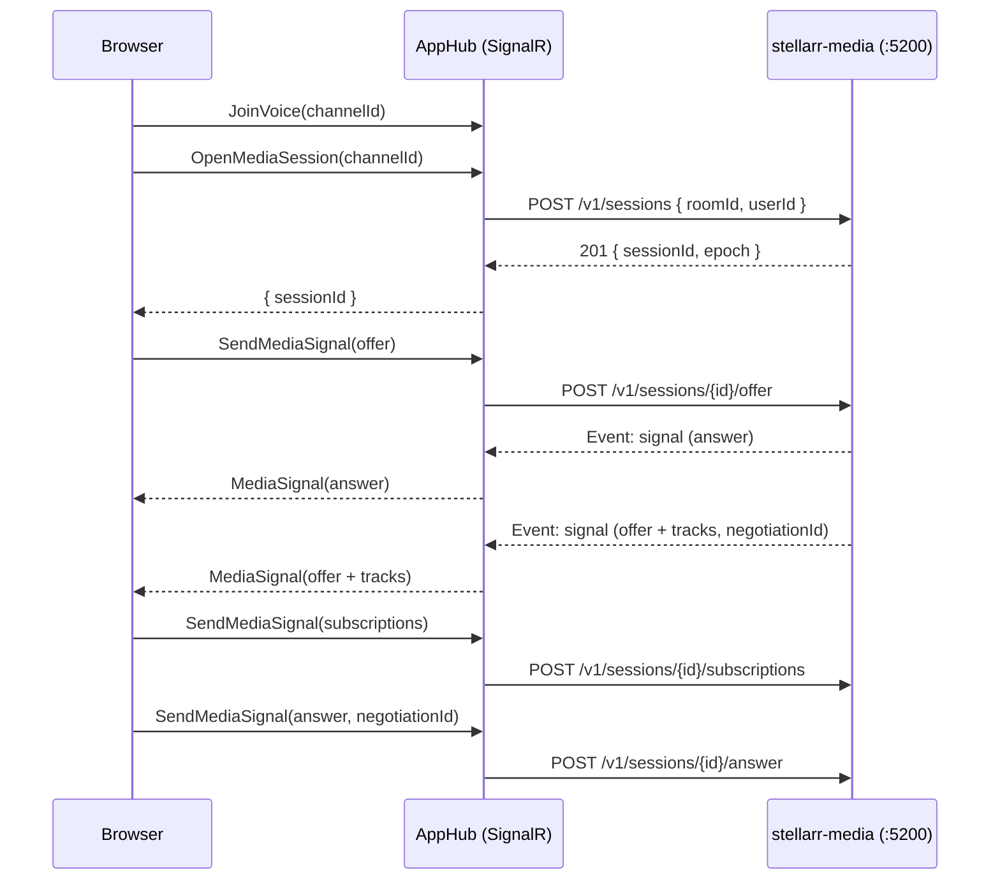

# Stellarr Media

Stellarr Media (`stellarr-media`, in `media/`) is Stellarr's Rust WebRTC Selective Forwarding Unit (SFU). Every voice channel and 1:1 direct call routes through it: each participant opens a single `RTCPeerConnection` to the media server, which forwards microphone, camera, and screen-share RTP packets to other participants in the room without transcoding or mixing. Browsers never exchange media peer-to-peer.

See [Voice and RTC protocol](./rtc-protocol.md) for bootstrap configuration, `VoiceSignal` state messages, `VoiceState`, and audio/video profiles.

## Overview

| Aspect | Behavior |
| --- | --- |
| WebRTC engine | `str0m` (sans-IO ICE, DTLS, SRTP, RTP/RTCP, GoogCC BWE) |
| Transport | ICE-lite on a single UDP socket (`0.0.0.0:49000`) |
| Forwarded media | Microphone audio, camera video, screen video, and screen audio |
| Media processing | Packet-level RTP header rewriting and forwarding; no decoding, mixing, or transcoding |
| Authorization | `AppHub` authorizes voice seats; `stellarr-media` accepts commands only on its loopback control API |
| Signaling path | Browser ↔ `AppHub` (SignalR) ↔ `stellarr-media` (`127.0.0.1:5200`) |
| Connections per client | Single `RTCPeerConnection` (`bundlePolicy: "max-bundle"`) |
| Offer direction | Browser offers published tracks (`sendonly`); `stellarr-media` offers forwarded tracks (`sendonly` to the receiver) |
| Glare resolution | Browser is the impolite peer; `stellarr-media` is the polite peer |
| Track attribution | Server-issued directory mapping SDP `mid` → `{ userId, kind, streamId, heldBack }` |
| Downlink adaptation | Per-receiver GoogCC BWE: all subscribed audio forwards; subscribed video forwards in priority order while bandwidth headroom allows, holding excess video back per receiver |
| Direct calls | Routed through `stellarr-media` identically to server voice channels |
| End-to-end encryption | Direct calls in encrypted conversations seal each audio/video frame in the browser via WebRTC Encoded Transform (`AES-256-GCM`); `stellarr-media` forwards the opaque ciphertext payloads (see [End-to-end encrypted calls](#end-to-end-encrypted-calls)) |

## Topology



Because all call media enters the container, any browser outside the Docker host needs the media server's public host candidate: set `STELLARR_PUBLIC_IP` and forward UDP `STELLARR_MEDIA_PORT` (default `49000`) to the host on the same external UDP port. Without `STELLARR_PUBLIC_IP`, the media server advertises only the container's internal bridge IPv4 address, which external browsers can reach only through TURN (`coturn`). See [Requirements](install/requirements.md#behind-nat).

`GET /api/bootstrap` includes:

```json
{
  "protocolVersion": 1,
  "mediaServer": "udp://chat.example.com:49000"
}
```

`mediaServer` (`udp://{Rtc:PublicHost}:{Rtc:MediaPort}`, falling back to `localhost`) is provided for diagnostics; actual media connection addresses come from SDP ICE host candidates.

## Hub leg

`AppHub` exposes two SignalR methods and two events for SFU signaling:

| Type | Name | Description |
| --- | --- | --- |
| Method | `OpenMediaSession` | Allocate a media session on `stellarr-media` for the caller's active voice seat |
| Method | `SendMediaSignal` | Send an SDP offer/answer, ICE candidate, or receive subscription list to `stellarr-media` |
| Event | `MediaSignal` | Deliver an SDP offer/answer or track directory from `stellarr-media` |
| Event | `MediaSessionClosed` | Notify the client that its media session was closed by `stellarr-media` |

### `OpenMediaSession(channelId) → { sessionId }`

- Requires the caller to hold an active voice seat in `channelId` (via `JoinVoice`, which needs `viewChannel` and `connect` in a server voice channel, or a moderator's move; see [Voice seats, `viewChannel` and `connect`](./rtc-protocol.md#voice-seats-viewchannel-and-connect)).
- If the connection already has an open media session, the previous session is detached and closed asynchronously in the background. Because `stellarr-media` enforces at most one session per `userId`, out-of-order close requests cannot clobber the newly created session.
- Returns an opaque `sessionId` required on all subsequent `SendMediaSignal` calls. Clients ignore any `MediaSignal` or `MediaSessionClosed` event carrying a different `sessionId` or `channelId`.
- Error responses:
  - `HubException("Invalid channelId.")` when `channelId` is not a valid UUID.
  - `HubException("Not seated in this voice room.")` when the caller has no seat in `channelId` (or lost the seat while the session was being allocated).
  - `HubException("Media server is unavailable.")` when `stellarr-media` is unreachable, times out, or is undergoing an epoch reset.

Clients call `OpenMediaSession` after every `JoinVoice` (initial join, channel switch, moderator move, hub reconnect, or session recovery) and create a fresh `RTCPeerConnection` for each session.

### `MediaSignal` envelope

```json
{
  "protocolVersion": 1,
  "channelId": "uuid",
  "sessionId": "opaque",
  "kind": "offer | answer | candidate | subscriptions | tracks",
  "payload": "JSON string"
}
```

| Kind | Direction | Payload schema |
| --- | --- | --- |
| `offer` | Browser → Media | `{ "type": "offer", "sdp": "…" }` |
| `answer` | Media → Browser | `{ "type": "answer", "sdp": "…" }` |
| `offer` | Media → Browser | `{ "type": "offer", "sdp": "…", "negotiationId": 7, "tracks": [Track] }` |
| `answer` | Browser → Media | `{ "type": "answer", "sdp": "…", "negotiationId": 7 }` |
| `candidate` | Browser → Media | `RTCIceCandidateInit` object, or `null` (end-of-candidates) |
| `subscriptions` | Browser → Media | `{ "mids": ["receiving-mid", "…"] }` (ordered list of receiving SDP `mid`s to forward) |
| `tracks` | Media → Browser | `{ "tracks": [Track] }` |

Each `Track` entry in the directory has the shape:

```json
{ "mid": "fAk", "userId": "uuid", "kind": "audio | video", "streamId": "…", "heldBack": false }
```

`heldBack` is `true` when the receiver subscribed to a video track that `stellarr-media` has temporarily paused because the receiver's estimated downlink bandwidth lacks headroom (see [Downlink adaptation](#downlink-adaptation)). It is always present on every directory entry, and is always `false` for audio tracks and for unsubscribed video tracks. Whenever any track's `heldBack` state changes, `stellarr-media` emits an updated `tracks` directory signal.

- **Validation**: `AppHub` verifies `protocolVersion == 1`, `kind` (`offer`, `answer`, `candidate`, or `subscriptions` from browser), seat ownership, `sessionId` ownership, payload UTF-8 byte length `≤ 128 KiB`, and payload schema. Invalid signals throw `HubException("Invalid media signal.")` (or `HubException("Invalid ChannelId.")`).
- **Control API status mapping**:
  - `409 stale-negotiation` on a stale answer returns normally (`stellarr-media` discards stale answers by design).
  - `422` or `413` throws `HubException("Invalid media signal.")`.
  - `404 unknown-session` returns normally and emits `MediaSessionClosed` with `reason: "media-restarted"`.
  - Other failures throw `HubException("Media server is unavailable.")`.
- **Server-to-browser events**: `MediaSignal` carries only `offer`, `answer`, and `tracks`. `stellarr-media` embeds its ICE host candidates directly in SDP and never trickles candidates.
- Every `tracks` list contains the complete track directory for the session, never a partial diff.

### Receive subscriptions

`subscriptions` replaces the complete ordered list of receiving SDP `mid`s that `stellarr-media` forwards to a session:

- **Default & empty state**: New sessions receive no media packets until they send a `subscriptions` list; sending `mids: []` pauses all forwarding.
- **Priority order**: The array order defines receiver priority (highest priority first) and determines which video tracks remain active during [downlink adaptation](#downlink-adaptation). Reordering the same `mid`s updates priority immediately.
- **Unsubscribed & pre-subscribed `mid`s**: Unlisted m-lines remain negotiated in SDP and present in the track directory without forwarding RTP packets. Unknown or not-yet-negotiated `mid`s are retained on the session, allowing the browser to pre-subscribe before answering a server offer.
- **Bounds & atomicity**: Lists accept up to `4,096` unique `mid`s (`1–16` printable ASCII characters, no whitespace). Invalid lists are rejected (`422 invalid-request`) without modifying the active subscription list.
- **No SDP renegotiation**: Updating subscriptions toggles RTP packet forwarding only; transceivers, `mid`s, and the track directory remain unchanged.
- **Resume without renegotiation**: Resuming a paused track continues outgoing RTP sequence numbers contiguously (preserving publisher timestamps) and issues a rate-limited PLI keyframe request for video. Receiver PLIs for unsubscribed or held-back m-lines are ignored.
- **Client subscription policy**: The browser orders subscriptions as: all microphones → watched screen video and screen audio → cameras in directory order (`VoiceClient.setReceivePreferences({ screen, cameras })`). Subscription updates are queued ahead of matching SDP `answer` signals in the serialized SignalR outbox and throttled to at most once every `250 ms`.

### Negotiation rules



- **Browser offers (publishing)**: The browser sends an SDP offer whenever its published tracks change (initial join, camera toggle, screen-share toggle). The initial offer after `OpenMediaSession` must contain at least one m-line; a receive-only client offers a `recvonly` audio transceiver (answered `inactive`).
- **Server offers (forwarding)**: `stellarr-media` sends an offer whenever forwarded tracks for the session change, starting only after answering the browser's first offer.
- **Ordering**: Signals from `stellarr-media` are delivered in sequence order. The browser serializes outgoing `SendMediaSignal` calls, awaiting each hub response before sending the next.
- **Glare**: The browser is impolite and ignores any incoming media-server offer while its own offer is in flight. `stellarr-media` is polite: if a browser offer arrives while a server offer is pending, it rolls back the server offer, answers the browser's offer, and issues a new server offer with an incremented `negotiationId`.
- **Stale answers and timeouts**: Each server offer carries a monotonically increasing `negotiationId` (starting at `1`), which the browser echoes in its `answer`. Answers with a mismatched `negotiationId` return `409 stale-negotiation`. If a server offer receives no answer or competing browser offer within `10 s`, it is rolled back and re-offered; after `3` consecutive unanswered offers, the session closes with `error`.
- **Immediate client recovery**: If the browser fails to apply a remote SDP description or `SendMediaSignal` is rejected, the client immediately replaces the media session rather than waiting for server timeouts.

> [!IMPORTANT]
> Published tracks must be added on dedicated transceivers via `addTransceiver(track, { direction: "sendonly", streams: [stream] })`. Never use `addTrack`: browsers may attach `addTrack` to an existing server-created transceiver, which `stellarr-media` never accepts incoming media on (answering `sendonly` or `inactive`).

### Track directory

Because all remote media arrives over a single `RTCPeerConnection`, the client attributes incoming tracks using the server-provided directory:

- `mid`: Matches the receiving transceiver's SDP `a=mid` value, assigned by `stellarr-media`.
- `userId`: Lowercase UUID of the publishing user, bound from the authenticated seat.
- `streamId`: Stream identifier declared by the publisher (`""` if none), matched against `screenStreamId` and `cameraStreamId` in the publisher's `VoiceSignal` (`kind: "state"`) to distinguish microphone, camera, and screen tracks.
- **Shared microphone and camera stream**: A publisher places its microphone and camera tracks into a single `MediaStream` (one `msid`) per call and advertises that stream ID as `cameraStreamId` while the camera is active. `stellarr-media` preserves the publisher's `msid` in forwarded offers so receiving browsers keep voice and camera synchronized. Screen shares use a separate `MediaStream`.
- **Distinguishing microphone vs. screen audio**: On the receiving side, an incoming audio track is classified as the publisher's microphone if its stream matches `cameraStreamId` or if the audio track was registered on that stream before any video track. It is classified as screen-share audio if its stream matches `screenStreamId` or if a video track was registered on that stream first. Because the track directory lists a screen share's video track before its audio track, receivers classify screen audio accurately even before the publisher's `state` signal arrives.
- **Holding unattributed tracks**: Tracks whose `mid` is not yet in the directory, or whose `userId` is not in the current `VoiceParticipantChanged` occupancy snapshot, remain muted/unplayed until both include them.
- **In-place track swaps**: When a publisher switches capture devices and updates its stream ID without adding a new transceiver, `stellarr-media` emits a `tracks` signal without renegotiating SDP.

### `MediaSessionClosed`

```json
{ "channelId": "uuid", "sessionId": "opaque", "reason": "media-restarted | transport-timeout | error" }
```

Emitted only when the media server closes a session while the user's voice seat is still active:

| Reason | Cause |
| --- | --- |
| `media-restarted` | `stellarr-media` restarted, the API reset it after an event-log gap, or a signal returned `404 unknown-session` |
| `transport-timeout` | ICE + DTLS + SRTP failed to connect within 30 s, or remained disconnected for 30 s |
| `error` | Protocol or resource limit exceeded (e.g. 3 unanswered server offers or SDP size limit) |

Sessions closed because the user left the seat or opened a replacement session do not emit `MediaSessionClosed`.

## Seat and session lifecycle

A media session is bound to an active voice seat in `PresenceTracker`. `AppHub` and moderation endpoints close the media session whenever a seat ends or moves:

| Trigger | Source |
| --- | --- |
| User leaves voice | `LeaveVoice` |
| SignalR connection disconnects | `OnDisconnectedAsync` |
| Newer browser tab takes the seat | `JoinVoice` (`VoiceSessionReplaced`) |
| User switches voice rooms | `JoinVoice` (from a previous room) |
| Direct call declined or user blocked | `DeclineDirectCall`, `SocialEndpoints` |
| Moderator kicks or moves user in voice | `VoiceModerationEndpoints` |
| Moderator kicks or bans user from server | `ModerationEndpoints` |

`PresenceTracker` detaches the session immediately in memory and enqueues a `DELETE /v1/sessions/{sessionId}` job in `MediaSessionCloser` (retrying every `2 s` up to a bounded queue of `4,096` pending deletes). Calling `JoinVoice` again for the room the connection already occupies is a no-op and preserves the existing session.

## Client state and recovery

### `VoiceState` mapping

| State / Field | Condition |
| --- | --- |
| `peerCount` | Number of other participants seated in the room |
| `connectedPeerCount` | Number of seated participants whose microphone `inbound-rtp` packet counter is advancing (or who have an active transceiver while muted) |
| `transport.media = connecting` | Peer connection is not yet `connected`, or outgoing audio RTP packets have not yet advanced |
| `transport.media = ready` | Peer connection is `connected`, outgoing audio RTP is verified, and `peerCount === 0` |
| `transport.media = connected` | Peer connection is `connected`, and every other participant's microphone either arrives or is still within its 3 s arrival grace window, with at least one arriving |
| `transport.media = degraded` | A microphone is missing past its arrival grace, connection is `disconnected`/`failed`, outgoing audio is unverified after 3 stats samples (`voiceClient.mediaServerStalled`), or session replacement is in progress |
| `transport.media = failed` | Automatic session replacement attempts exhausted (`voiceClient.mediaServerLost`) |

### Session recovery

- If the peer connection stays `disconnected` for more than `10 s`, transitions to `failed`/`closed`, receives `MediaSessionClosed`, fails SDP application, or fails `OpenMediaSession`/`SendMediaSignal`, the client closes the `RTCPeerConnection` and opens a replacement media session while keeping local microphone, camera, and screen tracks alive.
- The client performs up to `3` automatic replacement attempts with backoff delays of `2 s`, `4 s`, and `8 s`. Once outgoing audio RTP is verified (or on a fresh `JoinVoice`), the retry counter resets. If all 3 attempts fail, `transport.media` enters `failed` (`voiceClient.mediaServerLost`).
- Clicking **Reconnect** in the call banner repairs the session in place: it refreshes ICE credentials, calls `JoinVoice` for the current room (keeping the seat without broadcasting a leave/join to other participants), and opens a new media session with a reset retry budget.

### Proving media quickly

- Transport health is verified from cumulative RTP counters (`getStats`), sampled on a `3 s` interval. When the connection first reaches `connected` or a new participant joins, the client runs rapid initial checks at `250 ms`, `500 ms`, `1 s`, and `2 s` until RTP flow is confirmed, then resumes the normal `3 s` interval.
- A newly joined participant's microphone is treated as pending (not missing) for a `3 s` grace window starting from when the connection came up or when the participant joined, whichever is later.
- Each remote microphone transceiver is re-evaluated at most once every `500 ms`; samples taken less than `500 ms` apart retain the previous status so DTX silence packets (sent every `400 ms`) are not mistaken for a stalled stream.

## Control API (`127.0.0.1:5200`)

`AppHub` is the sole client of the HTTP/1.1 JSON control API:

- Every endpoint except `GET /v1/health` requires `Authorization: Bearer <secret>` (unless bound to loopback with an empty secret). Invalid or missing credentials return `401`.
- Error responses use `{ "error": "<code>", "detail": "<text>" }`.
- `sessionId` and `epoch` are 32-character lowercase hex strings; `roomId` and `userId` are lowercase UUIDs.

| Endpoint | Success response | Error statuses |
| --- | --- | --- |
| `GET /v1/health` | `200 { "status": "ok", "version": "…", "epoch": "…", "rooms": 0, "sessions": 0 }` | None |
| `POST /v1/reset` | `200 { "epoch": "…", "seq": 0 }` | None |
| `POST /v1/sessions` (`{ "roomId", "userId" }`) | `201 { "sessionId": "…", "epoch": "…" }` | `422 invalid-request` |
| `DELETE /v1/sessions/{sessionId}` | `204` (idempotent for unknown sessions) | None |
| `POST /v1/sessions/{sessionId}/offer` (`{ "sdp" }`) | `204` | `404 unknown-session`, `422 invalid-sdp`, `422 limit-exceeded` |
| `POST /v1/sessions/{sessionId}/answer` (`{ "sdp", "negotiationId" }`) | `204` | `404 unknown-session`, `409 stale-negotiation`, `422 invalid-sdp` |
| `POST /v1/sessions/{sessionId}/candidate` (`{ "candidate" }`) | `204` | `404 unknown-session`, `422 invalid-candidate` |
| `POST /v1/sessions/{sessionId}/subscriptions` (`{ "mids": [...] }`) | `204` | `404 unknown-session`, `422 invalid-request` |
| `GET /v1/events?epoch=…&after=…&waitMs=…` | `200 { "epoch": "…", "reset": false, "events": [Event] }` | `422 invalid-request` |
| `GET /v1/stats` | `200 { "epoch": "…", "rooms": [...] }` | None |

Additional status codes: `413 payload-too-large` (request body > 256 KiB), `404 not-found`, `405 method-not-allowed`, `503 unavailable`.

### Event long-polling (`GET /v1/events`)

Returns immediately when events with `seq > after` exist, or waits up to `waitMs` (max `30000`; the API polls with `waitMs=25000` and a `30 s` HTTP timeout). Returns up to `256` events per response:

```json
{ "seq": 41, "type": "signal", "sessionId": "…", "kind": "answer | offer | tracks", "payload": { } }
{ "seq": 42, "type": "closed", "sessionId": "…", "reason": "transport-timeout | error" }
```

- `epoch` identifies the `stellarr-media` process state. If the requested `epoch` does not match the running epoch, or if `after` falls outside the 4,096-event ring buffer, `stellarr-media` responds immediately with `{ "epoch": "<current>", "reset": true, "events": [] }`.
- On `reset: true`, the API closes all tracked sessions from the stale epoch (emitting `MediaSessionClosed` with `media-restarted`), calls `POST /v1/reset` if the epoch was unchanged but the ring buffer overflowed, and resumes polling from `after=0`.

### Diagnostics (`GET /v1/stats`)

```json
{
  "epoch": "…",
  "rooms": [
    {
      "roomId": "uuid",
      "sessions": [
        {
          "sessionId": "…",
          "userId": "uuid",
          "state": "new | connecting | connected | disconnected",
          "ageMs": 0,
          "published": 2,
          "forwarded": 6,
          "ingress": { "packets": 0, "bytes": 0 },
          "egress": { "packets": 0, "bytes": 0 },
          "downlink": {
            "estimateBps": 431000,
            "rawEstimateBps": 512000,
            "smoothedEstimateBps": 431000,
            "measured": true,
            "forwardedBps": 281000,
            "desiredBps": 531000,
            "paddingBps": 0,
            "heldBack": [{ "mid": "pmQ", "userId": "uuid", "costBps": 250000 }],
            "holds": 2,
            "resumes": 1
          }
        }
      ]
    }
  ]
}
```

- `ingress` and `egress` count media payload packets and bytes (excluding RTP headers, RTCP, and RTX retransmissions).
- `downlink` reports per-session [downlink adaptation](#downlink-adaptation) metrics in RTP payload bits per second:
  - `estimateBps`: Active bandwidth estimate used for track allocation (`min(rawEstimateBps, smoothedEstimateBps)`, or the initial `1 Mbit/s` guess while `measured` is `false`).
  - `forwardedBps`: Total bitrate of currently forwarded audio and video tracks.
  - `desiredBps`: Target probe rate (`forwardedBps` plus the cost of the first held-back video track).
  - `paddingBps`: Active padding rate during a bandwidth probe trial toward the first held-back video track.
  - `heldBack`: List of subscribed video tracks currently paused due to downlink constraints, with their publisher `userId` and measured `costBps`.
  - `holds` / `resumes`: Cumulative count of video hold and resume transitions over the session's lifetime (logged at `debug` level on each transition).

## Media plane behavior

### Transport

- Single UDP socket (`0.0.0.0:49000`); incoming packets are demultiplexed by remote socket address (and by STUN username fragment on the initial connectivity check).
- Each session accepts connectivity checks from at most `64` distinct remote socket addresses over its lifetime.
- ICE-lite: `stellarr-media` responds to STUN binding checks and acts as the DTLS server.
- Advertised host candidates (IPv4 only): `STELLARR_MEDIA_PUBLIC_IP:STELLARR_MEDIA_PUBLIC_PORT` (when set) followed by the primary local IPv4 address on the bound port (used for internal `coturn` relay).

### Forwarding

- Every session in a `roomId` negotiates the tracks published by the other sessions in that room (never its own) and receives RTP packets only for the tracks listed in its [receive subscriptions](#receive-subscriptions).
- Per leg, `stellarr-media` rewrites SSRC, payload type, RTP header extension IDs, sequence numbers, and timestamps while leaving media payloads untouched after SRTP decryption and re-encryption. Because payloads are never parsed or modified, [end-to-end encrypted call frames](#end-to-end-encrypted-calls) pass through unmodified.
- Supported codecs: Opus, VP9, VP8, H.264, AV1. Publisher codec preference order is preserved, and publisher Opus `a=fmtp` parameters are echoed back so the browser configures its encoder according to the selected profile.
- Audio-level RTP header extensions (`ssrc-audio-level`) are forwarded when negotiated (omitted in end-to-end encrypted calls).
- NACK, RTX, transport-wide congestion control (TWCC), and keyframe requests (PLI/FIR, rate-limited to once per second per track) are terminated and handled independently per leg.

### Downlink adaptation

Each receiving session runs independent GoogCC bandwidth estimation (`str0m`) driven by its own TWCC feedback. Congested receivers keep voice audio flowing while holding back excess video tracks, without affecting the publisher or other participants. Bitrates below measure RTP payload bits per second.

- **Bandwidth estimate**: Starts at `1 Mbit/s` and samples `min(rawEstimate, smoothed3sEstimate)` every `200 ms`, so congestion drops register immediately while increases require sustained capacity. Until TWCC feedback moves the estimate off `1 Mbit/s` and settles for `1 s`, video is neither held back nor paced (preventing initial keyframes from queuing behind an unmeasured initial guess). Once settled, unaffordable video is shed within `2 s` (or `300 ms` on a sharp drop).
- **Track cost**: Measured per published track as trailing payload bitrate over a `2 s` window (`≥ 0.5 s` for newly started tracks).
- **Allocation & priority blocking**: All subscribed audio is always forwarded. Subscribed video tracks are evaluated in `subscriptions` priority order against remaining downlink headroom:
  - A video track that fits is forwarded; one that does not is marked `heldBack: true`.
  - If a held-back video track is **within reach** (`cost ≤ 1.5× estimate`), lower-priority video tracks behind it are also held back so smaller camera streams cannot starve a higher-priority screen share waiting to recover. If it is **out of reach** (`cost > 1.5× estimate`), lower-priority video tracks that fit continue forwarding.
  - Allocation re-evaluates on estimate, subscription, or directory updates, and every `500 ms` while video is subscribed whenever a track cost shifts by `≥ 20%` (and `≥ 8 kbit/s`) or a hysteresis timer is active.
- **Hysteresis**:
  - **Hold**: Triggered once required bitrate exceeds `1.1×` smoothed estimate for `2 s`, or after `300 ms` when the raw estimate drops below `2/3` of the required bitrate.
  - **Resume**: Triggered once required bitrate stays within `85%` of the estimate for `4 s`. Re-holding within `30 s` doubles the recovery wait up to `64 s`; holding steady for `30 s` resets the backoff penalty.
  - **Unproven tracks**: Newly subscribed video tracks start immediately if they fit; a track held back from the start activates only after a padding trial sustains the required estimate for `1 s`.
- **Probing & padding**:
  - Target probe rate is `forwardedBps + firstHeldCost` (capped at `2×` by `str0m`), or `forwardedBps` when no video is held back.
  - Held-back video tracks within reach (`≤ 1.5×` estimate) run `6 s` padding trials (automatically suppressed on congestion) separated by `15 s`, `30 s`, and `60 s` rest intervals (ending early if the estimate rises by `25%`). During a trial and for `5 s` afterward, only a deep raw-estimate drop (`< 2/3`) can hold back active video. Out-of-reach tracks receive no padding probes.
  - If any video is held back, no padding trial is active, and the estimate stagnates for `5 s`, the estimator resets at its current rate to clear loss-limited state and emit fresh probes (repeating every `10 s`, doubling up to `2 min`).
- **Audio-only fallback**: When subscribed audio alone exceeds the estimate, all audio continues forwarding, all video and video-probing padding stop, and only `str0m`'s `50 kbit/s` minimum padding floor applies when the send rate is below it.
- **Pacing & isolation**: Active video paces at `1.1×` estimate while audio packets bypass video pacing queues. Receiver feedback and subscriptions affect only that session.

### Resource limits

| Limit | Value | Behavior when exceeded |
| --- | ---: | --- |
| SDP length | 128 KiB | `422 invalid-sdp` on browser SDP; session closed with `error` if server SDP exceeds limit |
| Published tracks per session | 8 | `422 limit-exceeded` |
| Control API request body | 256 KiB | `413 payload-too-large` |
| Usable trickled ICE candidates per session | 64 | Subsequent candidates return `204` and are ignored |
| Remote peer socket addresses per session | 64 | Connectivity checks from additional addresses are dropped |
| Initial connection timeout (ICE + DTLS + SRTP) | 30 s | Closed with `transport-timeout` |
| Disconnected timeout | 30 s | Closed with `transport-timeout` |
| Consecutive unanswered server offers | 3 | Closed with `error` |
| `mid`s in one receive subscription list | 4,096 | `422 invalid-request`; previous subscription list remains active |
| Held-back video recovery delay | 4 s (doubling to 64 s on rapid re-holds; 1 s after a successful padding trial for unproven tracks) | Track remains `heldBack: true` during recovery wait |
| Held-back video padding trials | 6 s trials with 15 s, 30 s, then 60 s rest intervals | Runs only while the first held-back track costs `≤ 1.5×` the downlink estimate |
| Stagnant BWE estimator reset | After 5 s stagnant, then every 10 s doubling to 2 min | Runs only while video is held back and no padding trial is active |

### Current limitations

`stellarr-media` does not currently implement:

- **Per-receiver simulcast or SVC layer selection**: Each subscribed video track is forwarded whole at the publisher's encoded bitrate or held back (`heldBack: true`); the SFU does not drop VP9 temporal layers or switch simulcast tiers per receiver.
- **SDP m-line recycling**: Inactive m-lines are not reused within an existing session. A long session with many camera/screen toggles that reaches the 128 KiB SDP limit automatically reconnects with a fresh session.
- **Active-speaker video switching**: Receive subscriptions and downlink allocation follow the priority order sent by the browser rather than switching video by active speaker.
- **Session persistence across hub reconnects or ICE restarts**: The client opens a replacement session instead.
- **IPv6 or direct ICE-TCP**: The SFU media socket binds IPv4 UDP only; clients restricted to TCP connect through `coturn`.

> [!WARNING]
> Call media is encrypted in transit between each browser and `stellarr-media` via DTLS-SRTP. Because `stellarr-media` terminates SRTP on each leg to forward packets, the audio and video of server voice channels—and of 1:1 direct calls in conversations without end-to-end encryption—are decrypted in process memory on the host running the container. Only a 1:1 direct call in a conversation with end-to-end encryption enabled is encrypted end-to-end between the two browsers.

## End-to-end encrypted calls

A 1:1 direct call in a conversation with end-to-end encryption enabled encrypts every audio and video frame in the two browsers using keys derived from the conversation's active epoch key. `stellarr-media` forwards the RTP packets without configuration changes because it never inspects media payloads.

### Activation and call lifecycle

- **Strict encryption requirement**: Before joining a direct call seat, the caller fetches the conversation's live encryption state from the API. If encryption is `on`, the call must be end-to-end encrypted; if the browser lacks WebRTC Encoded Transform (`RTCRtpScriptTransform` or Chromium's `createEncodedStreams`), WebCrypto `X25519`, a secure HTTPS context, or an active encryption device slot, the call refuses to start and displays the reason in the conversation rather than falling back to an unencrypted call.
- **No mid-call downgrade**: A call that starts encrypted remains encrypted until hangup, even if a participant disables conversation encryption while the call is active.
- **Automatic upgrade and noise prevention**: In an unencrypted direct call, a receiver plays no audio or video from the remote peer until their `VoiceSignal` (`kind: "state"`) arrives, preventing encrypted ciphertext from being decoded as loud static. If the remote peer announces `encrypted: true` (or if conversation encryption is turned on mid-call), the browser upgrades its media pipeline to end-to-end encryption using the latest conversation epoch key.
- **UI verification**: The call view displays **End-to-end encrypted** under the peer's name only while the local browser is actively encrypting frames. Media tracks that arrive but fail AES-GCM authentication are muted and flagged in the UI.

### Frame format (`sframe.ts`, `frameWorker.ts`)

Each encoded media frame is transformed inside a dedicated Web Worker (`web/src/stellarr/lib/voice/e2ee/frameWorker.ts`) into:

```text
clear prefix | SFrame header | AES-256-GCM ciphertext | GCM tag (16 B) | prefix length (1 B)
```

- **SFrame header**: RFC 9605 Section 4.3 variable-length header containing a configuration byte, a 64-bit `keyId` (`16` bits of epoch sequence + `48` random bits drawn per connection and epoch), and a monotonically increasing frame counter.
- **Clear prefix**: Unencrypted leading bytes required by the receiving browser's RTP packetizer/depacketizer before the receiver transform runs:
  - **Opus and VP9**: `0` clear bytes (entire encoded frame is encrypted).
  - **VP8**: `3` clear bytes on delta frames (frame tag) and `10` clear bytes on keyframes (frame tag, start code, and dimensions).
  - **Codec restriction**: H.264 and AV1 packetizers inspect internal NAL/OBU structures across the frame, so encrypted calls filter SDP to negotiate **only Opus, VP8, and VP9** and drop any frame of another codec before transmission.
- **Associated data (AAD)**: `clear prefix || SFrame header || prefix length (1 B)`, authenticating the clear prefix, key ID, frame counter, and prefix length against tampering.
- **Key derivation (`callCrypto.ts`)**: The conversation's current 256-bit epoch key is imported as a non-extractable HKDF base key (`callBase`). Each sender track derives a 256-bit AES-GCM key and a 12-byte nonce salt via `HKDF-SHA-256` using the `epochId` as salt and `stellarr/e2ee/call/v1|<conversationId>|<senderUserId>|<keyIdHex>` as `info`. Each frame's 12-byte AES-GCM nonce is `salt XOR counter`.
- **Receiver verification and replay protection**: Receivers bind the expected `senderUserId` from `stellarr-media`'s authenticated track directory (so frames reflected back to the sender or relabeled under another user ID fail authentication), look up unknown epochs on demand (throttled to once every `2 s`), enforce a 128-frame sliding anti-replay window advanced only by authenticated frames, and request a keyframe at most once per second while waiting for decryption to synchronize.
- **Mid-call key rotation**: When conversation keys rotate (device added/revoked or account key reset), the new epoch key is distributed to both receivers immediately while senders delay switching their outgoing frame encryption to the new epoch by `1.5 s` so no frames are dropped during the transition.

### What the server still observes

End-to-end encryption protects media content (audio and video frames), not call metadata. The server and host operator can still observe:

- **Participants and timing**: Who joined the call, when the call started and ended, `VoiceSignal` state flags (`muted`, stream IDs, `encrypted`), and the track directory (which user publishes microphone, camera, or screen tracks).
- **RTP/RTCP headers and network addresses**: Client IP addresses, SSRCs, sequence numbers, RTP timestamps, marker bits, payload types (codec identity), NACKs, PLI keyframe requests, and TWCC bandwidth estimates.
- **Packet sizes and cadence**: Encrypted calls force Opus to constant bitrate (`cbr=1`) with DTX disabled (`usedtx=0`) and strip the `ssrc-audio-level` header extension in SDP so voice packet sizes and timing do not reveal speech vs. silence. Video frame sizes remain variable and reflect motion and keyframes.
- **Unencrypted frame headers**: The 3-to-10-byte VP8 clear prefix (keyframe flag and dimensions) and the SFrame header (`keyId` with epoch sequence and frame counter).

## Process configuration

### `stellarr-media` environment variables

| Variable | Default | Description |
| --- | --- | --- |
| `STELLARR_MEDIA_BIND` | `0.0.0.0:49000` | UDP media socket bind address |
| `STELLARR_MEDIA_PUBLIC_IP` | empty | Public IPv4 address advertised in ICE host candidates |
| `STELLARR_MEDIA_PUBLIC_PORT` | port of `STELLARR_MEDIA_BIND` | Public UDP port advertised with `STELLARR_MEDIA_PUBLIC_IP` |
| `STELLARR_MEDIA_ADVERTISE` | empty | Comma-separated IPv4 `ip:port` list overriding derived host candidates |
| `STELLARR_MEDIA_CONTROL_BIND` | `127.0.0.1:5200` | HTTP control API bind address |
| `STELLARR_MEDIA_CONTROL_SECRET` | empty | Bearer token required by the control API (mandatory when not bound to loopback) |
| `STELLARR_MEDIA_LOG` | `info` | `tracing` log filter (e.g. `info,stellarr_media=debug`) |

### ASP.NET Core API settings

| Setting | Default | Description |
| --- | --- | --- |
| `Rtc:MediaControlUrl` | `http://127.0.0.1:5200` | Base URL of the `stellarr-media` control API |
| `Rtc:MediaControlSecret` | empty | Shared bearer secret (`/data/stellarr/secrets/media-control-secret`) |
| `Rtc:MediaPort` | `49000` | Public UDP port advertised in `GET /api/bootstrap` (`1–65535`) |
