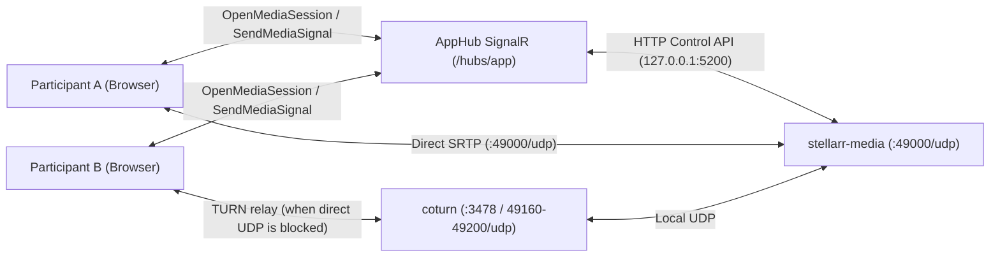
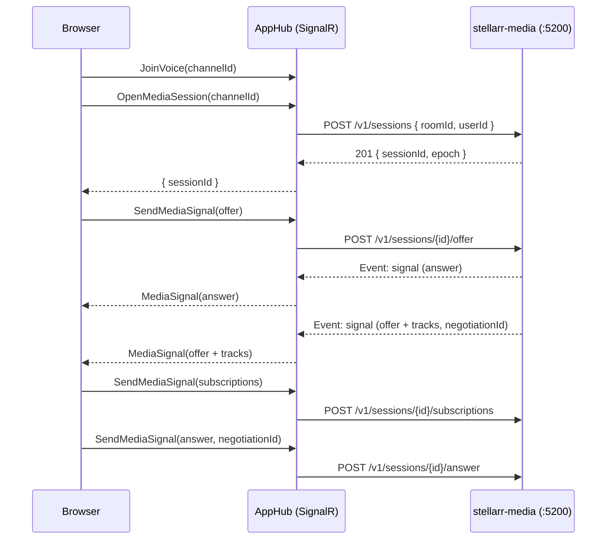

# Stellarr Media

Stellarr Media (`stellarr-media`, in `media/`) is Stellarr's Rust Selective Forwarding Unit (SFU). Every voice channel and direct call goes through it: each participant opens a single `RTCPeerConnection` to the media server, which forwards microphone, camera, and screen-share RTP packets to everyone else in the room without transcoding or mixing. Browsers never send media directly to one another.

This page covers:

1. **Hub leg**: SignalR methods and events between browser clients and `AppHub`.
2. **Control API**: Loopback HTTP protocol between `AppHub` and `stellarr-media`.
3. **Media plane**: ICE-lite transport, SDP negotiation, RTP forwarding, and resource limits.

See [Voice and RTC protocol](./rtc-protocol.md) for bootstrap configuration, `VoiceSignal` state messages, `VoiceState`, and audio/video profiles.

## Overview

| Aspect | Behavior |
| --- | --- |
| WebRTC engine | `str0m` (sans-IO ICE, DTLS, SRTP, RTP/RTCP) |
| Transport | ICE-lite on a single UDP socket (`0.0.0.0:49000`) |
| Forwarded media | Microphone audio, camera video, screen video, and screen audio |
| Media processing | Packet-level RTP forwarding; no decoding, mixing, or transcoding |
| Authorization | `AppHub` authorizes seats; `stellarr-media` only accepts commands on its loopback control API |
| Signaling path | Browser ↔ `AppHub` (SignalR) ↔ `stellarr-media` (`127.0.0.1:5200`) |
| Connections per client | Single `RTCPeerConnection` (`bundlePolicy: "max-bundle"`) |
| Offer direction | Browser offers published tracks (`sendonly`); `stellarr-media` offers forwarded tracks (`sendonly` to the receiver) |
| Glare resolution | Browser is the impolite peer; `stellarr-media` is the polite peer |
| Track attribution | Server-issued directory mapping SDP `mid` → `{ userId, kind, streamId, heldBack }` |
| Downlink adaptation | Per-receiver GoogCC BWE: all subscribed audio forwards; video forwards in subscription priority order while headroom allows, holding excess video back per receiver |
| Direct calls | Routed through the media server just like server voice channels |
| End-to-end encryption | A direct call in a conversation with end-to-end encryption on is encrypted frame by frame in the browsers; the media server forwards payloads it cannot read (see [End-to-end encrypted calls](#end-to-end-encrypted-calls)) |

## Topology



Because all media goes through the container, any browser outside the Docker host needs the media server's public candidate: set `PUBLIC_IP` and forward UDP `STELLARR_MEDIA_PORT` (default `49000`) to the host on the same external port. Without `PUBLIC_IP`, the media server advertises only the container's internal address, which off-host browsers can reach only through TURN (`coturn`). See [Requirements](install/requirements.md#behind-nat).

`GET /api/bootstrap` returns:

```json
{
  "protocolVersion": 1,
  "mediaServer": "udp://chat.example.com:49000"
}
```

- `mediaServer` is `udp://{Rtc:PublicHost}:{Rtc:MediaPort}` (falling back to `localhost` when `Rtc:PublicHost` is unset). It is used for diagnostics; actual connection addresses come from SDP ICE candidates.

## Hub leg

`AppHub` exposes two SignalR methods and two events for the media server:

| Type | Name | Description |
| --- | --- | --- |
| Method | `OpenMediaSession` | Allocate a media session for the caller's active voice seat |
| Method | `SendMediaSignal` | Send an SDP offer/answer, ICE candidate, or receive subscriptions to `stellarr-media` |
| Event | `MediaSignal` | Deliver an SDP offer/answer or track directory from `stellarr-media` |
| Event | `MediaSessionClosed` | Notify the client that the media session was closed by the media server |

### `OpenMediaSession(channelId) → { sessionId }`

- Requires the caller to hold an active seat in `channelId` (via `JoinVoice`).
- If the connection already has a media session, the previous session is detached and closed asynchronously in the background. Because `stellarr-media` enforces at most one session per `userId`, out-of-order close requests cannot affect the new session.
- Returns an opaque `sessionId` that must accompany all subsequent `SendMediaSignal` calls. Clients ignore any `MediaSignal` or `MediaSessionClosed` event carrying a different `sessionId` or `channelId`.
- Error responses:
  - `HubException("Invalid channelId.")` when `channelId` is not a valid UUID.
  - `HubException("Not seated in this voice room.")` when the caller has no seat in `channelId` (including if the seat ended while the session was being created).
  - `HubException("Media server is unavailable.")` when `stellarr-media` is unreachable, times out, or is undergoing a startup/event-loss reset.

Clients call `OpenMediaSession` after every `JoinVoice` (initial join, moderator move, hub reconnect, or session recovery) and create a fresh `RTCPeerConnection` for each session.

### `MediaSignal` envelope

```json
{
  "protocolVersion": 1,
  "channelId": "uuid",
  "sessionId": "opaque",
  "kind": "offer | answer | candidate | subscriptions | tracks",
  "payload": "JSON string"
}
```

| Kind | Direction | Payload schema |
| --- | --- | --- |
| `offer` | Browser → Media | `{ "type": "offer", "sdp": "…" }` |
| `answer` | Media → Browser | `{ "type": "answer", "sdp": "…" }` |
| `offer` | Media → Browser | `{ "type": "offer", "sdp": "…", "negotiationId": 7, "tracks": [Track] }` |
| `answer` | Browser → Media | `{ "type": "answer", "sdp": "…", "negotiationId": 7 }` |
| `candidate` | Browser → Media | `RTCIceCandidateInit` object, or `null` (end-of-candidates) |
| `subscriptions` | Browser → Media | `{ "mids": ["receiving-mid", "…"] }`, every receiving section to forward |
| `tracks` | Media → Browser | `{ "tracks": [Track] }` |

Each `Track` entry in the directory has the shape:

```json
{ "mid": "fAk", "userId": "uuid", "kind": "audio | video", "streamId": "…", "heldBack": false }
```

`heldBack` is `true` for a picture this receiver asks for that its downlink has no room for now: nothing of it is sent until it is `false` again (see [Downlink adaptation](#downlink-adaptation)). It is always present, and `false` for every sound and for every section the receiver does not ask for. A change of it sends a new `tracks` directory.

- **Validation**: `AppHub` verifies `protocolVersion == 1`, `kind` (`offer`, `answer`, `candidate`, or `subscriptions` from browser), seat ownership, `sessionId` ownership, payload UTF-8 byte length ≤ 128 KiB, and payload schema. Invalid signals throw `HubException("Invalid media signal.")` (or `HubException("Invalid ChannelId.")`).
- **Control API forwarding**:
  - `409 stale-negotiation` on a stale answer returns normally (`stellarr-media` discards stale answers by design).
  - `422` or `413` throws `HubException("Invalid media signal.")`.
  - `404 unknown-session` returns normally and triggers `MediaSessionClosed` with `reason: "media-restarted"`.
  - Other failures throw `HubException("Media server is unavailable.")`.
- **Server-to-browser events**: `MediaSignal` carries only `offer`, `answer`, and `tracks`. `stellarr-media` includes all ICE host candidates directly in its SDP and never trickles candidates.
- Every `tracks` list contains the complete track directory for the session, never a partial diff.

### Receive subscriptions

`subscriptions` replaces the complete ordered list of receiving SDP `mid`s that `stellarr-media` forwards to a session.

- **Default & empty state**: New sessions receive nothing until they send a list; sending `mids: []` pauses all forwarding.
- **Priority order**: Order expresses receiver priority (most important first) and determines which video tracks survive [downlink adaptation](#downlink-adaptation). Reordering the same `mid`s counts as a new list.
- **Unsubscribed & future `mid`s**: Unlisted sections remain negotiated in SDP and present in the track directory without carrying RTP packets (including newly negotiated sections until listed). Unknown or not-yet-negotiated `mid`s are harmlessly retained on that session alone, allowing the browser to pre-subscribe before answering a server offer.
- **Bounds & atomicity**: Lists accept up to `4,096` unique `mid`s (`1–16` printable ASCII characters, no spaces). Invalid lists are rejected whole without altering the active list.
- **No SDP renegotiation**: Updating subscriptions toggles packet forwarding only. Transceivers, `mid`s, and the track directory stay unchanged.
- **Seamless resume**: Resuming a paused track continues RTP sequence numbers contiguously (keeping publisher timestamps) and triggers a rate-limited PLI keyframe request for video. Receiver PLIs for unsubscribed sections are ignored.
- **Client subscription policy**: The browser subscribes in priority order (microphones, watched screen video and screen audio, then cameras in directory order) via `VoiceClient.setReceivePreferences({ screen, cameras })`.
  - Updates precede the matching `answer` in the serialized SignalR outbox and throttle to at most once every `250 ms`.
  - Until a publisher's `state` signal arrives, video streams default to screen-share classification. Newcomers receive occupancy/`state` before the first SFU offer, and classifications survive session replacements.
- **Whole-track forwarding**: Forwarded tracks carry the publisher's encoded stream as-is without per-receiver simulcast or SVC layer selection.

### Negotiation rules



- **Browser offers (publishing)**: The browser sends an SDP offer whenever its published tracks change (initial join, camera toggle, screen-share toggle). The initial offer after `OpenMediaSession` must contain at least one m-line; a receive-only client offers a `recvonly` audio transceiver (answered `inactive`).
- **Server offers (forwarding)**: `stellarr-media` sends an offer whenever forwarded tracks for the session change, but only after answering the browser's first offer.
- **Ordering**: Signals from `stellarr-media` are delivered in sequence order. The browser serializes its outgoing `SendMediaSignal` calls, awaiting each hub response before sending the next.
- **Glare**: The browser is impolite and drops any incoming media-server offer while its own offer is in flight. `stellarr-media` is polite: if a browser offer arrives while a server offer is pending, it rolls back the server offer, answers the browser's offer, and issues a new server offer with an incremented `negotiationId`.
- **Stale answers and timeouts**: Each server offer carries a monotonically increasing `negotiationId` (starting at `1`), which the browser echoes in its `answer`. Answers with a non-matching `negotiationId` are rejected with `409 stale-negotiation`. If a server offer receives no answer or competing browser offer within 10 s, it is rolled back and re-offered; after 3 consecutive unanswered offers, the session is closed with `error`.
- **Immediate client recovery**: If the browser fails to apply a remote SDP description or `SendMediaSignal` is rejected by the hub, the client immediately replaces the media session rather than waiting for server timeouts.

> [!IMPORTANT]
> Published tracks must be added on dedicated transceivers via `addTransceiver(track, { direction: "sendonly", streams: [stream] })`. Do not use `addTrack`: browsers may attach `addTrack` to an existing server-created transceiver, which `stellarr-media` never accepts incoming media on (answering `sendonly` or `inactive`).

### Track directory

Because all remote media arrives over a single `RTCPeerConnection`, the client attributes incoming tracks using the server-provided directory:

- `mid`: Matches the receiving transceiver's SDP `a=mid` value, assigned by `stellarr-media`.
- `userId`: Lowercase UUID of the publishing user, bound from the authenticated seat.
- `streamId`: Stream identifier declared by the publisher (`""` if none), matched against `screenStreamId` and `cameraStreamId` in the publisher's `VoiceSignal` (`kind: "state"`) to distinguish microphone, camera, and screen tracks.
- **Shared microphone and camera stream**: A publisher places its microphone and camera tracks into a single `MediaStream` (one `msid`) per call and advertises that stream ID as `cameraStreamId` while the camera is active. `stellarr-media` preserves the publisher's `msid` in forwarded offers so receiving browsers keep voice and camera synchronized. Screen shares use a separate `MediaStream`.
- **Distinguishing microphone vs. screen audio**: On the receiving side, an incoming audio track is treated as the publisher's microphone if its stream is or was announced as `cameraStreamId` or if the audio track was registered on that stream before any video track. It is treated as screen-share audio if its stream matches `screenStreamId` or if a video track was registered on that stream first. Because the track directory lists a screen share's video track before its audio track, receivers classify screen audio accurately even before the publisher's `state` signal arrives.
- **Holding unattributed tracks**: Tracks whose `mid` is not yet in the directory, or whose `userId` is not in the current `VoiceParticipantChanged` occupancy snapshot, remain muted/unplayed until both include them.
- **In-place track swaps**: When a publisher switches capture devices and updates its stream ID without adding a new transceiver, `stellarr-media` emits a `tracks` signal without renegotiating SDP.

### `MediaSessionClosed`

```json
{ "channelId": "uuid", "sessionId": "opaque", "reason": "media-restarted | transport-timeout | error" }
```

Sent only when the media server closes a session while the user's voice seat is still active:

| Reason | Cause |
| --- | --- |
| `media-restarted` | `stellarr-media` restarted, the API reset it after an event-log gap, or a signal returned `404 unknown-session` |
| `transport-timeout` | ICE + DTLS + SRTP failed to connect within 30 s, or remained disconnected for 30 s |
| `error` | Protocol or resource limit exceeded (e.g. 3 unanswered offers or SDP size limit) |

Sessions closed because the user left the seat or opened a replacement session do not emit `MediaSessionClosed`.

## Seat and session lifecycle

A media session is bound to an active voice seat in `PresenceTracker`. `AppHub` and moderation endpoints close the media session whenever a seat changes:

| Trigger | Source |
| --- | --- |
| User leaves voice | `LeaveVoice` |
| SignalR connection disconnects | `OnDisconnectedAsync` |
| Newer browser tab takes the seat | `JoinVoice` (`VoiceSessionReplaced`) |
| User switches voice rooms | `JoinVoice` (from a previous room) |
| Direct call declined or user blocked | `DeclineDirectCall`, `SocialEndpoints` |
| Moderator kicks or moves user in voice | `VoiceModerationEndpoints` |
| Moderator kicks or bans user from server | `ModerationEndpoints` |

`PresenceTracker` detaches the session immediately in memory and enqueues a `DELETE /v1/sessions/{sessionId}` job in `MediaSessionCloser` (which retries every 2 s up to a bounded queue of 4,096 pending deletes). Calling `JoinVoice` again for the room the connection already occupies is a no-op and preserves the existing session.

## Client state and recovery

### `VoiceState` mapping

| State / Field | Condition |
| --- | --- |
| `peerCount` | Number of other participants seated in the room |
| `connectedPeerCount` | Number of seated participants whose microphone `inbound-rtp` packet counter is advancing (or who have an active transceiver while muted) |
| `transport.media = connecting` | Peer connection is not yet `connected`, or outgoing audio RTP packets have not yet advanced |
| `transport.media = ready` | Peer connection is `connected`, outgoing audio RTP is verified, and `peerCount === 0` |
| `transport.media = connected` | Peer connection is `connected`, and every other participant's microphone either arrives or is still within its arrival grace, with at least one arriving |
| `transport.media = degraded` | A microphone is missing past its arrival grace, connection is `disconnected`/`failed`, outgoing audio is unverified after 3 stats samples (`voiceClient.mediaServerStalled`), or session replacement is in progress |
| `transport.media = failed` | Automatic session replacement attempts exhausted (`voiceClient.mediaServerLost`) |

### Session recovery

- If the peer connection stays `disconnected` for more than 10 s, transitions to `failed`/`closed`, receives `MediaSessionClosed`, fails SDP application, or fails `OpenMediaSession`/`SendMediaSignal`, the client closes the `RTCPeerConnection` and opens a replacement media session while keeping local microphone, camera, and screen tracks alive.
- The client performs up to 3 automatic replacement attempts with backoff delays of `2 s`, `4 s`, and `8 s`. Once outgoing audio RTP is verified (or on a fresh `JoinVoice`), the retry counter resets. If all 3 attempts fail, `transport.media` enters `failed` (`voiceClient.mediaServerLost`).
- Clicking **Reconnect** in the call banner repairs the session in place: it refreshes ICE credentials, calls `JoinVoice` for the current room (keeping the seat without broadcasting a leave/join to other participants), and opens a new media session with a reset retry budget.

### Proving media quickly

- Transport health is verified from cumulative RTP counters (`getStats`), sampled on a 3 s interval. When the connection first reaches `connected` or a new participant joins, the client runs rapid initial checks at `250 ms`, `500 ms`, `1 s`, and `2 s` until RTP flow is confirmed, then resumes the normal 3 s interval.
- A newly joined participant's microphone is treated as pending (not missing) for a 3 s grace window starting from when the connection came up or when the participant joined, whichever is later.
- Each remote microphone transceiver is re-evaluated at most once every 500 ms; samples taken less than 500 ms apart keep the previous status so DTX silence packets (sent every 400 ms) are not mistaken for a stalled stream.

## Control API (`127.0.0.1:5200`)

`AppHub` is the only client of the HTTP/1.1 JSON control API:

- Every endpoint except `GET /v1/health` requires `Authorization: Bearer <secret>` (unless bound to loopback with an empty secret). Invalid or missing credentials return `401`.
- Error responses have the shape `{ "error": "<code>", "detail": "<text>" }`.
- `sessionId` and `epoch` are 32-character lowercase hex strings; `roomId` and `userId` are lowercase UUIDs.

| Endpoint | Success response | Error statuses |
| --- | --- | --- |
| `GET /v1/health` | `200 { "status": "ok", "version": "…", "epoch": "…", "rooms": 0, "sessions": 0 }` | None |
| `POST /v1/reset` | `200 { "epoch": "…", "seq": 0 }` | None |
| `POST /v1/sessions` (`{ "roomId", "userId" }`) | `201 { "sessionId": "…", "epoch": "…" }` | `422 invalid-request` |
| `DELETE /v1/sessions/{sessionId}` | `204` (idempotent for unknown sessions) | None |
| `POST /v1/sessions/{sessionId}/offer` (`{ "sdp" }`) | `204` | `404 unknown-session`, `422 invalid-sdp`, `422 limit-exceeded` |
| `POST /v1/sessions/{sessionId}/answer` (`{ "sdp", "negotiationId" }`) | `204` | `404 unknown-session`, `409 stale-negotiation`, `422 invalid-sdp` |
| `POST /v1/sessions/{sessionId}/candidate` (`{ "candidate" }`) | `204` | `404 unknown-session`, `422 invalid-candidate` |
| `POST /v1/sessions/{sessionId}/subscriptions` (`{ "mids": [...] }`) | `204` | `404 unknown-session`, `422 invalid-request` |
| `GET /v1/events?epoch=…&after=…&waitMs=…` | `200 { "epoch": "…", "reset": false, "events": [Event] }` | `422 invalid-request` |
| `GET /v1/stats` | `200 { "epoch": "…", "rooms": [...] }` | None |

Additional status codes: `413 payload-too-large` (request body > 256 KiB), `404 not-found`, `405 method-not-allowed`, `503 unavailable`.

### Event long-polling (`GET /v1/events`)

Returns immediately when events with `seq > after` exist, or waits up to `waitMs` (max `30000`; the API polls with `waitMs=25000` and a 30 s HTTP timeout). Returns up to 256 events per response:

```json
{ "seq": 41, "type": "signal", "sessionId": "…", "kind": "answer | offer | tracks", "payload": { } }
{ "seq": 42, "type": "closed", "sessionId": "…", "reason": "transport-timeout | error" }
```

- `epoch` identifies the `stellarr-media` process instance. If the requested `epoch` does not match the running epoch, or if `after` falls outside the 4,096-event ring buffer, `stellarr-media` responds immediately with `{ "epoch": "<current>", "reset": true, "events": [] }`.
- On `reset: true`, the API closes all tracked sessions from the stale epoch (emitting `MediaSessionClosed` with `media-restarted`), calls `POST /v1/reset` if the epoch was unchanged but the ring buffer overflowed, and resumes polling from `after=0`.

### Diagnostics (`GET /v1/stats`)

```json
{
  "epoch": "…",
  "rooms": [
    {
      "roomId": "uuid",
      "sessions": [
        {
          "sessionId": "…",
          "userId": "uuid",
          "state": "new | connecting | connected | disconnected",
          "ageMs": 0,
          "published": 2,
          "forwarded": 6,
          "ingress": { "packets": 0, "bytes": 0 },
          "egress": { "packets": 0, "bytes": 0 },
          "downlink": {
            "estimateBps": 431000,
            "rawEstimateBps": 512000,
            "smoothedEstimateBps": 431000,
            "measured": true,
            "forwardedBps": 281000,
            "desiredBps": 531000,
            "paddingBps": 0,
            "heldBack": [{ "mid": "pmQ", "userId": "uuid", "costBps": 250000 }],
            "holds": 2,
            "resumes": 1
          }
        }
      ]
    }
  ]
}
```

`ingress` and `egress` count media payload packets and bytes (excluding RTP headers, RTCP, and RTX retransmissions).

`downlink` is the session's [downlink adaptation](#downlink-adaptation), in bits per second of RTP payload: `estimateBps` is the estimate the allocation uses (the lower of str0m's latest raw estimate and its three-second smoothing, or the initial guess while `measured` is `false`), `forwardedBps` what is sent, `desiredBps` what the estimator probes toward, `paddingBps` the rate padding keeps up toward the first held picture while a trial runs, `heldBack` every picture held back with its publisher and its current cost, and `holds` and `resumes` how often a picture was held back and came back since the session began. Every change of what is held back is also logged at `debug` with the estimate, what is forwarded and what is desired.

## Media plane behavior

### Transport

- Single UDP socket (`0.0.0.0:49000`); incoming packets are demultiplexed by remote socket address (and by STUN username fragment on the initial connectivity check).
- Each session accepts connectivity checks from at most 64 distinct remote addresses over its lifetime.
- ICE-lite: `stellarr-media` responds to STUN checks and acts as DTLS server.
- Advertised host candidates (IPv4 only): `STELLARR_MEDIA_PUBLIC_IP:STELLARR_MEDIA_PUBLIC_PORT` (when set) followed by the primary local IPv4 address on the bound port (used for internal `coturn` relay).

### Forwarding

- Every session in a `roomId` negotiates the tracks published by the other sessions in that room, never its own, and is forwarded those its [receive subscriptions](#receive-subscriptions) ask for.
- Per connection, `stellarr-media` rewrites SSRC, payload type, RTP header extension IDs, and sequence numbers/timestamps while leaving media payloads untouched after SRTP decryption and re-encryption. It never reads a payload, which is what lets an [end-to-end encrypted call](#end-to-end-encrypted-calls) pass through it unchanged.
- Supported codecs: Opus, VP9, VP8, H.264, AV1. Publisher codec order is preserved, and publisher Opus `a=fmtp` parameters are echoed back so the browser configures its encoder according to the selected profile.
- Audio level RTP header extensions are forwarded (an end-to-end encrypted call does not negotiate them).
- NACK, RTX, transport-wide congestion control (TWCC), and keyframe requests (PLI/FIR, rate-limited to once per second per track) are handled per leg. The TWCC feedback of each receiving browser drives the media server's estimate of that receiver's downlink.

### Downlink adaptation

Each receiving session runs independent GoogCC bandwidth estimation (`str0m`) from its own TWCC feedback. Congested receivers keep voice audio flowing while holding back excess video, without affecting the publisher or other participants. Rates below count RTP payload bits per second (smaller packets such as voice carry higher IP/UDP wire overhead).

- **Bandwidth estimate**: Starts at `1 Mbit/s` and samples `min(rawEstimate, smoothed3sEstimate)` every `200 ms`, so congestion drops register immediately while increases require sustained headroom. Until feedback moves the estimate off `1 Mbit/s` and settles for `1 s`, video is neither held back nor paced (preventing initial keyframes from queuing behind an unmeasured initial guess). Once settled, unaffordable video is shed within `2 s` (or `300 ms` on a steep drop).
- **Track cost**: Measured per published track as trailing payload bitrate over `2 s` (`≥ 0.5 s` for new tracks).
- **Allocation & priority blocking**: All subscribed audio is always forwarded. Subscribed video tracks are evaluated in `subscriptions` order against remaining headroom:
  - A video track that fits is forwarded; one that does not is marked `heldBack: true`.
  - If a held-back video is **within reach** (`cost ≤ 1.5× estimate`), lower-priority videos behind it are also held back so lesser cameras cannot starve a higher-priority share waiting to recover. If it is **out of reach** (`cost > 1.5× estimate`), lower-priority videos that fit can still forward.
  - Allocation re-runs on estimate/subscription/directory updates and every `500 ms` while video is subscribed whenever a track cost shifts by `≥ 20%` (and `≥ 8 kbit/s`) or a hysteresis timer is active.
- **Holding back**: Held-back video behaves identically to an unsubscribed track (contiguous sequence numbers on resume, rate-limited PLI on return, receiver PLIs ignored) and sets `heldBack: true` in the `tracks` directory.
- **Hysteresis**:
  - **Hold**: Triggered once required rate exceeds `1.1×` smoothed estimate for `2 s`, or after `300 ms` when raw estimate drops below `2/3` of required rate.
  - **Resume**: Triggered once required rate stays within `85%` of estimate for `4 s`. Re-holding within `30 s` doubles the recovery wait up to `64 s`; holding steady for `30 s` resets the penalty.
  - **Unproven tracks**: Newly subscribed tracks start immediately if they fit; a track held back from the start only activates after a padding trial holds the required estimate for `1 s`.
- **Probing & padding**:
  - Target probe rate is `forwardedBps + firstHeldCost` (capped at `2×` by `str0m`), or `forwardedBps` when nothing is held back.
  - Held tracks within reach (`≤ 1.5×` estimate) run `6 s` padding trials (suppressed automatically on congestion) separated by `15 s`, `30 s`, and `60 s` rests (ending early if the estimate rises by `25%`). During a trial and for `5 s` afterward, only a deep raw-estimate drop (`< 2/3`) can hold back active video. Out-of-reach tracks receive no padding.
  - If any video is held back, no padding trial is active, and the estimate stagnates for `5 s`, the estimator resets at its current rate to clear loss-limited state and emit fresh probes (repeating every `10 s`, doubling up to `2 min`).
- **Audio-only fallback**: When even subscribed audio exceeds the estimate, all audio continues forwarding, all video and video-probing padding stop, and only `str0m`'s `50 kbit/s` minimum padding floor applies when send rate is below it.
- **Pacing & isolation**: Active video paces at `1.1×` estimate while audio remains unpaced ahead of video queues. Receiver feedback and subscriptions affect only that session, and withdrawn transceivers stop receiving padding once the browser confirms them inactive.

### Resource limits

| Limit | Value | Behavior when exceeded |
| --- | ---: | --- |
| SDP length | 128 KiB | `422 invalid-sdp` on browser SDP; session closed with `error` if server SDP exceeds limit |
| Published tracks per session | 8 | `422 limit-exceeded` |
| Control API request body | 256 KiB | `413 payload-too-large` |
| Usable trickled ICE candidates per session | 64 | Subsequent candidates return `204` and are ignored |
| Remote peer addresses per session | 64 | Checks from additional addresses are dropped |
| Initial connection timeout (ICE + DTLS + SRTP) | 30 s | Closed with `transport-timeout` |
| Disconnected timeout | 30 s | Closed with `transport-timeout` |
| Consecutive unanswered server offers | 3 | Closed with `error` |
| Mids in one receive subscription list | 4,096 | `422 invalid-request`; the previous list stays in force |
| Return of a held-back picture | after 4 s of headroom, doubling to 64 s after each return that lasts under 30 s; one that never had room, after 1 s of padding toward it that the estimate holds | The picture stays held back meanwhile |
| Padding toward a held-back picture | 6 s trials, rests of 15, 30, then 60 s | Only while the picture needs at most 1.5 times the estimate |
| Fresh looks of a still estimate | after 5 s, then every 10 s doubling to 2 min | Only while a picture is held back and no padding trial runs |

### Current limitations

`stellarr-media` does not currently implement:

- **Layer and simulcast selection per receiver**: A receiver is sent a picture whole, at the publisher's quality, or not at all; nothing drops VP9 temporal layers or picks a simulcast encoding for a slow downlink, and sounds are always sent at their publisher's rate.
- **SDP m-line recycling**: Inactive m-lines are not reused within a session. A long session with many track toggles eventually reaches the 128 KiB SDP limit and automatically reconnects with a fresh session.
- **Active-speaker filtering**: Receive subscriptions and the downlink allocation select whole tracks in the order the browser gives; nothing follows who is speaking.
- **Session persistence across hub reconnects or ICE restarts**: The client opens a new session instead.
- **IPv6 or direct ICE-TCP**: The media socket uses IPv4 UDP only; clients restricted to TCP connect through `coturn`.

> [!WARNING]
> Call media is encrypted in transit between each browser and `stellarr-media` (DTLS-SRTP). Because `stellarr-media` terminates SRTP on each leg to forward packets, the audio and video of server voice channels, and of direct calls in conversations without end-to-end encryption, are decrypted in process memory on the host running the container. Only a direct call in a conversation with end-to-end encryption on is encrypted between the two browsers; see [End-to-end encrypted calls](#end-to-end-encrypted-calls) for what the server still sees.

## End-to-end encrypted calls

A direct call in a conversation whose end-to-end encryption is on is encrypted in the two browsers, frame by frame, with keys the server never holds. `stellarr-media` forwards it like any other call: it needs no setting and no change, because it never reads a payload.

### When a call is encrypted

- The browser decides before it takes the seat, so before the other side rings, from the conversation's encryption state read from the API at that moment. An encrypted conversation's call is encrypted or does not happen: a browser that cannot encrypt, or cannot load the keys, does not join, and never falls back to a call in the clear.
- The call button of an encrypted conversation is disabled with the reason in a browser that cannot encrypt calls (no WebRTC Encoded Transform, no WebCrypto X25519, a page not served over HTTPS, or an account that already holds keys in its maximum number of browsers). An incoming call there says it cannot be answered in this browser and why.
- A call stays as it began: switching encryption off during an encrypted call keeps that call encrypted until it ends. A browser that joins it later in the clear sees the other side announce `encrypted: true` in its `state` signal, plays nothing of them, and moves its own connection to encryption with the conversation's newest epoch it can open. A plain call whose conversation is switched on moves to encryption the same way.
- Every media session of the call, including the replacements after a lost connection, uses the same keys; each new connection draws new key ids.
- The call view shows "End-to-end encrypted" under the other person's name only while this browser encrypts the call, and a person whose sound or picture arrives but does not decrypt is shown as such; nothing that fails to decrypt is played.

### Frame format

Each encoded frame becomes `clear prefix | header | AES-256-GCM ciphertext | tag (16 B) | prefix length (1 B)`, using WebRTC Encoded Transform (`RTCRtpScriptTransform`, or Chromium's `createEncodedStreams`) in a dedicated worker (`web/src/stellarr/lib/voice/e2ee/frameWorker.ts`, format in `sframe.ts`).

- **Header**: the RFC 9605 section 4.3 header: a config byte, then a 64-bit key id and a frame counter, each in as few bytes as it takes.
- **Clear prefix**: what the receiving browser's depacketizer must read before the receiving transform runs. Opus and VP9 keep nothing in the clear. VP8 keeps its 3-byte frame tag on a delta frame and 10 bytes on a keyframe (the tag, the start code and the frame size). H.264 and AV1 cannot be encrypted this way (their packetizers parse the frame), so encrypted calls negotiate only Opus, VP8 and VP9, sending and receiving, and a frame of any other codec is never sent.
- **Associated data**: the clear prefix, the header and the length byte, so none of them can be changed in transit.
- **Keys**: the conversation's current epoch key (the one its next message would be encrypted with; see the conversation's epochs in the encryption API) is imported as a non-extractable HKDF key. Each sender track draws a key id of 16 bits of epoch sequence and 48 random bits per connection and epoch; its AES key and 12-byte nonce salt are HKDF-SHA-256 of the epoch key with the epoch id as salt and `stellarr/e2ee/call/v1|conversationId|senderUserId|keyIdHex` as info. The nonce is the salt XORed with the counter.
- **Receivers** take the sender's user id from the media server's track directory, so a frame reflected back to its sender, or relabelled as another person's, does not open. A receiver derives the key of an unknown key id on demand, looks up an epoch it does not hold (at most once every two seconds) and drops that epoch's frames meanwhile, rejects a counter it has already accepted (a 128-frame sliding window, advanced only by frames that verify), and asks for a keyframe at most once a second until one opens.
- **Rotation**: when the conversation's keys change (a device added or removed, a key reset), the next message's epoch is handed to every receiver at once and the senders move to it 1.5 s later.

### What the media server still sees

End-to-end encryption hides what is said and shown, not that a call takes place. Whoever runs the server, or can read its memory and traffic, still has:

- **Who, when and how long**: the seats and the call's occupancy, the hub signals (`state` with mute, stream ids and whether the sender encrypts), and the track directory (which user publishes which microphone, camera and screen, and when each starts and stops).
- **RTP and RTCP metadata**: SSRCs, sequence numbers, timestamps, marker bits and payload types (so the codec), NACKs, keyframe requests, receiver reports and transport-wide congestion control feedback, the bandwidth estimates and which pictures are held back, and every participant's IP address.
- **Sizes and timing**: the size and timing of every packet. Encrypted calls ask for their voice at a constant bitrate without discontinuous transmission, and do not negotiate the audio-level header extension, so the voice's packets do not follow speech. Both are written into the browser's own description; a browser that refuses the edited description gets the unedited one, and its voice is then still encrypted but variable (Chromium accepts it). Pictures stay variable: their sizes show motion and keyframes.
- **The clear bytes and headers of each frame**: a VP8 frame's tag (keyframe or not, frame size), a VP8 keyframe's dimensions, and each frame's key id (with the epoch sequence) and counter.

What the keys cover follows the conversation's devices: every active device of both people can open the epoch, and so the call. See the conversation's safety code to confirm whose keys these are.

## Process configuration

### `stellarr-media` environment variables

| Variable | Default | Description |
| --- | --- | --- |
| `STELLARR_MEDIA_BIND` | `0.0.0.0:49000` | UDP media bind address |
| `STELLARR_MEDIA_PUBLIC_IP` | empty | Public IPv4 address advertised in ICE host candidates |
| `STELLARR_MEDIA_PUBLIC_PORT` | port of `STELLARR_MEDIA_BIND` | Public UDP port advertised with `STELLARR_MEDIA_PUBLIC_IP` |
| `STELLARR_MEDIA_ADVERTISE` | empty | Comma-separated `ip:port` list overriding derived host candidates |
| `STELLARR_MEDIA_CONTROL_BIND` | `127.0.0.1:5200` | HTTP control API bind address |
| `STELLARR_MEDIA_CONTROL_SECRET` | empty | Bearer token required by the control API (required when not bound to loopback) |
| `STELLARR_MEDIA_LOG` | `info` | `tracing` log filter (e.g. `info,stellarr_media=debug`) |

### ASP.NET Core API settings

| Setting | Default | Description |
| --- | --- | --- |
| `Rtc:MediaControlUrl` | `http://127.0.0.1:5200` | Base URL of the `stellarr-media` control API |
| `Rtc:MediaControlSecret` | empty | Shared bearer secret |
| `Rtc:MediaPort` | `49000` | Public UDP port advertised in `GET /api/bootstrap` (`1–65535`) |
