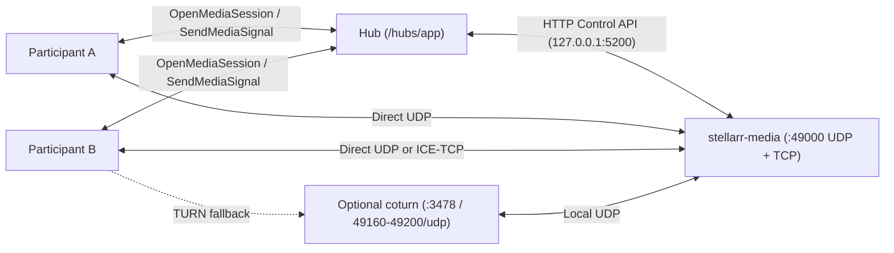
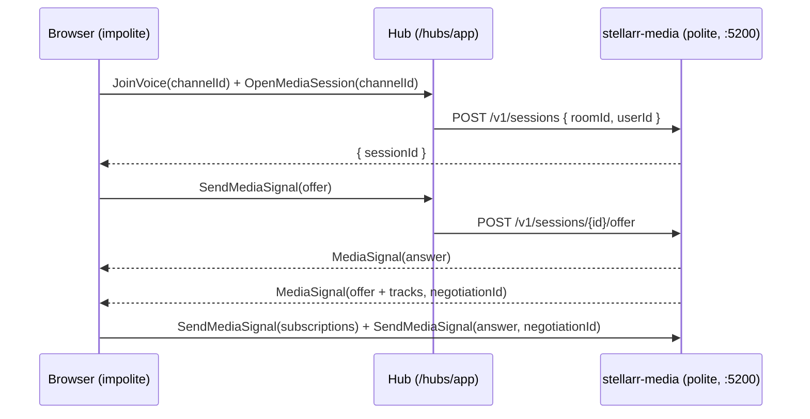

# Stellarr Media

Stellarr Media (`stellarr-media` in `media/`) is Stellarr's Rust WebRTC Selective Forwarding Unit (SFU) built on `str0m`. Every voice channel and 1:1 call connects to it via a single `max-bundle` `RTCPeerConnection` per participant—rewriting RTP headers per leg without decoding, mixing, or transcoding. See [Voice and RTC protocol](./rtc-protocol.md) for `VoiceState`, audio DSP, and media profiles.

## Architecture summary

| Property | Behavior |
| --- | --- |
| **WebRTC engine & transport** | `str0m` sans-IO ICE-lite + DTLS-SRTP + GoogCC BWE on shared `0.0.0.0:49000` UDP + RFC 4571 passive TCP |
| **Signaling & authorization** | Browser ↔ Hub (`/hubs/app`, `stellarr.v1`) ↔ Loopback Control API (`127.0.0.1:5200`); seats authorized by API |
| **Negotiation & glare** | Browser offers published tracks (`sendonly`, impolite); SFU offers forwarded tracks (`sendonly`, polite) |
| **Track attribution** | Full session track directory mapping SDP `mid` → `{ userId, kind, streamId, heldBack }` |
| **Downlink adaptation** | Per-receiver GoogCC BWE: forwards all subscribed audio first, then video in subscription priority order, pausing excess video (`heldBack: true`) |
| **1:1 E2EE calls** | Browser WebRTC Encoded Transform (`SFrame` AES-256-GCM); SFU forwards opaque ciphertext ([details](#end-to-end-encrypted-calls)) |



For remote callers, advertise a reachable IPv4 candidate and forward both UDP and TCP on `STELLARR_MEDIA_PORT` ([Behind NAT](install/requirements.md#behind-nat)).

---

## Hub leg

Implemented in `api/crates/server/src/voice/media.rs`:

- **`OpenMediaSession(channelId) → { sessionId }`:** Requires an active voice seat ([Voice seats](./rtc-protocol.md#voice-seats-viewchannel-and-connect)). Replaces the previous voice session on the same `userId` without race clobbering. Throws `"Invalid channelId."`, `"Not seated in this voice room."`, or `"Media server is unavailable."`.
- `ActivityCamera(place, { install, access, action })` opens or closes a separate session for the signed-in activity participant. The server selects the media room and revokes access when the launch or hub connection ends.
- **`SendMediaSignal` / `MediaSignal` (`protocolVersion: 1`, `≤ 128 KiB`):**

| `kind` | Direction | Payload |
| --- | --- | --- |
| `offer` | Browser → SFU | `{ "type": "offer", "sdp": "…" }` |
| `answer` | SFU → Browser | `{ "type": "answer", "sdp": "…" }` |
| `offer` | SFU → Browser | `{ "type": "offer", "sdp": "…", "negotiationId": 7, "tracks": [Track] }` |
| `answer` | Browser → SFU | `{ "type": "answer", "sdp": "…", "negotiationId": 7 }` (`409 stale-negotiation` ignored cleanly) |
| `candidate` | Browser → SFU | `RTCIceCandidateInit` or `null` (SFU embeds its own host candidates in SDP and never trickles) |
| `subscriptions` | Browser → SFU | `{ "mids": ["…"] }` ordered by receiver priority |
| `tracks` | SFU → Browser | `{ "tracks": [{ "mid", "userId", "kind", "streamId", "heldBack" }] }` (always complete list, never a diff) |

### Receive subscriptions

- **Opt-in forwarding:** Sessions receive zero RTP packets until sending `subscriptions` (`mids: []` pauses all forwarding; up to `4,096` printable ASCII `mid`s). Pre-subscribing unknown `mid`s before answering an SFU offer is supported.
- **Zero renegotiation:** Changing `subscriptions` toggles RTP forwarding immediately (continuing sequence numbers contiguously and sending a rate-limited PLI keyframe on video resume) without altering SDP transceivers.
- **Client ordering:** All microphones → watched screen video + screen audio → cameras (`VoiceClient.setReceivePreferences`), queued ahead of SDP answers and throttled to `250 ms`.

### Negotiation and track attribution



> [!IMPORTANT]
> Publish tracks strictly via `addTransceiver(track, { direction: "sendonly", streams: [stream] })`—never `addTrack`, which browsers can attach to server-created `recvonly`/`inactive` m-lines.

- **Glare & timeouts:** If a browser offer collides with a pending SFU offer, the browser ignores the SFU offer while `stellarr-media` rolls back, answers the browser, and re-offers with `negotiationId + 1` (`10 s` answer timeout; `3` unanswered strikes close with `error`).
- **Stream attribution:** Mic and camera share one `msid` (`cameraStreamId`) for lip-sync; screen video and audio share a separate `msid` (`screenStreamId`, with video listed before audio in `tracks` so receivers classify screen audio before `VoiceSignal` arrives). Unattributed tracks stay muted until present in both `tracks` and `VoiceParticipantChanged`.

### Session closure and seat lifecycle

`MediaSessionClosed` (`reason: "media-restarted" | "transport-timeout" | "error"`) fires only when the SFU drops a session while the user's seat remains active. Leaving voice, disconnecting, switching tabs/rooms, declining a 1:1 call, kicks/bans, or `voice::enforce` permission revocations detach the seat immediately and enqueue `DELETE /v1/sessions/{id}` (`voice/closer.rs`, `2 s` retry, `4,096` queue cap).

---

## Client recovery and proving media quickly

### Proving media quickly

- **Rapid startup sampling:** Samples `getStats()` at `250 ms`, `500 ms`, `1 s`, and `2 s` upon connecting or peer join until RTP advances, then settles to `3 s` intervals (`500 ms` min per-transceiver re-evaluation so `400 ms` DTX silence packets never look stalled).
- **Grace & auto-replacement:** Remote mics have a `3 s` arrival grace window before `transport.media` enters `degraded`. On disconnect (`> 10 s`), SDP/signal error, or `MediaSessionClosed`, the client replaces the SFU session automatically up to `3` times (`2 s`, `4 s`, `8 s` backoff, each stretched by up to half at random so a room does not return in one instant) while keeping local capture tracks alive.

---

## Control API (`127.0.0.1:5200`)

Authenticated with `Authorization: Bearer <media-control-secret>` on all routes except `/v1/health`:

| Endpoint | Response / behavior |
| --- | --- |
| `GET /v1/health` | `200 { status: "ok", version, epoch, rooms, sessions }` |
| `POST /v1/reset` | `200 { epoch, seq: 0 }` |
| `POST /v1/sessions` | `201 { sessionId, epoch }` (`422 invalid-request`) |
| `DELETE /v1/sessions/{id}` | `204` (idempotent) |
| `POST /v1/activity-sessions` | Opens a camera session in a dedicated activity room. Reopening replaces the same account’s session in that activity. The account’s voice session continues independently. |
| `POST /v1/sessions/{id}/{offer,answer,candidate,subscriptions}` | `204` (`404 unknown-session`, `409 stale-negotiation`, `422 invalid-*` / `limit-exceeded`, `413 payload-too-large`) |
| `GET /v1/events?epoch=…&after=…&waitMs=…` | Long-polls up to `256` `signal`/`closed` events (`4,096`-event ring buffer; returns `reset: true` on epoch change or overflow) |
| `GET /v1/stats` | Per-room/session `ingress`, `egress`, and GoogCC `downlink` (`estimateBps`, `forwardedBps`, `desiredBps`, `paddingBps`, `heldBack`, `holds`, `resumes`) |

---

## Media plane and downlink adaptation

### Downlink adaptation

Each receiver runs independent GoogCC bandwidth estimation (`str0m`) from its TWCC feedback (`min(rawEstimate, smoothed3sEstimate)` sampled every `200 ms`, starting at `1 Mbit/s` unpaced until settled for `1 s`):

| Mechanism | Thresholds & behavior |
| --- | --- |
| **Priority & head-of-line rule** | All subscribed audio always forwards unpaced. Video tracks allocate in `subscriptions` order. A held-back video track **within reach** (`cost ≤ 1.5× estimate`) also blocks lower-priority video behind it so small cameras cannot starve a recovering screen share; **out-of-reach** tracks (`> 1.5×`) let smaller tracks pass. |
| **Hold hysteresis** | Triggers when required bitrate exceeds `1.1×` smoothed estimate for `2 s`, or after `300 ms` if raw estimate drops below `2/3` of required bitrate. |
| **Resume backoff** | Resumes once required bitrate stays `≤ 85%` of estimate for `4 s` (doubling up to `64 s` on re-holds within `30 s`; `1 s` after padding proof for newly subscribed tracks). |
| **Padding trials & stagnant reset** | Held tracks within `1.5×` run `6 s` padding probes (`15 s`, `30 s`, `60 s` rests). Stagnant estimates reset after `5 s` (repeating `10 s` → `2 min`). When audio alone exceeds estimate, all video and video padding stop. |

### Resource limits and current boundaries

| Limit | Value | On exceed |
| --- | ---: | --- |
| SDP size / Control API body | `128 KiB` / `256 KiB` | `422 invalid-sdp` (or close `error`) / `413 payload-too-large` |
| Published tracks / ICE candidates / remote sockets | `8` / `64` / `64` per session | `422 limit-exceeded` / ignored / dropped |
| Connect / disconnect / unanswered-offer timeouts | `30 s` / `30 s` / `3 × 10 s` | Closed with `transport-timeout` / `error` |

**Not implemented:** per-receiver simulcast/SVC layer dropping (tracks forward whole or pause via `heldBack`), SDP m-line recycling (long sessions hitting `128 KiB` auto-replace), active-speaker switching, session survival across hub reconnects, and IPv6 media sockets.

> [!WARNING]
> Standard server voice channels and unencrypted 1:1 calls use hop-by-hop DTLS-SRTP—media headers and payloads traverse `stellarr-media` memory on your host. Only 1:1 calls in E2EE conversations encrypt media frames end-to-end between browsers.

---

## End-to-end encrypted calls

1:1 calls in E2EE conversations seal every encoded frame inside `web/src/stellarr/lib/voice/e2ee/frameWorker.ts` (`sframe.ts`, `callCrypto.ts`):

```text
| Clear codec prefix (0 / 3 / 10 B) | RFC 9605 SFrame header (keyId + counter) | AES-256-GCM ciphertext | 16 B GCM tag | 1 B prefix len |
```

- **Fail-closed startup & no downgrade:** Refuses to join if WebRTC Encoded Transform, WebCrypto `X25519`, HTTPS, or an active device slot is unavailable; once started encrypted, stays encrypted until hangup.
- **Codec allowlist & clear prefixes:** Negotiates **Opus, VP9** (`0` clear bytes), and **VP8** (`3 B` delta / `10 B` keyframe clear tag) only—blocking H.264 and AV1 whose RTP packetizers parse internal NAL/OBU bytes.
- **Key derivation & anti-replay:** Derives per-sender `256-bit` AES-GCM keys and `12-byte` salts from the epoch key via `HKDF-SHA256` (`stellarr/e2ee/call/v1|<convId>|<senderId>|<keyIdHex>`), binds `senderId` to the authenticated track directory, enforces a `128`-frame replay window, and delays sender epoch switches by `1.5 s` on mid-call rotation for zero frame loss.
- **Observable metadata:** The host still sees participant IDs, call timing, `VoiceSignal` flags, IP addresses, RTP/RTCP headers, variable video frame sizes, and the SFrame/VP8 clear headers (Opus uses `cbr=1`, `usedtx=0`, and no `ssrc-audio-level` to mask speech cadence).

## Process configuration

| `stellarr-media` variable / API setting | Default | Purpose |
| --- | --- | --- |
| `STELLARR_MEDIA_BIND` | `0.0.0.0:49000` | Shared UDP + passive TCP bind address |
| `STELLARR_MEDIA_PUBLIC_IP` / `STELLARR_MEDIA_PUBLIC_PORT` | empty / bind port | Advertised public IPv4 candidate |
| `STELLARR_MEDIA_ADVERTISE` | empty | Explicit `ip:port` candidate override list |
| `STELLARR_MEDIA_CONTROL_BIND` / `Rtc:MediaControlUrl` | `127.0.0.1:5200` | Loopback HTTP control API |
| `STELLARR_MEDIA_CONTROL_SECRET` / `Rtc:MediaControlSecret` | empty | Shared bearer token (`/data/stellarr/secrets/media-control-secret`) |
| `STELLARR_MEDIA_LOG` | `info` | `tracing` filter (`info,stellarr_media=debug`) |
