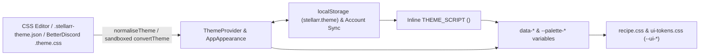

# Themes and appearance

The web client (`web/src/stellarr/`) lets each user customize palettes, light/dark schemes, contrast, self-hosted fonts, text scale, message spacing, personal wallpapers, `.stellarr-theme.json` files, and BetterDiscord `.theme.css` stylesheets.

## Rendering pipeline



`ThemeProvider` (`web/src/stellarr/state/ThemeProvider.tsx`) syncs preferences to the user's server-side client settings and mirrors them into `localStorage` (`stellarr.theme`). At build time, `themeScript.ts` inlines `THEME_SCRIPT` into `<head>` so `data-*` attributes and `--palette-*` variables apply before first paint with zero flash.

## Theme preference model

A `ThemePreference` (`web/src/stellarr/design/themes.ts`) tracks seven independent axes plus an optional wallpaper state:

| Axis | Values | DOM target & effect |
| --- | --- | --- |
| `palette` | `midnight` (default), `slate`, `evergreen`, `harbor`, `amethyst`, `ink`, `custom` | `data-theme` and `--palette-*` CSS variables |
| `accent` | `#rrggbb` (`#6f65d1` default) | `--palette-accent` (selecting a preset resets `accent` to that preset's default) |
| `scheme` | `dark` (default), `light`, `system` | `data-scheme` (`system` tracks `prefers-color-scheme`) |
| `contrast` | `normal` (default), `high` | `data-contrast` |
| `font` | 29 self-hosted families (`outfit` default) | `data-font` (fetched on demand; unauthenticated `/login` and `/setup` stay in `Outfit`) |
| `size` | `sm`, `md` (default), `lg` | `data-size` message text scale |
| `density` | `cozy` (default), `compact` | `data-density` message row spacing |
| `wallpaper` | `{ shade, blur, placeholder? }` or `null` | App-wide background treatment (`wallpaperUrl` lives on the user profile) |

## Built-in presets and custom palettes

| Preset | Surface character | Default accent |
| --- | --- | --- |
| `midnight` (default) | Deep zinc surfaces | `#6f65d1` |
| `slate` | Cool charcoal surfaces | `#6f65d1` |
| `evergreen` | Neutral dark surfaces | `#1db954` |
| `harbor` | Slate-blue surfaces | `#1a9fff` |
| `amethyst` | Near-black surfaces | `#9146ff` |
| `ink` | Dark slate surfaces | `#58a6ff` |

### Visual & CSS custom palette editors

Forking any preset (`forkPreset` in `customTheme.ts`) unlocks 19 hex color roles (`#rgb`, `#rgba`, `#rrggbb`, or `#rrggbbaa`; CSS functions and `url(...)` are rejected):

| Token family | Roles |
| --- | --- |
| `--palette-background-*` (8) | `darkest`, `dark`, `primary`, `secondary`, `tertiary`, `hover`, `active`, `floating` |
| `--palette-text-*` (3) | `normal`, `muted`, `faint` |
| `--palette-border-*` (3) | `subtle`, `default`, `strong` |
| `--palette-*` semantic (4) | `success`, `warning`, `danger`, `info` |
| `--palette-accent` (1) | Opaque `#rrggbb` accent |

Whenever a custom palette is saved, `makeCustomTheme` precomputes two derived values once so pre-paint and runtime styles never run color math:

- `accessibleFaint`: WCAG AA-compliant faint text color checked against all 8 surfaces.
- `neutral`: `{ hue, chroma }` (`--h-neutral`, `--c-neutral`, capped at `LIGHT_TINT_MAX = 20`) for tinting light-mode surfaces.

Under **User Settings → Appearance → Edit CSS**, users can also paste or edit a `:root` block directly (omitted roles inherit from the base preset):

```css
:root {
  --palette-accent: #47bfa2;
  --palette-background-darkest: #101923;
  --palette-background-dark: #152230;
  --palette-background-primary: #1c2c3b;
  --palette-background-secondary: #243647;
  --palette-text-normal: #edf5f8;
  --palette-text-muted: #bacbd5;
  --palette-border-subtle: #b1cde630;
}
```

Switching back to a built-in preset preserves `ThemePreference.custom` in storage so users can return to it later.

## Wallpapers

Uploaded personal wallpapers (`uploads/profile.rs`) support `shade` (`0–100%`, default `80%`), `blur` (`0–24 px`, default `0 px`), and an instant 32-byte base64 `placeholder`. Wallpaper assets are private to the uploading account (`assets/access.rs`). Selecting `midnight` or resetting defaults hides the active wallpaper until re-enabled via **Show saved wallpaper**.

---

## Sharing themes and BetterDiscord conversion

### `.stellarr-theme.json` export/import

Themes export and import as portable `.stellarr-theme.json` files (`≤ 12 MiB`, `themeFile.ts`):

```json
{
  "stellarrTheme": 1,
  "name": "Harbor Night",
  "author": "Maya",
  "colors": { "backgrounds": {}, "text": {}, "borders": {}, "semantic": {} },
  "accent": "#1a9fff",
  "font": "outfit",
  "wallpaper": {
    "image": "data:image/webp;base64,...",
    "shade": 80,
    "blur": 0
  }
}
```

Importing applies `colors`, `accent`, `font`, and any embedded raster `wallpaper` (decoded and re-encoded before upload) while leaving the recipient's personal readability settings (`size`, `density`, `contrast`, `scheme`) untouched.

### BetterDiscord `.theme.css` converter

`web/src/stellarr/lib/betterDiscord/` converts local `.theme.css` files, BetterDiscord catalog entries, direct HTTPS stylesheets, and public GitHub repository/file URLs:

1. **Server-assisted fetch:** Resolves `@import` chains (rewriting legacy RawGit URLs and retrying missing GitHub Pages stylesheets against source commits) via authenticated API requests bounded in size and duration.
2. **Isolated evaluation:** Evaluates sanitized CSS inside a detached document to extract modern and legacy Discord color variables, surface colors (deriving solid tones from gradients where needed), fonts, and wallpaper URLs.
3. **Preview & re-encode:** Previews the mapped palette, matching installed Stellarr font, optional wallpaper, and any skipped imports before applying. Chosen wallpapers are decoded and re-encoded cleanly before upload.
