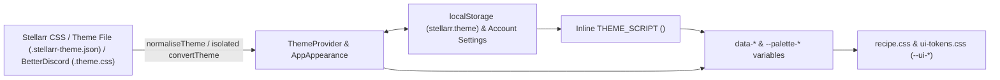

# Themes and appearance

The web client (`web/src/stellarr/`) lets each user pick or edit a color palette, choose a scheme and self-hosted typeface, set a personal wallpaper, and import or share theme files.

## Theme pipeline



## Theme model

A theme (`ThemePreference` in `web/src/stellarr/design/themes.ts`) stores seven independent axes plus an optional wallpaper object:

| Axis | Values | Purpose |
| --- | --- | --- |
| `palette` | `midnight` (default), `slate`, `evergreen`, `harbor`, `amethyst`, `ink`, or `custom` | Color vocabulary (`--palette-*` CSS variables) |
| `accent` | `#rrggbb` | Accent color (`#6f65d1` default); picking a preset resets `accent` to that preset's accent |
| `scheme` | `dark` (default), `light`, or `system` | Color scheme (`system` follows `prefers-color-scheme`) |
| `contrast` | `normal` (default) or `high` | Contrast level (`data-contrast`) |
| `font` | One of 29 self-hosted families (`outfit` default) | Interface typeface (`data-font`), applied by `AppAppearance` |
| `size` | `sm`, `md` (default), or `lg` | Message text scale (`data-size`) |
| `density` | `cozy` (default) or `compact` | Message spacing (`data-density`) |
| `wallpaper` | `{ shade, blur, placeholder? }` or `null` | App-wide background presentation (`wallpaperUrl` lives on the account) |

## Presets and custom palettes

Six presets live in `web/src/stellarr/design/themes.ts` and `web/src/stellarr/styles/themes/palettes.css`:

- `midnight` (default): deep zinc surfaces, `#6f65d1` accent
- `slate`: cool charcoal surfaces, `#6f65d1` accent
- `evergreen`: neutral dark surfaces, `#1db954` accent
- `harbor`: slate-blue surfaces, `#1a9fff` accent
- `amethyst`: near-black surfaces, `#9146ff` accent
- `ink`: dark slate surfaces, `#58a6ff` accent

### Custom palette editor

Forking a preset (`forkPreset` in `web/src/stellarr/design/customTheme.ts`) opens the `custom` palette (`ThemeStage.tsx`). Every color role must be `#rrggbb` or `#rrggbbaa`; CSS functions and `url(…)` values are rejected:

- Backgrounds (8): `darkest`, `dark`, `primary`, `secondary`, `tertiary`, `hover`, `active`, `floating`
- Text (3): `normal`, `muted`, `faint`
- Borders (3): `subtle`, `default`, `strong`
- Semantic (4): `success`, `warning`, `danger`, `info`
- Accent (1): `accent` (`#rrggbb`)

When a custom palette changes, `makeCustomTheme` computes two derived values once and stores them on the palette so neither runtime painting nor the pre-paint script runs color math:

- `accessibleFaint`: an AA-contrast faint text color checked against all eight backgrounds.
- `neutral`: `{ hue, chroma }` (`--h-neutral` and `--c-neutral`, capped at `LIGHT_TINT_MAX = 20`) for tinting light-mode surfaces.

Switching back to a preset keeps `ThemePreference.custom` stored so the user can return to it later. Choosing Midnight or restoring defaults hides the wallpaper and returns the surfaces to their normal opacity. **Show saved wallpaper** in Appearance makes the uploaded picture visible again.

### Write a CSS theme

Open **User Settings → Appearance → Edit CSS**. Stellarr opens the saved source of your custom theme or generates a starting stylesheet from the palette. Paste your own CSS or edit the declarations, then save to apply the palette.

```css
:root {
  /* Deep blue panels with a sea-green accent */
  --palette-accent: #47bfa2;
  --palette-background-darkest: #101923;
  --palette-background-dark: #152230;
  --palette-background-primary: #1c2c3b;
  --palette-background-secondary: #243647;
  --palette-text-normal: #edf5f8;
  --palette-text-muted: #bacbd5;
  --palette-border-subtle: #b1cde630;
}
```

| Variables | Where they appear |
| --- | --- |
| `--palette-background-{darkest,dark,primary,secondary,tertiary,hover,active,floating}` | App surfaces and interactive states |
| `--palette-text-{normal,muted,faint}` | Text and secondary labels |
| `--palette-border-{subtle,default,strong}` | Dividers and outlines |
| `--palette-{success,warning,danger,info}` | Status colors |
| `--palette-accent` | Selected controls and highlights |

Use one `:root` block with semicolon-separated declarations. The editor accepts CSS comments and hex colors (`#rgb`, `#rgba`, `#rrggbb`, `#rrggbbaa`). Use an opaque hex color for the accent. Each omitted role inherits from the preset the custom palette is based on. The saved editor text syncs with the account. Changing colors in the visual palette editor regenerates the stylesheet from the current colors the next time you open it.

The editor reads palette declarations. Choose fonts, light or dark scheme, and wallpaper in the Appearance controls. For Discord-specific selectors, styles and remote assets, use the BetterDiscord converter below.

## Typography and wallpapers

All 29 font families (`FONTS` in `themes.ts`) are self-hosted (`scripts/sync-theme-fonts.mjs`). Browsers download only the active font. Sign-in and setup pages always stay in `Outfit` so unauthenticated visits fetch no extra font files.

Users can upload a personal background image (`uploads/profile.rs`, stored on the account as `wallpaperUrl`) and set `shade` (`0–100%`, default `80%`) and `blur` (`0–24 px`, default `0 px`). A 32-byte base64 `placeholder` paints before the image loads. Wallpapers are readable only by their uploader (`assets/access.rs`).

## Theme files and BetterDiscord conversion

### `.stellarr-theme.json` files

Themes export and import as `.stellarr-theme.json` (`web/src/stellarr/design/themeFile.ts`, capped at `12 MiB`):

```json
{
  "stellarrTheme": 1,
  "name": "Harbor Night",
  "author": "Maya",
  "colors": { "backgrounds": {}, "text": {}, "borders": {}, "semantic": {} },
  "accent": "#1a9fff",
  "font": "outfit",
  "wallpaper": {
    "image": "data:image/webp;base64,...",
    "shade": 80,
    "blur": 0
  }
}
```

A theme file carries only `colors`, `accent`, `font`, and an optional embedded `wallpaper`. Reader preferences (`size`, `density`, `contrast`, `scheme`) are left untouched. Embedded wallpapers must be raster `data:image/(webp|jpeg|png);base64,…` payloads and are decoded and re-encoded before upload.

### BetterDiscord `.theme.css` converter

`web/src/stellarr/lib/betterDiscord/` converts local CSS files, direct HTTPS stylesheets, BetterDiscord theme and download pages, and public GitHub file or repository links. The dialog searches BetterDiscord's theme catalog and GitHub repositories by name. A repository with several `.theme.css` files opens a file picker. GitHub search and repository discovery share GitHub's unauthenticated request limit for the instance.

1. Reads the theme's metadata and loads its CSS imports relative to each stylesheet's final URL. The authenticated Stellarr API fetches public HTTPS resources with limits on size and time. Old RawGit links resolve through GitHub Raw. A missing GitHub Pages stylesheet can be retried against the same repository and commit as the published theme.
2. Evaluates the sanitized CSS in an isolated document. It reads both modern and legacy Discord variables, selected colors from Discord's main surfaces, and wallpaper references. Stellarr fills missing roles when the theme supplies a background or wallpaper. A gradient can supply a representative color for a solid surface.
3. Shows the resulting palette, available font, wallpaper host and any skipped imports before applying. Only installed Stellarr fonts can be selected. The user can include a linked wallpaper or a raster image embedded in the CSS. Stellarr decodes and re-encodes the chosen image before upload.

## Persistence and pre-paint script

`ThemeProvider` (`web/src/stellarr/state/ThemeProvider.tsx`) syncs preferences to the account's client settings and writes `stellarr.theme` in `localStorage`. At build time, `themeScript.ts` inlines `THEME_SCRIPT` into `<head>` of `web/index.html` to set `data-theme`, `data-scheme`, `data-contrast`, `data-size`, `data-density`, and `--palette-*` variables on `<html>` before first paint.
