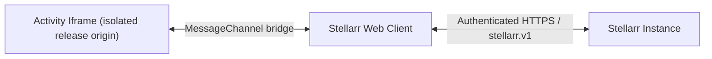

# Activity Contract

> [!NOTE]
> Formal platform contract between Stellarr instances, `@stellarr/sdk`, and Activity authors. For tutorials, copy-paste recipes, and full TypeScript API signatures, start with the [SDK README](README.md) or the [Activity SDK guides](../docs/sdk/getting-started.md).
>
> Sections carry explicit status markers: **Decided** (enforced rule), **Implemented** (live in `0.3.0`), **Proposed** (active v1 design), or **Open** (pending product decision).

## Terminology

| Term | Definition |
| --- | --- |
| **Instance / Owner** | One Stellarr container + `/data/stellarr` volume, administered by the owner in Cockpit. |
| **Activity** | Static web app (`index.html` + `stellarr.json` + assets) launched in a voice room (`voice`) or solo (`personal`). |
| **Session** | Live activity instance holding participants, revisioned state, seats, and optional **Host** authority. |
| **Checkpoint** | Confirmed state revision paired with host-private `assignments`, transferable on host failover. |
| **Library** | Activities approved and installed on an instance under **Cockpit → Activities**. |

---

## 1. Execution and isolation model



- **Static-only packaging (*Decided*):** Activities ship HTML, JS, CSS, WASM, and media assets only—zero custom backend code executes on the Stellarr server.
- **Origin isolation (*Implemented*):** Fresh instances serve installed packages on the existing Stellarr HTTPS address inside an opaque-origin sandboxed frame connected via a private `MessageChannel` (native browser storage is unavailable in opaque-origin mode; durable state uses `session.progress`). Operators can optionally set `STELLARR_ACTIVITY_DOMAIN` to give each installed release a dedicated origin with isolated browser storage (`game-<hash>.localhost` in `stellarr dev`). `/_stellarr/` is reserved for the host bridge and `/_stellarr/sdk/v1.js`.
- **Iframe capabilities & blocks (*Implemented / Proposed*):** Permits scripts, isolated storage, autoplay media, and fullscreen (pointer lock, clipboard, and gamepad planned for v1); blocks popups, top-frame navigation, and direct `Permissions-Policy: microphone=(), camera=(), display-capture=()`.
- **Default-deny CSP (*Implemented*):** `Content-Security-Policy` locks `default-src`, `script-src`, and `style-src` to `'self'` plus `https://<host>` entries declared in `connects` (`{ host, why }`) and approved by the owner in Cockpit. *(Because frames can still navigate themselves or open WebRTC channels, installing an activity remains an explicit owner trust decision.)*

---

## 2. Manifest (`stellarr.json`)

*Implemented in `sdk/dev/files.js` and `api/crates/server/src/activities/` (duplicate JSON keys are rejected).*

| Field | Rule / Bounds | Description |
| --- | --- | --- |
| `protocol` | integer `1` | Contract version spoken by the activity. |
| `id` | `1–100` chars `[a-z0-9-]+` | Stable identifier within its source repository. |
| `name` | `1–240` UTF-8 bytes | Non-blank title displayed in Cockpit and launchers. |
| `description` | `1–4000` UTF-8 bytes | Non-blank summary shown before launch/install. |
| `version` | SemVer `2.0.0` | Release version (independent of `protocol` and server version). |
| `icon` | relative path | Required for `validate` / `pack` / install (optional in `dev`): magic-byte verified PNG, JPEG, or WebP `≤ 512 KiB`. |
| `cover` | relative path *(opt)* | Optional banner PNG, JPEG, or WebP `≤ 2 MiB` (falls back to `icon` on theme surface). |
| `devices` | array *(opt)* | Subset of `["desktop", "tablet", "phone"]` (omitted = all three). Unsupported devices show an inline notice without loading assets. |
| `launchModes` | array *(opt)* | Unique list of `"voice"`, `"personal"`, or both (`["voice"]` default). |
| `authority` | `"shared"` \| `"host"` *(opt)* | `"shared"` (default) lets seated players patch state; `"host"` routes mutations through one elected host. |
| `seats` | integer `1..128` *(opt)* | Player seat cap; extra participants join as read-only spectators. |
| `permissions` | array *(opt)* | Unique capabilities from `["media.microphoneLevel", "media.cameraTile"]`. |
| `connects` | `{ host, why }[]` *(opt)* | Up to `64` entries: lowercase DNS `host` (`≤ 253` chars) and `why` (`1–1024` UTF-8 bytes). |

### Minimal activity without a build step

`stellarr.json`:

```json
{
  "protocol": 1,
  "id": "shared-poll",
  "name": "Shared Poll",
  "description": "Vote together in a session.",
  "version": "1.0.0"
}
```

`index.html`:

```html
<!doctype html>
<html lang="en">
<meta charset="utf-8">
<meta name="viewport" content="width=device-width, initial-scale=1">
<title>Shared Poll</title>
<form>
  <fieldset disabled>
    <legend>Play another round?</legend>
    <button value="yes">Yes</button> <button value="no">No</button>
  </fieldset>
</form>
<p role="status">Connecting…</p>
<script type="module">
  import { connect } from "/_stellarr/sdk/v1.js";

  const form = document.querySelector("form");
  const status = document.querySelector('[role="status"]');
  try {
    const { context, state } = await connect({ initialState: {} });
    state.subscribe(votes => {
      const choices = Object.values(votes);
      const count = choice => choices.filter(vote => vote === choice).length;
      status.textContent = `Yes: ${count("yes")} · No: ${count("no")}`;
    });
    form.onsubmit = async event => {
      event.preventDefault();
      try {
        await state.set({ ["vote-" + context.me.id]: event.submitter.value });
      } catch {
        status.textContent = "Could not confirm your vote. Try again.";
      }
    };
    form.querySelector("fieldset").disabled = false;
  } catch {
    status.textContent = "Could not join the poll.";
  }
</script>
</html>
```

---

## 3. Session, state, and media guarantees

*Implemented in `sdk/client.js`, `sdk/media.js`, and `sdk/dev/room.js`.*

| Surface | Guarantee |
| --- | --- |
| `connect({ initialState })` | Initializes room state once under concurrent first joins and returns `{ context, locale, device, theme, participants, state, seats, host, commands, assignments, progress, media, capabilities, connection, send, on, now, close, limits }`. |
| `context`, `locale`, `device`, `theme` | Identifies session, `me`, `place` (`null` in `personal`), `standalone`, UI `locale`, and `device` (`desktop` / `tablet` / `phone`), with live observables for `locale`, `device`, and 6-color `theme`. |
| `participants` & `seats` | Person-scoped opaque IDs (`{ id, name, username?, avatar, connected }`, where `avatar` is `string \| null`, updating live on profile edits). Opening a newer frame retires the old frame (`403`). Disconnected players hold their place for `graceSeconds` (`10 s`). Extra joiners past `seats` spectate and can `claim()` / `release()` seats. |
| `state.get()` / `subscribe()` / `set()` | Revision-ordered JSON object (`≤ 256 KiB`). `set(patch)` overwrites top-level keys; `set(fn)` retries pure functional updates on conflict (`undefined` cancels) with sequence deduplication across network retries. |
| `commands`, `host` & `assignments` | Under `authority: "host"`, seated players call `commands.submit(kind, data, { id })` (idempotent per `(player, id)`). The elected host runs the activity rules in their browser, can see all players’ assignments, and decides outcomes and scores. The host commits `patch`, `result`, and per-seat secret `assignments` (`null` clears a seat's secret) atomically. Host disconnect (`> 10 s`) or `host.transfer(id)` promotes a connected seated successor who can read `assignments.checkpoint()`, rejecting stale host epochs (`409`). |
| `progress.load()` / `save(data, rev)` | Per-account private JSON save (`≤ 64 KiB`, `{ revision: 0, data: null }` initially, `409` on conflict) scoped to `(account, release source, activity ID)`, surviving room expiry, updates, and restarts. |
| `send(kind, data, { to, latest })` | Best-effort JSON or binary (`Uint8Array` / `ArrayBuffer`) messages (`≤ 64 KiB`, `32`-item client/recipient queues). `latest: true` replaces queued messages of the same `(sender, kind, recipient)`. |
| `media.*` | `volume` (`0..1` per-listener **Game audio**), `embed.mount(url, element, options?)` (HTTPS embeds from approved `connects` hosts, with provider-defined messages), `microphoneLevel` (`0..1` amplitude), and `cameraTile` (host-rendered video overlay unreadable by activity JS). Camera tiles and embeds support `setVisible(boolean)` on each mount. Device inputs require manifest declaration + Cockpit approval + per-session player consent, with a host **Stop** button and automatic release on mute/close. |

---

## 4. Packaging, Cockpit lifecycle, and limits

### Distribution and lifecycle (*Decided & Implemented*)

- **Deterministic archives (`stellarr pack`):** Normalizes file permissions (`0644`) and timestamps (`2000-01-01T00:00:00Z`), emitting `<id>-<sha256_16>.zip` and `stellarr-release.json` (`{ protocol: 1, activities: [{ id, name, version, asset, sha256, bytes }] }`). Multiple activities can publish from one GitHub repository using scoped tags (`<id>/v<version>`).
- **Session scoping:** Each voice channel/call runs at most one live session per installed activity; `"personal"` activities run independent per-account sessions under **Friends → Activities**.
- **Cockpit actions:** **Disable** ends live sessions while retaining files/grants; **Enable** reopens launches; **Update** previews SemVer/permission/`connects` diffs and switches new sessions while existing sessions finish on their pinned origin; **Uninstall** terminates sessions and deletes stored releases/grants.

### Enforced limits (`sdk/dev/room.js` & `sdk/dev/files.js`)

| Limit | Enforced value | Behavior when exceeded |
| --- | ---: | --- |
| `stateBytes` (shared state & total assignments) | `256 KiB` | `413` (`State is too large.`) |
| `messageBytes` (transient message, command payload, or command result) | `64 KiB` | `false` on `send()`; `413` on `submit()` / `decide()` |
| `progress` save payload | `64 KiB` | `413` (`State is too large.`) |
| `writesPerSecond` / `messagesPerSecond` (per participant) | `32 / s` · `96 / s` | `429` (`Participant rate limit reached.`) |
| `graceSeconds` / `emptySeconds` / `maxParticipants` | `10 s` · `120 s` · `128` | Disconnect eviction / room state reset / `429` (`The session is full.`) |
| Dev preview bundle (`stellarr dev --instance`) | `16 MiB` / `1,024` files | `413` (`Preview exceeds 16 MiB or 1024 files.`) |
| Published release archive (`stellarr pack` / `validate`) | `256 MiB` / `8,192` files | `413` (`Release exceeds 256 MiB or 8192 files.`) |

---

## 5. Open platform questions (*Open*)

1. **Instances without `STELLARR_ACTIVITY_DOMAIN`:** Should bare-IP or self-signed deployments serve built-in first-party activities only?
2. **Multi-hundred-MB asset packs:** Content-addressed external packs (excluded from `.zip` backups and cached transparently by the SDK) for large 3D games.
3. **Private GitHub repositories:** Supporting repository tokens in Cockpit vs. public release assets or volume imports.
4. **Persistent collaborative documents:** Retention rules beyond `emptySeconds` (`120 s`) for whiteboards and shared notes.
5. **External bots:** Out-of-process protocol for music and automation bots outside static iframe activities.
